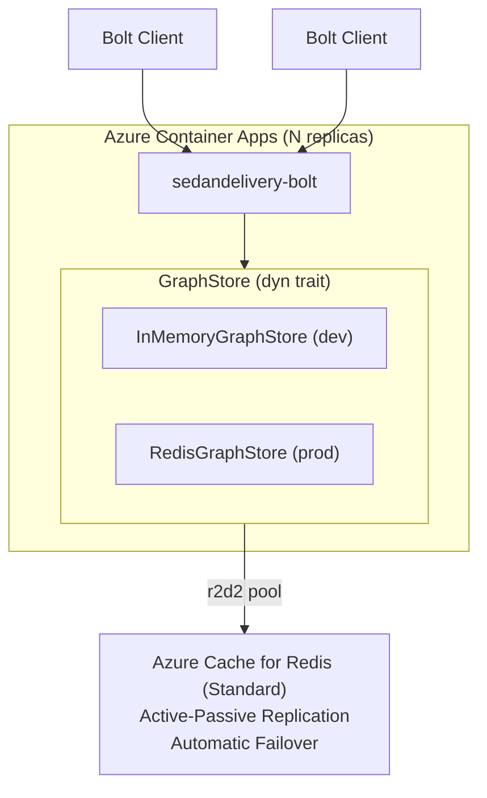

# ADR-004: Distributed Redis Backend for sedandelivery-bolt

**Status**: Accepted
**Date**: 2026-03-01
**Supersedes**: N/A

## Context

SedanDelivery runs a single Valkey 8.1 instance with graph data stored entirely
in-process via `InMemoryGraphStore`. This architecture has three reliability
gaps:

1. **Single point of failure** — if the Valkey container crashes, all graph data
   is lost (InMemoryGraphStore data is not persisted by RDB/AOF)
2. **No horizontal scaling** — the Bolt server is coupled to a single process
3. **Single connection** — `RedisGraphStore` used `Mutex<Connection>` (no pooling)

The `RedisGraphStore` already existed as an alternative storage backend with
Redis Cluster-compatible key schemas (`{graphname}` hash tags), but was unused
by the Bolt server.

## Decision

### Tier 1: High Availability

Use **Azure Cache for Redis Standard C1** (built-in active-passive replication +
automatic failover) as the managed Redis backend. The `sedandelivery-bolt`
server connects via `GQL_REDIS_URL` environment variable.

### Tier 2: Connection Pooling

Replace the single `Mutex<Connection>` in `RedisGraphStore` with an **r2d2
connection pool** (`r2d2::Pool<redis::Client>`). Pool configuration is
injectable via environment variables:

- `GQL_REDIS_POOL_SIZE` (default 16)
- `GQL_REDIS_POOL_TIMEOUT_SECS` (default 5)

### Tier 3: Multi-Instance Scaling

Deploy `sedandelivery-bolt` as a **separate Container App** (`Dockerfile.bolt`)
from the Valkey+module container. Multiple bolt replicas share the same Redis
backend, enabling horizontal scaling of the query layer.

### Abstraction Design

The existing `GraphStore` trait is the abstraction boundary. No new traits were
created. Three methods were added to `GraphStore`:

- `as_any()` — runtime downcasting for transaction snapshot types
- `tx_snapshot()` — copy-on-write snapshot for transaction isolation (default: None)
- `tx_commit()` — merge snapshot on commit (default: no-op)

`InMemoryGraphStore` implements full snapshot isolation. `RedisGraphStore`
uses the defaults (writes are immediately durable).

### Store Factory

A `create_store()` factory in `sedandelivery-bolt/src/main.rs` selects the
backend based on environment:

- `GQL_REDIS_URL` set → `RedisGraphStore` with r2d2 pool
- `GQL_REDIS_URL` absent → `InMemoryGraphStore` (backward compatible)

## Architecture

## Consequences

### Positive

- SPOF eliminated via Azure Cache for Redis managed HA
- Connection pooling enables concurrent query execution
- Bolt server scales horizontally (stateless query layer)
- Backward compatible — default behavior unchanged (in-memory)
- Redis Cluster ready — key schema already uses `{graphname}` hash tags

### Negative

- Transaction isolation degrades for RedisGraphStore (auto-commit semantics);
  proper isolation requires WATCH/MULTI/EXEC (deferred to Option C)
- Additional Container App adds deployment complexity
- r2d2 pool adds a dependency (but replaces custom Mutex pattern)

### Option C: Redis Cluster (Implemented)

Redis Cluster support was added via enum-based connection dispatch:

- `RedisPool` enum wraps either `r2d2::Pool<Client>` (standalone) or
  `r2d2::Pool<ClusterClient>` (cluster)
- `RedisConn` enum wraps either connection type, exposing `&mut dyn ConnectionLike`
- Set `GQL_REDIS_CLUSTER_NODES=redis://node1:6379,redis://node2:6379,...`
  to use cluster mode
- All `redis::Commands` calls replaced with explicit `redis::cmd()` to work
  with `dyn ConnectionLike` (the `Commands` trait requires `Sized`)
- Pipeline operations dispatch to `redis::pipe()` or `cluster_pipe()` based
  on connection variant
- No data model changes — `{graphname}` hash tags route correctly

## Alternatives Considered

1. **New `RedisBackend` trait** — rejected. Unnecessary abstraction layer;
   `GraphStore` is sufficient as the polymorphism boundary.

2. **Async pool (bb8/deadpool)** — rejected. `GraphStore` is synchronous;
   mixing async pool into sync trait would require `block_on` in every method.

3. **Redis Sentinel** — rejected for initial implementation. Azure Cache for
   Redis provides equivalent HA with less operational overhead. Sentinel
   support can be added later if needed for self-managed deployments.

4. **snapshot/merge_from on trait as required methods** — rejected. Redis does
   not need client-side snapshots; default no-op is correct.
