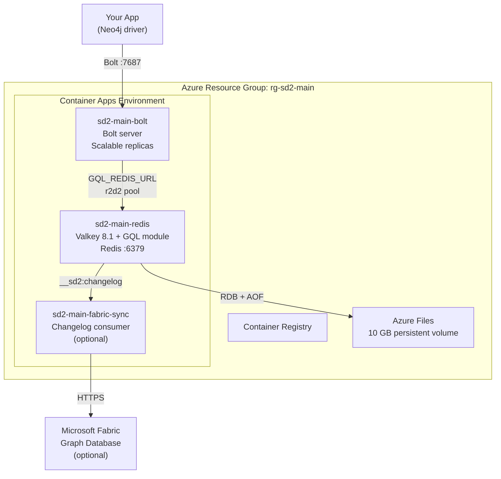

# Deploy Your Own SedanDelivery Instance

Deploy a production-ready graph database on Azure in under 10 minutes. You get:

- **Bolt protocol server** — any Neo4j driver connects out of the box (Python, .NET, Java, Go, Rust, JavaScript)
- **Redis-backed persistence** — data survives restarts via Valkey RDB + AOF, with support for standalone, [Azure Cache for Redis](#azure-cache-for-redis) (managed HA), [Redis Cluster](#redis-cluster) (sharding), and [read replicas](#read-replicas)
- **Horizontal scaling** — the Bolt server runs as a separate container that can scale independently
- **Optional Fabric replication** — automatic sync to Microsoft Fabric Graph Database for analytics

## Pre-built Container Images (GHCR)

All images are published to GitHub Container Registry on every push to `main`:

```bash
# Valkey + GQL module
docker pull ghcr.io/cloud-ecosystem-security/sedandelivery:latest

# Bolt protocol server
docker pull ghcr.io/cloud-ecosystem-security/sedandelivery-bolt:latest

# Fabric sync sidecar
docker pull ghcr.io/cloud-ecosystem-security/sedandelivery-fabric-sync:latest
```

Tags: `latest`, `YYYYMMDD` (date-based), `sha-<commit>`, and semver on version tags.

## Prerequisites

- An **Azure subscription** (free trial works)
- **GitHub account** with a fork of this repo
- CLI tools: `az`, `gh`, `jq` (install via `brew install azure-cli gh jq` or equivalent)

## Quick Start (5 minutes)

### 1. Fork the repo

```bash
gh repo fork cloud-ecosystem-security/SedanDelivery --clone
cd SedanDelivery
```

### 2. Create an Azure Service Principal

```bash
az login
SUBSCRIPTION_ID=$(az account show --query id -o tsv)

# Create a service principal with Contributor + User Access Administrator roles
SP=$(az ad sp create-for-rbac --name sedan-deploy \
  --role Contributor \
  --scopes "/subscriptions/${SUBSCRIPTION_ID}" \
  --output json)

# Also grant User Access Administrator for managed identity ACR pull
az role assignment create \
  --assignee "$(echo $SP | jq -r .appId)" \
  --role "User Access Administrator" \
  --scope "/subscriptions/${SUBSCRIPTION_ID}"

echo "Client ID: $(echo $SP | jq -r .appId)"
echo "Tenant ID: $(echo $SP | jq -r .tenant)"
```

### 3. Configure GitHub Secrets

```bash
gh secret set AZURE_CLIENT_ID       --body "$(echo $SP | jq -r .appId)"
gh secret set AZURE_CLIENT_SECRET   --body "$(echo $SP | jq -r .password)"
gh secret set AZURE_TENANT_ID       --body "$(echo $SP | jq -r .tenant)"
gh secret set AZURE_SUBSCRIPTION_ID --body "${SUBSCRIPTION_ID}"
```

### 4. Deploy

```bash
# Option A: Push to main (deploys to production)
git push origin main

# Option B: Manual trigger
gh workflow run deploy.yml -f environment=production

# Option C: PR-based (isolated environment per branch)
gh pr create --title "my feature"
gh pr edit --add-label deploy
```

### 5. Connect

The deployment takes ~8 minutes. When complete, get your endpoint:

```bash
# Get the Bolt endpoint
az containerapp show \
  --name sd2-main-bolt \
  --resource-group rg-sd2-main \
  --query "properties.configuration.ingress.fqdn" -o tsv
```

Then connect from any Neo4j driver:

```python
from neo4j import GraphDatabase

driver = GraphDatabase.driver(
    "bolt://sd2-main-bolt.<your-cae-id>.eastus2.azurecontainerapps.io:7687",
    auth=("neo4j", "password")
)
with driver.session() as session:
    session.run("CREATE (:Person {name: 'Alice', age: 30})")
    result = session.run("MATCH (p:Person) RETURN p.name, p.age")
    for record in result:
        print(record["p.name"], record["p.age"])
driver.close()
```

Works with Python, .NET, Java, Go, Rust, JavaScript — any driver supporting Bolt v4.2+.

## What Gets Deployed



| Resource | Purpose | Cost |
|----------|---------|------|
| Container Registry (Basic) | Stores Docker images | ~$5/mo |
| Container App: Valkey + GQL module | Graph engine + Redis storage | ~$15/mo (0.5 CPU, 1 GB) |
| Container App: Bolt server | Bolt protocol endpoint | ~$15/mo (0.5 CPU, 1 GB) |
| Azure Files (10 GB) | Persistent storage for RDB/AOF | ~$1/mo |
| VNet + NSG | Network isolation | Free |
| **Total (standalone)** | | **~$36/mo** |
| + Azure Cache for Redis (optional) | Managed HA with replication | +$40/mo (Standard C1) |
| + Fabric sync sidecar (optional) | Replication to Fabric | +$8/mo (0.25 CPU, 0.5 GB) |

## Redis Backend Options (GitOps)

The deployment workflow supports three Redis backends via `workflow_dispatch` parameters. A single `persistenceBackend` parameter controls the entire Redis deployment -- no manual steps required.

### Workflow Parameters

| Parameter | Default | Description |
|-----------|---------|-------------|
| `persistenceBackend` | `valkey` | Backend mode: `valkey`, `azure-cache`, or `cluster` |
| `clusterNodeCount` | `3` | Number of cluster shards (only for `cluster` mode, range 1-10) |
| `replicaCount` | `0` | Read replicas per shard. When >0, sets `GQL_REDIS_REPLICA_URL` and upgrades to Premium SKU. |

### Deploying each mode

```bash
# Valkey (default) -- standalone Valkey container with Azure Files persistence
gh workflow run deploy.yml -f environment=production -f persistenceBackend=valkey

# Azure Cache for Redis -- managed HA with automatic failover
gh workflow run deploy.yml -f environment=production -f persistenceBackend=azure-cache

# Cluster -- Azure Cache with clustering for horizontal data sharding
gh workflow run deploy.yml -f environment=production -f persistenceBackend=cluster -f clusterNodeCount=3

# Any mode with read replicas (sets GQL_REDIS_REPLICA_URL on Bolt/API containers)
gh workflow run deploy.yml -f environment=production -f persistenceBackend=azure-cache -f replicaCount=1
```

### What each mode provisions

| Mode | Infrastructure | Env Var | Bicep SKU | Approx Cost |
|------|---------------|---------|-----------|-------------|
| `valkey` | Valkey container + Azure Files | `GQL_REDIS_URL` | N/A | ~$16/mo |
| `azure-cache` | Azure Cache for Redis | `GQL_REDIS_URL` | Standard C1 | ~$40/mo |
| `azure-cache` + replicas | Azure Cache (Premium) | `GQL_REDIS_URL` + `GQL_REDIS_REPLICA_URL` | Premium P1 | ~$225/mo |
| `cluster` | Azure Cache clustered | `GQL_REDIS_CLUSTER_NODES` | Premium P1 | ~$225/mo per shard |

### Automated health checks

After every deployment, the workflow runs two checks regardless of backend:

1. **Redis health check** -- Verifies the backend is reachable (Azure Cache provisioning state or Valkey container running state). For cluster mode, confirms clustering is enabled on the Azure Cache instance.
2. **Bolt smoke test** -- TCP connectivity check against the Bolt endpoint on port 7687 to verify end-to-end connectivity from the public internet.

## Configuration

### Redis Backend Options

SedanDelivery supports four Redis deployment modes. The deployment workflow sets `GQL_REDIS_URL` automatically for the default setup -- no manual configuration needed.

#### Decision Matrix

| Scenario | Recommended Mode | Why |
|----------|-----------------|-----|
| Local development | In-memory (no env vars) | Zero setup, volatile storage |
| Staging / single-server | Standalone Valkey | Simple, ~$16/mo, RDB+AOF durability |
| Production with HA | Azure Cache for Redis | Managed failover, TLS, monitoring |
| High-read workloads | Standalone + read replicas | Offload reads from primary |
| Large datasets (>16 GB) | Redis Cluster | Horizontal data sharding |

#### Standalone Valkey (default)

A single Valkey instance with RDB + AOF persistence. This is what the default deployment provisions.

| Variable | Default | Description |
|----------|---------|-------------|
| `GQL_REDIS_URL` | (none) | Connection URL, e.g. `redis://:password@host:6379` |
| `GQL_REDIS_POOL_SIZE` | `64` | r2d2 connection pool max size |
| `GQL_REDIS_POOL_TIMEOUT_SECS` | `5` | Pool checkout timeout (seconds) |
| `GQL_REDIS_IDLE_TIMEOUT_SECS` | `300` | Idle connection reap timeout (seconds) |
| `GQL_REDIS_MIN_IDLE` | `1` | Minimum warm connections kept in pool |
| `GQL_REDIS_KEY_PREFIX` | (none) | Key prefix for multi-tenant isolation |

When `GQL_REDIS_URL` is unset, the Bolt server falls back to `InMemoryGraphStore` (volatile, no persistence).

#### Azure Cache for Redis

Managed HA with active-passive replication and automatic failover. TLS is enabled by default on Azure Cache.

**Deploy:**

```bash
az deployment group create \
  --resource-group rg-sd2-main \
  --template-file infra/main.bicep \
  --parameters environmentName=main persistenceBackend=azure-cache
```

The workflow automatically wires the TLS connection string into `GQL_REDIS_URL` (using `rediss://` for TLS). No additional env vars needed.

**Cost:** ~$40/mo for Standard C1 (1 GB, active-passive replication) on top of the base deployment (~$36/mo).

**When to use:** Production workloads that need automatic failover, managed patching, and Azure Monitor integration without operating your own Valkey instance.

#### Redis Cluster

Horizontal data sharding across multiple Redis nodes. All keys use `{graphname}` hash tags so that all data for a single graph lands on the same cluster slot.

| Variable | Default | Description |
|----------|---------|-------------|
| `GQL_REDIS_CLUSTER_NODES` | (none) | Comma-separated seed node URLs, e.g. `redis://n1:6379,redis://n2:6379,redis://n3:6379` |

When `GQL_REDIS_CLUSTER_NODES` is set, it takes precedence over `GQL_REDIS_URL`. The client auto-discovers the full cluster topology from the seed nodes.

**Hash-tag routing:** The key schema wraps graph names in curly braces (`G:{graphname}:node:42`). Redis Cluster hashes only the content inside `{}`, so all keys for a graph map to the same slot. This means cross-key operations (pipelines, transactions) work correctly within a single graph. Operations spanning multiple graphs may hit different slots.

**When to use:** Datasets larger than a single node's memory (>16 GB), or when you need write throughput beyond what a single primary can deliver.

#### Read Replicas

Offload read-only queries to one or more Redis replicas. Writes always go to the primary.

| Variable | Default | Description |
|----------|---------|-------------|
| `GQL_REDIS_REPLICA_URL` | (none) | Comma-separated replica URLs, e.g. `redis://replica1:6379,redis://replica2:6379` |

**How routing works:**
- All `GraphStore` read methods (`get_node`, `find_nodes_by_label`, `out_edges`, etc.) are routed to the replica pool.
- All write methods (`create_node`, `create_edge`, `delete_node`, etc.) always go to the primary pool (`GQL_REDIS_URL`).
- Connections are distributed across replicas using round-robin. Each checkout sends the `READONLY` command to handle post-failover topology changes.

**Consistency model:** Eventual consistency. Replica lag depends on network conditions and write throughput -- typically sub-millisecond on a local network, but a write followed by an immediate read may return stale data. Applications that require read-your-writes consistency should not use read replicas.

**When to use:** Read-heavy workloads (analytics dashboards, reporting queries) where the primary is under write pressure.

### Environment Variables

Set these in your Container App or `deploy.yml` to customize behavior:

| Variable | Default | Description |
|----------|---------|-------------|
| **Bolt Server** | | |
| `BOLT_BIND_ADDR` | `0.0.0.0:7687` | Bolt TCP listen address |
| `BOLT_PASSWORD` | (none) | Optional password for Bolt auth |
| `BOLT_WS_ALLOWED_ORIGINS` | (none) | Comma-separated browser origins allowed to upgrade Bolt over WebSocket; when set, requests must send a matching `Origin` header and `*` allows any origin |
| `BOLT_MAX_CONNECTIONS` | `1024` | Max concurrent Bolt connections |
| `BOLT_IDLE_TIMEOUT_SECS` | `3600` | Close idle connections after N seconds |
| **Redis Backend** | | |
| `GQL_REDIS_URL` | (none) | Redis/Valkey connection URL |
| `GQL_REDIS_CLUSTER_NODES` | (none) | Cluster seed URLs (overrides `GQL_REDIS_URL`) |
| `GQL_REDIS_REPLICA_URL` | (none) | Comma-separated replica URLs for read routing |
| `GQL_REDIS_POOL_SIZE` | `64` | Connection pool max size |
| `GQL_REDIS_POOL_TIMEOUT_SECS` | `5` | Pool checkout timeout (seconds) |
| `GQL_REDIS_IDLE_TIMEOUT_SECS` | `300` | Idle connection reap timeout (seconds) |
| `GQL_REDIS_MIN_IDLE` | `1` | Minimum warm connections in pool |
| `GQL_REDIS_KEY_PREFIX` | (none) | Key prefix for multi-tenant isolation |
| **REST API (gql-api)** | | |
| `GQL_API_BIND_ADDR` | `0.0.0.0:3001` | HTTP listen address |
| `GQL_API_ALLOWED_ORIGINS` | localhost:5000,5173 | Comma-separated CORS origins |
| `GQL_API_RATE_LIMIT_RPS` | `100` | Max requests per second per client (rate limiting) |
| `ENVIRONMENT` | (none) | Set to `production` to require `GQL_REDIS_URL` and `GQL_API_ALLOWED_ORIGINS` |
| **Query Engine** | | |
| `GQL_QUERY_TIMEOUT_MS` | `30000` | Max query execution time |
| `GQL_QUERY_MAX_ROWS` | `10000000` | Max intermediate rows |
| `GQL_VARLEN_MAX_DEPTH` | `30` | Max variable-length path depth |
| `GQL_PLAN_CACHE_SIZE` | `1024` | Process-local plan cache capacity; when full, it clears all entries before adding the next plan |
| **Valkey** | | |
| `VALKEY_PASSWORD` | (generated) | Authentication password (auto-generated on first deploy) |

## Scaling

### Horizontal: Multiple Bolt Replicas

The Bolt server is stateless (all state is in Redis). Scale it independently:

```bash
# Scale to 3 replicas
az containerapp update \
  --name sd2-main-bolt \
  --resource-group rg-sd2-main \
  --min-replicas 3 \
  --max-replicas 10
```

Container Apps automatically load-balances across replicas.

### Vertical: More CPU/Memory

```bash
az containerapp update \
  --name sd2-main-bolt \
  --resource-group rg-sd2-main \
  --cpu 2 --memory 4Gi
```

### High Availability: Azure Cache for Redis

For automatic failover and replication, deploy with Azure Cache:

```bash
# Re-deploy with Azure Cache backend
az deployment group create \
  --resource-group rg-sd2-main \
  --template-file infra/main.bicep \
  --parameters environmentName=main persistenceBackend=azure-cache
```

This provisions a Standard C1 Azure Cache for Redis with active-passive replication. The deploy workflow automatically wires the connection string.

## Cleanup

```bash
# Delete a branch environment
az group delete --name rg-sd2-mybranch --yes

# Delete production
az group delete --name rg-sd2-main --yes
```

Or use the **Undeploy** GitHub Actions workflow.

## Local Testing

Three docker-compose configurations are provided for testing each Redis backend mode locally. Each is self-contained and requires only Docker with the compose v2 plugin.

### Standalone Valkey (default)

Single Valkey 8 instance. Best for local development and most use cases.

```bash
# Start
docker compose up -d

# Connect via any Neo4j driver at bolt://localhost:7687
# Health check: curl http://localhost:7688/health

# Stop and remove data
docker compose down -v
```

Environment: `GQL_REDIS_URL=redis://valkey:6379`

### Redis Cluster (3 masters + 3 replicas)

Tests cluster mode with automatic hash-slot distribution. Uses 6 Redis 7 nodes and an init container that forms the cluster.

```bash
# Start
docker compose -f docker-compose.cluster.yml up -d

# The cluster-init container will form the cluster and exit.
# sedandelivery-bolt starts after cluster formation completes.

# Stop and remove data
docker compose -f docker-compose.cluster.yml down -v
```

Environment: `GQL_REDIS_CLUSTER_NODES=redis://redis-node-1:6379,...,redis://redis-node-6:6379`

### Master + 2 Read Replicas

Tests read-replica routing. Writes go to the master; reads are distributed across two replicas via round-robin.

```bash
# Start
docker compose -f docker-compose.replica.yml up -d

# Ports:
#   Master:   localhost:6379
#   Replica1: localhost:6380
#   Replica2: localhost:6381
#   Bolt:     localhost:7687

# Stop and remove data
docker compose -f docker-compose.replica.yml down -v
```

Environment: `GQL_REDIS_URL=redis://master:6379`, `GQL_REDIS_REPLICA_URL=redis://replica1:6379,redis://replica2:6379`

### Automated Smoke Tests

A script tests all three modes sequentially. It starts each configuration, runs a basic Bolt smoke test (create graph, create node, query, delete), and reports pass/fail.

```bash
./scripts/test-redis-modes.sh
```

The script detects available Bolt clients (`cypher-shell` or `python3` with the `neo4j` driver). If neither is installed, it falls back to HTTP health checks.

## Troubleshooting

### Bolt server won't start

Check logs:
```bash
az containerapp logs show --name sd2-main-bolt --resource-group rg-sd2-main --tail 50
```

Common causes:
- `GQL_REDIS_URL` not set or wrong — the server panics intentionally (no silent fallback)
- Valkey container not running — check `sd2-main-redis` logs
- Port conflict — ensure only the bolt Container App exposes port 7687

### Connection refused from client

```bash
# Verify the endpoint is reachable
az containerapp show --name sd2-main-bolt --resource-group rg-sd2-main \
  --query "properties.configuration.ingress.fqdn" -o tsv
```

Ensure your client connects to port **7687** (Bolt), not 6379 (Redis).

### Data not persisting across restarts

Check that the Valkey container has Azure Files mounted:
```bash
az containerapp show --name sd2-main-redis --resource-group rg-sd2-main \
  --query "properties.template.volumes" -o json
```

If empty, the volume mount may have been skipped. Re-deploy to fix.

## Architecture Decisions

- [ADR-001: Storage Model](ADR-001-storage-model) — Why Redis-native data structures
- [ADR-004: Distributed Redis](ADR-004-distributed-redis) — HA, pooling, clustering design
