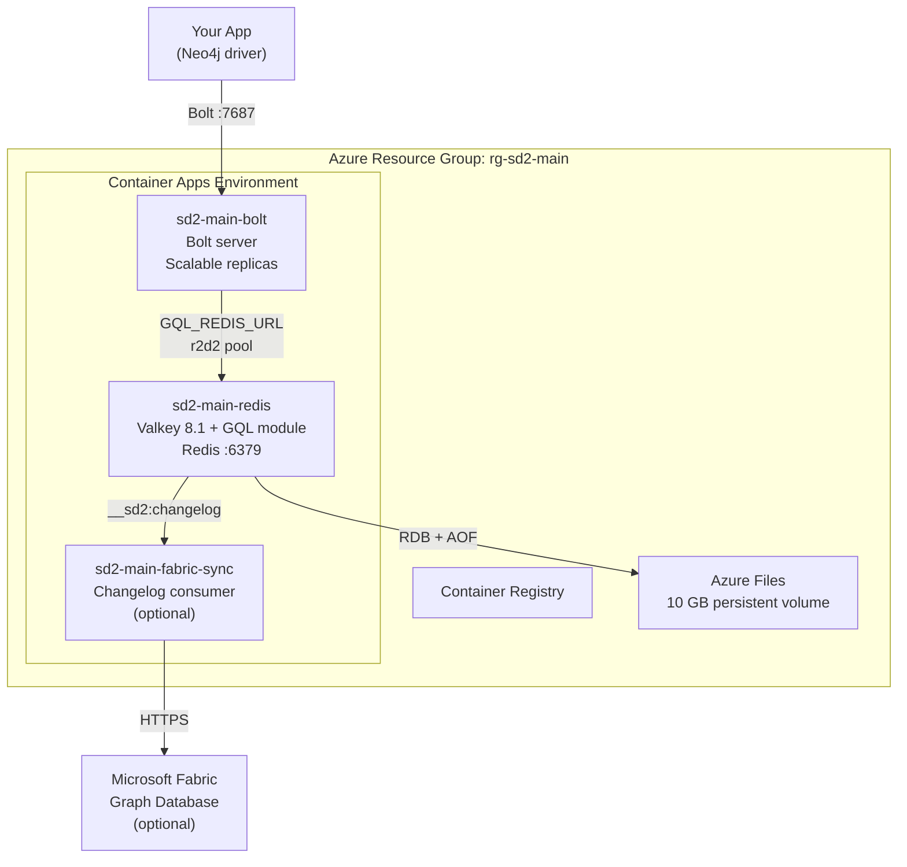

# Deploy Your Own SedanDelivery Instance

Deploy a production-ready graph database on Azure in under 10 minutes. You get:

- **Bolt protocol server** — any Neo4j driver connects out of the box (Python, .NET, Java, Go, Rust, JavaScript)
- **Redis-backed persistence** — data survives restarts via Valkey RDB + AOF, with support for standalone, [Azure Cache for Redis](#azure-cache-for-redis) (managed HA), [Redis Cluster](#redis-cluster) (sharding), and [read replicas](#read-replicas)
- **Horizontal scaling** — the Bolt server runs as a separate container that can scale independently
- **Optional Fabric replication** — automatic sync to Microsoft Fabric Graph Database for analytics

## Pre-built Container Images (GHCR)

All images are published to GitHub Container Registry on every push to `main`:

```bash
# Valkey + GQL module
docker pull ghcr.io/cloud-ecosystem-security/sedandelivery:latest

# Bolt protocol server
docker pull ghcr.io/cloud-ecosystem-security/sedandelivery-bolt:latest

# Fabric sync sidecar
docker pull ghcr.io/cloud-ecosystem-security/sedandelivery-fabric-sync:latest
```

Tags: `latest`, `YYYYMMDD` (date-based), `sha-<commit>`, and semver on version tags.

## Prerequisites

- An **Azure subscription** (free trial works)
- **GitHub account** with a fork of this repo
- CLI tools: `az`, `gh`, `jq` (install via `brew install azure-cli gh jq` or equivalent)

## Quick Start (5 minutes)

### 1. Fork the repo

```bash
gh repo fork cloud-ecosystem-security/SedanDelivery --clone
cd SedanDelivery
```

### 2. Create an Azure Service Principal

```bash
az login
SUBSCRIPTION_ID=$(az account show --query id -o tsv)

# Create a service principal with Contributor + User Access Administrator roles
SP=$(az ad sp create-for-rbac --name sedan-deploy \
  --role Contributor \
  --scopes "/subscriptions/${SUBSCRIPTION_ID}" \
  --output json)

# Also grant User Access Administrator for managed identity ACR pull
az role assignment create \
  --assignee "$(echo $SP | jq -r .appId)" \
  --role "User Access Administrator" \
  --scope "/subscriptions/${SUBSCRIPTION_ID}"

echo "Client ID: $(echo $SP | jq -r .appId)"
echo "Tenant ID: $(echo $SP | jq -r .tenant)"
```

### 3. Configure GitHub Secrets

```bash
gh secret set AZURE_CLIENT_ID       --body "$(echo $SP | jq -r .appId)"
gh secret set AZURE_CLIENT_SECRET   --body "$(echo $SP | jq -r .password)"
gh secret set AZURE_TENANT_ID       --body "$(echo $SP | jq -r .tenant)"
gh secret set AZURE_SUBSCRIPTION_ID --body "${SUBSCRIPTION_ID}"

# Public Bolt deployments also require a TLS certificate and private key.
# Production deploys read GitHub environment `main`.
gh secret set DEPLOY_BOLT_TLS_CERT_PEM --env main < bolt-cert.pem
gh secret set DEPLOY_BOLT_TLS_KEY_PEM  --env main < bolt-key.pem

# Branch / PR deploys read the same sanitized GitHub environment name that
# deploy.yml derives from the branch:
BRANCH_NAME="$(git rev-parse --abbrev-ref HEAD)"
BRANCH_ENV="$(printf '%s' "$BRANCH_NAME" | sed 's/[^a-zA-Z0-9-]/-/g' | tr '[:upper:]' '[:lower:]' | cut -c1-20 | sed 's/^-*//;s/-*$//')"
gh secret set DEPLOY_BOLT_TLS_CERT_PEM --env "${BRANCH_ENV:-manual-deploy}" < bolt-cert.pem
gh secret set DEPLOY_BOLT_TLS_KEY_PEM  --env "${BRANCH_ENV:-manual-deploy}" < bolt-key.pem
```

For manual branch deploys, an empty sanitized name falls back to GitHub
environment `manual-deploy`. For PR deploys, the same empty-name case falls back
to `pr-<number>`.

### 4. Deploy

```bash
# Option A: Push to main (deploys to production)
git push origin main

# Option B: Manual trigger
gh workflow run deploy.yml -f environment=production

# Option C: PR-based (isolated environment per branch)
gh pr create --title "my feature"
gh pr edit --add-label deploy
```

### 5. Connect

The deployment takes ~8 minutes. When complete, get your endpoint and Bolt
password:

```bash
# Get the Bolt endpoint
az containerapp show \
  --name sd2-main-bolt \
  --resource-group rg-sd2-main \
  --query "properties.configuration.ingress.fqdn" -o tsv

# Get the generated/reused Bolt password
az containerapp secret show \
  --name sd2-main-bolt \
  --resource-group rg-sd2-main \
  --secret-name bolt-password \
  --query value -o tsv
```

Then connect from any Neo4j driver:

```python
import os

from neo4j import GraphDatabase

driver = GraphDatabase.driver(
    "bolt+ssc://sd2-main-bolt.<your-cae-id>.eastus2.azurecontainerapps.io:7687",
    auth=("neo4j", os.environ["BOLT_PASSWORD"]),
)
with driver.session() as session:
    session.run("CREATE (:Person {name: 'Alice', age: 30})")
    result = session.run("MATCH (p:Person) RETURN p.name, p.age")
    for record in result:
        print(record["p.name"], record["p.age"])
driver.close()
```

The default ACA-generated hostname presents the certificate you supply, but this
workflow does not bind a custom domain or managed public certificate that
authenticates that hostname. Treat `bolt+ssc://...` (or the equivalent trust
override in your driver) as a temporary bootstrap or trusted-network validation
path only. Before treating the public endpoint as production-ready for
untrusted clients, bind a custom domain with a matching CA-issued certificate
and switch to `bolt+s://...`.

Works with Python, .NET, Java, Go, Rust, JavaScript — any driver supporting Bolt v4.2+.

## What Gets Deployed



| Resource | Purpose | Cost |
|----------|---------|------|
| Container Registry (Basic) | Stores Docker images | ~$5/mo |
| Container App: Valkey + GQL module | Graph engine + Redis storage | ~$15/mo (0.5 CPU, 1 GB) |
| Container App: Bolt server | Bolt protocol endpoint | ~$15/mo (0.5 CPU, 1 GB) |
| Azure Files (10 GB) | Persistent storage for RDB/AOF | ~$1/mo |
| VNet + NSG | Network isolation | Free |
| **Total (standalone)** | | **~$36/mo** |
| + Azure Cache for Redis (optional) | Managed HA with replication | +$40/mo (Standard C1) |
| + Fabric sync sidecar (optional) | Replication to Fabric | +$8/mo (0.25 CPU, 0.5 GB) |

## Redis Backend Options (GitOps)

The deployment workflow supports three Redis backends via `workflow_dispatch` parameters. A single `persistenceBackend` parameter controls the entire Redis deployment -- no manual steps required.

### Workflow Parameters

| Parameter | Default | Description |
|-----------|---------|-------------|
| `persistenceBackend` | `valkey` | Backend mode: `valkey`, `azure-cache`, or `cluster` |
| `clusterNodeCount` | `3` | Number of cluster shards (only for `cluster` mode, range 1-10) |
| `replicaCount` | `0` | Read replicas per shard. When >0, sets `GQL_REDIS_REPLICA_URL` and upgrades to Premium SKU. |

### Deploying each mode

```bash
# Valkey (default) -- standalone Valkey container with Azure Files persistence
gh workflow run deploy.yml -f environment=production -f persistenceBackend=valkey

# Azure Cache for Redis -- managed HA with automatic failover
gh workflow run deploy.yml -f environment=production -f persistenceBackend=azure-cache

# Cluster -- Azure Cache with clustering for horizontal data sharding
gh workflow run deploy.yml -f environment=production -f persistenceBackend=cluster -f clusterNodeCount=3

# Any mode with read replicas (sets GQL_REDIS_REPLICA_URL on Bolt/API containers)
gh workflow run deploy.yml -f environment=production -f persistenceBackend=azure-cache -f replicaCount=1
```

### What each mode provisions

| Mode | Infrastructure | Env Var | Bicep SKU | Approx Cost |
|------|---------------|---------|-----------|-------------|
| `valkey` | Valkey container + Azure Files | `GQL_REDIS_URL` | N/A | ~$16/mo |
| `azure-cache` | Azure Cache for Redis | `GQL_REDIS_URL` | Standard C1 | ~$40/mo |
| `azure-cache` + replicas | Azure Cache (Premium) | `GQL_REDIS_URL` + `GQL_REDIS_REPLICA_URL` | Premium P1 | ~$225/mo |
| `cluster` | Azure Cache clustered | `GQL_REDIS_CLUSTER_NODES` | Premium P1 | ~$225/mo per shard |

### Automated health checks

After every deployment, the workflow runs two checks regardless of backend:

1. **Redis health check** -- Verifies the backend is reachable (Azure Cache provisioning state or Valkey container running state). For cluster mode, confirms clustering is enabled on the Azure Cache instance.
2. **Bolt smoke test** -- Certificate-based TLS probe against the Bolt endpoint on port 7687 to verify the public listener is serving TLS, not just accepting raw TCP connections.

## Configuration

### Redis Backend Options

SedanDelivery supports four Redis deployment modes. The deployment workflow sets `GQL_REDIS_URL` automatically for the default setup -- no manual configuration needed.

#### Decision Matrix

| Scenario | Recommended Mode | Why |
|----------|-----------------|-----|
| Local development | In-memory (no env vars) | Zero setup, volatile storage |
| Staging / single-server | Standalone Valkey | Simple, ~$16/mo, RDB+AOF durability |
| Production with HA | Azure Cache for Redis | Managed failover, TLS, monitoring |
| High-read workloads | Standalone + read replicas | Offload reads from primary |
| Large datasets (>16 GB) | Redis Cluster | Horizontal data sharding |

#### Standalone Valkey (default)

A single Valkey instance with RDB + AOF persistence. This is what the default deployment provisions.

| Variable | Default | Description |
|----------|---------|-------------|
| `GQL_REDIS_URL` | (none) | Connection URL, e.g. `redis://:password@host:6379` |
| `GQL_REDIS_POOL_SIZE` | `64` | r2d2 connection pool max size |
| `GQL_REDIS_POOL_TIMEOUT_SECS` | `5` | Pool checkout timeout (seconds) |
| `GQL_REDIS_IDLE_TIMEOUT_SECS` | `300` | Idle connection reap timeout (seconds) |
| `GQL_REDIS_MIN_IDLE` | `1` | Minimum warm connections kept in pool |
| `GQL_REDIS_KEY_PREFIX` | (none) | Key prefix for multi-tenant isolation |

When `GQL_REDIS_URL` is unset, the Bolt server falls back to `InMemoryGraphStore` (volatile, no persistence).

#### Azure Cache for Redis

Managed HA with active-passive replication and automatic failover. TLS is enabled by default on Azure Cache.

**Deploy:**

```bash
az deployment group create \
  --resource-group rg-sd2-main \
  --template-file infra/main.bicep \
  --parameters environmentName=main persistenceBackend=azure-cache
```

The workflow automatically wires the TLS connection string into `GQL_REDIS_URL` (using `rediss://` for TLS). No additional env vars needed.

**Cost:** ~$40/mo for Standard C1 (1 GB, active-passive replication) on top of the base deployment (~$36/mo).

**When to use:** Production workloads that need automatic failover, managed patching, and Azure Monitor integration without operating your own Valkey instance.

#### Redis Cluster

Horizontal data sharding across multiple Redis nodes. All keys use `{graphname}` hash tags so that all data for a single graph lands on the same cluster slot.

| Variable | Default | Description |
|----------|---------|-------------|
| `GQL_REDIS_CLUSTER_NODES` | (none) | Comma-separated seed node URLs, e.g. `redis://n1:6379,redis://n2:6379,redis://n3:6379` |

When `GQL_REDIS_CLUSTER_NODES` is set, it takes precedence over `GQL_REDIS_URL`. The client auto-discovers the full cluster topology from the seed nodes.

**Hash-tag routing:** The key schema wraps graph names in curly braces (`G:{graphname}:node:42`). Redis Cluster hashes only the content inside `{}`, so all keys for a graph map to the same slot. This means cross-key operations (pipelines, transactions) work correctly within a single graph. Operations spanning multiple graphs may hit different slots.

**When to use:** Datasets larger than a single node's memory (>16 GB), or when you need write throughput beyond what a single primary can deliver.

#### Read Replicas

Offload read-only queries to one or more Redis replicas. Writes always go to the primary.

| Variable | Default | Description |
|----------|---------|-------------|
| `GQL_REDIS_REPLICA_URL` | (none) | Comma-separated replica URLs, e.g. `redis://replica1:6379,redis://replica2:6379` |

**How routing works:**
- All `GraphStore` read methods (`get_node`, `find_nodes_by_label`, `out_edges`, etc.) are routed to the replica pool.
- All write methods (`create_node`, `create_edge`, `delete_node`, etc.) always go to the primary pool (`GQL_REDIS_URL`).
- Connections are distributed across replicas using round-robin. Each checkout sends the `READONLY` command to handle post-failover topology changes.

**Consistency model:** Eventual consistency. Replica lag depends on network conditions and write throughput -- typically sub-millisecond on a local network, but a write followed by an immediate read may return stale data. Applications that require read-your-writes consistency should not use read replicas.

**When to use:** Read-heavy workloads (analytics dashboards, reporting queries) where the primary is under write pressure.

### Environment Variables

Set these in your Container App or `deploy.yml` to customize behavior:

| Variable | Default | Description |
|----------|---------|-------------|
| **Bolt Server** | | |
| `BOLT_BIND_ADDR` | `0.0.0.0:7687` | Bolt TCP listen address |
| `BOLT_PASSWORD` | (none) | Bolt authentication password. Required when `ENVIRONMENT=production`; the deploy workflow auto-generates and stores it as the Container App secret `bolt-password`, while local Compose defaults it from `VALKEY_PASSWORD` unless overridden |
| `BOLT_TLS_CERT` | (none) | Path to the PEM certificate chain file for in-process Bolt TLS. Must be set together with `BOLT_TLS_KEY`; Azure Container Apps deploys mount this as `/mnt/secrets/bolt-tls-cert` |
| `BOLT_TLS_KEY` | (none) | Path to the PEM private key for in-process Bolt TLS. Must be set together with `BOLT_TLS_CERT`; Azure Container Apps deploys mount this as `/mnt/secrets/bolt-tls-key` |
| `BOLT_REQUIRE_TLS` | (unset) | Set to `1` to refuse startup unless in-process TLS is configured. The deploy workflow sets this automatically when `DEPLOY_BOLT_TLS_CERT_PEM` / `DEPLOY_BOLT_TLS_KEY_PEM` are provisioned |
| `BOLT_WS_ALLOWED_ORIGINS` | (none) | Comma-separated browser origins allowed to upgrade Bolt over WebSocket; when set, requests must send a matching `Origin` header and `*` allows any origin |
| `BOLT_MAX_CONNECTIONS` | `1024` | Max concurrent Bolt connections |
| `BOLT_MAX_CONN_PER_IP` | `50` | Max concurrent connections from a single IP address (DoS protection) |
| `BOLT_HANDSHAKE_TIMEOUT_MS` | `5000` | Max time (ms) to complete TLS handshake before the connection slot is reclaimed |
| `BOLT_IDLE_TIMEOUT_SECS` | `300` | Close idle connections after N seconds (short default aids L4 load-balancer rebalancing) |
| `BOLT_MAX_CONNECTION_LIFETIME_SECS` | `1800` | Force-close connections after N seconds regardless of activity (0 = disabled); ensures periodic reconnection for L4 load balancing |
| `BOLT_AUTH_MAX_ATTEMPTS` | `10` | Max failed auth attempts per IP per window before rate limiting |
| `BOLT_AUTH_WINDOW_SECS` | `60` | Auth rate limit sliding window duration (seconds) |
| **Redis Backend** | | |
| `GQL_REDIS_URL` | (none) | Redis/Valkey connection URL |
| `GQL_REDIS_CLUSTER_NODES` | (none) | Cluster seed URLs (overrides `GQL_REDIS_URL`) |
| `GQL_REDIS_REPLICA_URL` | (none) | Comma-separated replica URLs for read routing |
| `GQL_REDIS_POOL_SIZE` | `64` | Connection pool max size |
| `GQL_REDIS_POOL_TIMEOUT_SECS` | `5` | Pool checkout timeout (seconds) |
| `GQL_REDIS_IDLE_TIMEOUT_SECS` | `300` | Idle connection reap timeout (seconds) |
| `GQL_REDIS_MIN_IDLE` | `1` | Minimum warm connections in pool |
| `GQL_REDIS_KEY_PREFIX` | (none) | Key prefix for multi-tenant isolation |
| **REST API (gql-api)** | | |
| `GQL_API_BIND_ADDR` | `0.0.0.0:3001` | HTTP listen address |
| `GQL_API_ALLOWED_ORIGINS` | localhost:5000,5173 | Comma-separated CORS origins |
| `GQL_API_RATE_LIMIT_RPS` | `100` | Max requests per second per client (rate limiting) |
| `GQL_API_MAX_CONCURRENCY` | `100` | Max concurrent HTTP requests per replica (tower ConcurrencyLimitLayer); excess requests receive HTTP 503 |
| `ENVIRONMENT` | (none) | Set to `production` to require `GQL_REDIS_URL` and `GQL_API_ALLOWED_ORIGINS` |
| **Query Engine** | | |
| `GQL_QUERY_TIMEOUT_MS` | `30000` | Max query execution time |
| `GQL_QUERY_MAX_ROWS` | `10000000` | Max intermediate rows |
| `GQL_VARLEN_MAX_DEPTH` | `30` | Max variable-length path depth |
| `GQL_PLAN_CACHE_SIZE` | `1024` | Process-local plan cache capacity; when full, it clears all entries before adding the next plan |
| **Valkey** | | |
| `VALKEY_PASSWORD` | (generated) | Authentication password (auto-generated on first deploy) |

### Bolt authentication and TLS in Container Apps

`deploy.yml` provisions a dedicated Container App secret named
`bolt-password` for the Bolt container. On the first deploy it generates a
random 32-byte value via `openssl rand`; on later updates it reuses the
existing secret so clients do not lose access unexpectedly after a routine
rollout.

If an environment was deployed before `bolt-password` existed, the first
post-#736 rollout generates a one-time migration password and stores it as the
new `bolt-password` secret. Retrieve and redistribute that password before
reconnecting clients.

#### TLS provisioning

Public Bolt runs over Azure Container Apps **TCP** ingress on port `7687`.
Azure Container Apps provides TLS termination for **HTTPS** ingress but
**not** for raw TCP transport. If Bolt is publicly exposed on TCP, you must
terminate TLS inside the Bolt process itself by provisioning two GitHub
**environment** secrets:

- `DEPLOY_BOLT_TLS_CERT_PEM` — PEM certificate chain
- `DEPLOY_BOLT_TLS_KEY_PEM` — PEM private key

When both secrets are present, the deploy workflow:

1. Stores them as Container App secrets `bolt-tls-cert` / `bolt-tls-key`
2. Mounts `/mnt/secrets` via `--secret-volume-mount`
3. Sets `BOLT_TLS_CERT=/mnt/secrets/bolt-tls-cert`,
   `BOLT_TLS_KEY=/mnt/secrets/bolt-tls-key`, and `BOLT_REQUIRE_TLS=1`

When the TLS secrets are **not** provisioned, the Bolt container starts in
plaintext mode without `BOLT_REQUIRE_TLS`. This is safe only for:

- Internal/VNet-only endpoints not exposed to the public internet
- Environments where a sidecar proxy (e.g. Envoy, Dapr) terminates TLS
  before traffic reaches the Bolt container

> **Summary:** `BOLT_PASSWORD` is always provisioned automatically.
> In-process TLS requires the operator to supply `DEPLOY_BOLT_TLS_CERT_PEM`
> and `DEPLOY_BOLT_TLS_KEY_PEM`. Without them, Bolt starts in plaintext mode
> with a warning — it will **not** panic on startup.

Retrieve the current Bolt password after deploy with:

```bash
az containerapp secret show \
  --name sd2-main-bolt \
  --resource-group rg-sd2-main \
  --secret-name bolt-password \
  --query value -o tsv
```

For the generated ACA FQDN, use `bolt+ssc://` only for temporary bootstrap or
trusted-network validation where you explicitly accept the trust override. For
production clients on untrusted networks, bind a custom domain with a matching
CA-issued certificate outside this workflow and use `bolt+s://` instead.

## Scaling

The Bolt server and REST API are stateless and scale horizontally. Quick reference:

```bash
az containerapp update \
  --name sd2-main-bolt \
  --resource-group rg-sd2-main \
  --min-replicas 1 --max-replicas 10
```

For comprehensive scaling documentation -- including KEDA auto-scaling, write safety under multi-replica, connection lifecycle tuning, observability, and chaos testing -- see the [Auto-Scaling Guide](auto-scaling).

### Vertical: More CPU/Memory

```bash
az containerapp update \
  --name sd2-main-bolt \
  --resource-group rg-sd2-main \
  --cpu 2 --memory 4Gi
```

## Cleanup

```bash
# Delete a branch environment
az group delete --name rg-sd2-mybranch --yes

# Delete production
az group delete --name rg-sd2-main --yes
```

Or use the **Undeploy** GitHub Actions workflow.

## Local Testing

Three docker-compose configurations are provided for testing each Redis backend mode locally. Each is self-contained and requires only Docker with the compose v2 plugin.

### Standalone Valkey (default)

Single Valkey 8 instance. Best for local development and most use cases.

```bash
export VALKEY_PASSWORD='change-me-for-local-dev'
export BOLT_PASSWORD='different-secret-if-you-do-not-want-bolt-to-reuse-valkey'  # optional

# Start
docker compose up -d

# Connect via any Neo4j driver at bolt://localhost:7687 using username neo4j
# and the password from BOLT_PASSWORD (or VALKEY_PASSWORD if BOLT_PASSWORD is unset)
# Health check: curl http://localhost:7688/health

# Stop and remove data
docker compose down -v
```

Environment: `VALKEY_PASSWORD=<required>`, `BOLT_PASSWORD=<optional, defaults to VALKEY_PASSWORD in local Compose>`, `GQL_REDIS_URL=redis://:password@valkey:6379`

### Redis Cluster (3 masters + 3 replicas)

Tests cluster mode with automatic hash-slot distribution. Uses 6 Redis 7 nodes and an init container that forms the cluster.

```bash
export VALKEY_PASSWORD='change-me-for-local-dev'
export BOLT_PASSWORD='different-secret-if-you-do-not-want-bolt-to-reuse-valkey'  # optional

# Start
docker compose -f docker-compose.cluster.yml up -d

# The cluster-init container will form the cluster and exit.
# sedandelivery-bolt starts after cluster formation completes.

# Stop and remove data
docker compose -f docker-compose.cluster.yml down -v
```

Environment: `VALKEY_PASSWORD=<required>`, `BOLT_PASSWORD=<optional, defaults to VALKEY_PASSWORD in local Compose>`, `GQL_REDIS_CLUSTER_NODES=redis://:password@redis-node-1:6379,...,redis://:password@redis-node-6:6379`

### Master + 2 Read Replicas

Tests read-replica routing. Writes go to the master; reads are distributed across two replicas via round-robin.

```bash
export VALKEY_PASSWORD='change-me-for-local-dev'
export BOLT_PASSWORD='different-secret-if-you-do-not-want-bolt-to-reuse-valkey'  # optional

# Start
docker compose -f docker-compose.replica.yml up -d

# Ports:
#   Master:   localhost:6379
#   Replica1: localhost:6380
#   Replica2: localhost:6381
#   Bolt:     localhost:7687

# Stop and remove data
docker compose -f docker-compose.replica.yml down -v
```

Environment: `VALKEY_PASSWORD=<required>`, `BOLT_PASSWORD=<optional, defaults to VALKEY_PASSWORD in local Compose>`, `GQL_REDIS_URL=redis://:password@master:6379`, `GQL_REDIS_REPLICA_URL=redis://:password@replica1:6379,redis://:password@replica2:6379`

### Automated Smoke Tests

A script tests all three modes sequentially. It starts each configuration, runs a basic Bolt smoke test (create graph, create node, query, delete), and reports pass/fail.

```bash
export VALKEY_PASSWORD='change-me-for-local-dev'
export BOLT_PASSWORD='different-secret-if-you-do-not-want-bolt-to-reuse-valkey'  # optional
./scripts/test-redis-modes.sh
```

The script detects available Bolt clients (`cypher-shell` or `python3` with the `neo4j` driver). If neither is installed, it falls back to HTTP health checks.

## Troubleshooting

### Bolt server won't start

Check logs:
```bash
az containerapp logs show --name sd2-main-bolt --resource-group rg-sd2-main --tail 50
```

Common causes:
- `GQL_REDIS_URL` not set or wrong — the server panics intentionally (no silent fallback)
- Valkey container not running — check `sd2-main-redis` logs
- Port conflict — ensure only the bolt Container App exposes port 7687

### Connection refused from client

```bash
# Verify the endpoint is reachable
az containerapp show --name sd2-main-bolt --resource-group rg-sd2-main \
  --query "properties.configuration.ingress.fqdn" -o tsv
```

Ensure your client connects to port **7687** (Bolt), not 6379 (Redis).

### Data not persisting across restarts

Check that the Valkey container has Azure Files mounted:
```bash
az containerapp show --name sd2-main-redis --resource-group rg-sd2-main \
  --query "properties.template.volumes" -o json
```

If empty, the volume mount may have been skipped. Re-deploy to fix.

## Observability

### Prometheus Metrics

The Bolt server exposes a `/metrics` endpoint on the health port (default 7688) in Prometheus text format. Available metrics:

| Metric | Type | Description |
|--------|------|-------------|
| `sedandelivery_bolt_connections_active` | Gauge | Currently active Bolt connections |
| `sedandelivery_bolt_connections_total` | Counter | Total connections accepted since startup |
| `sedandelivery_bolt_queries_total` | Counter | Total queries executed (labels: `type=read\|write`) |
| `sedandelivery_bolt_query_duration_seconds` | Histogram | Query execution duration |
| `sedandelivery_bolt_errors_total` | Counter | Protocol errors (labels: `code=Neo.ClientError.*`) |
| `sedandelivery_bolt_backend_errors_total` | Gauge | Total `StorageError::Backend` occurrences (Redis failures) |
| `redis_pool_size` | Gauge | Total connections in the Redis connection pool |
| `redis_pool_idle` | Gauge | Idle connections in the Redis pool |
| `redis_pool_active` | Gauge | Active (checked-out) connections in the Redis pool |
| `redis_pool_checkouts_total` | Counter | Successful pool checkouts |
| `redis_pool_timeout_total` | Counter | Pool checkout timeouts |
| `redis_used_memory_bytes` | Gauge | Redis `used_memory` from INFO (when memory reporter is active) |
| `redis_maxmemory_bytes` | Gauge | Redis `maxmemory` limit (0 = unlimited) |
| `redis_evicted_keys_total` | Counter | Cumulative evicted keys from Redis INFO stats |

When Bolt runs against `RedisGraphStore` (`GQL_REDIS_URL` or `REDIS_URL` set), the same `/metrics` endpoint also exposes write-lock coordination telemetry from the store. The gql-api `/metrics` endpoint surfaces the same store metrics when the API is Redis-backed.

| Metric | Type | Description |
|--------|------|-------------|
| `redis_write_lock_acquire_attempts_total` | Counter | Write operations that entered the graph write-lock acquire path. |
| `redis_write_lock_acquire_successes_total` | Counter | Write operations that acquired the graph write lock and entered the mutation body. |
| `redis_write_lock_acquire_contention_total` | Counter | Write operations that observed at least one contended acquire attempt before they either succeeded or failed. |
| `redis_write_lock_contention_failures_total` | Counter | Write operations that exhausted lock retries because the graph stayed contended. |
| `redis_write_lock_acquire_wait_seconds` | Histogram | End-to-end time spent waiting for lock acquisition, recorded for both successful and failed acquire attempts. |
| `redis_write_lock_renew_successes_total` | Counter | Successful lease renewals during long-running writes. |
| `redis_write_lock_renew_failures_total` | Counter | Failed lease renewals. Use `redis_write_lock_conflict_outcomes_total{stage="renew"}` versus `redis_write_lock_backend_failures_total{stage="renew"}` to classify the reason. |
| `redis_write_lock_release_successes_total` | Counter | Successful lock releases after a write completes. |
| `redis_write_lock_release_failures_total` | Counter | Failed lock releases. Use `redis_write_lock_conflict_outcomes_total{stage="release"}` versus `redis_write_lock_backend_failures_total{stage="release"}` to classify the reason. If the write body had already failed before release, this counter still increments even though no extra conflict outcome is emitted. |
| `redis_write_lock_hold_seconds` | Histogram | Total time a write held the graph lock before its release attempt. |
| `redis_write_lock_conflict_outcomes_total{stage="renew"\| "release"}` | Counter | Lease-loss outcomes that were surfaced as `TransactionConflict` instead of a false success. |
| `redis_write_lock_backend_failures_total{stage="acquire"\| "renew"\| "release"}` | Counter | Redis/pool/backend failures on the write-lock path, broken down by lifecycle stage. |

Interpret these metrics together rather than in isolation:

- Rising `redis_write_lock_acquire_contention_total` and `redis_write_lock_acquire_wait_seconds` with flat `redis_write_lock_backend_failures_total` usually means a hot graph is saturated by legitimate same-graph writes, not that Redis is unhealthy.
- Rising `redis_write_lock_contention_failures_total` means retries are no longer enough for that workload; operators should expect write failures until the hot-graph pressure or lock hold time drops.
- Rising `redis_write_lock_backend_failures_total{stage="acquire"}` indicates a real coordination-path backend problem (Redis availability, routing, or pool checkout), not just write contention.
- Rising `redis_write_lock_conflict_outcomes_total` indicates the service lost lock ownership mid-write and intentionally failed closed rather than reporting a false success.

### Alerting

Prometheus alert rules are provided in `infra/prometheus-alert-rules.yaml` for Redis memory pressure:

- **RedisEvictionOccurred** (warning) -- fires when Redis evicts keys in a 5-minute window
- **RedisMemoryPressureHigh** (warning) -- fires when memory usage exceeds 90% of maxmemory for 5 minutes
- **RedisMemoryPressureCritical** (critical) -- fires when memory exceeds 95% for 2 minutes

Deploy these as a `PrometheusRule` CRD (Prometheus Operator) or load into Azure Monitor Managed Prometheus.

### Authentication Rate Limiting

The Bolt server includes per-IP authentication rate limiting to mitigate brute-force attacks:

| Variable | Default | Description |
|----------|---------|-------------|
| `BOLT_AUTH_MAX_ATTEMPTS` | `10` | Max failed auth attempts per IP per window |
| `BOLT_AUTH_WINDOW_SECS` | `60` | Sliding window duration in seconds |

Rate limit entries are automatically cleaned up:
- **Inline pruning**: On each auth attempt, expired windows (older than `BOLT_AUTH_WINDOW_SECS`) are removed
- **Periodic sweep**: A background task runs every 300 seconds, removing entries idle for over 3600 seconds
- **Hard cap**: Maximum 100,000 tracked IPs; new IPs are rejected when at capacity to prevent memory exhaustion

After a successful authentication, the rate limit counter for that IP is cleared.

The rate limiter is per-replica. See the [Auto-Scaling Guide](auto-scaling) for multi-replica security implications.

## Chaos Testing

Three chaos test scripts validate Bolt resilience under adverse conditions (network partitions, resharding, and scale-down drain). See the [Auto-Scaling Guide](auto-scaling) for full details and usage instructions.

## Architecture Decisions

- [ADR-001: Storage Model](ADR-001-storage-model) — Why Redis-native data structures
- [ADR-004: Distributed Redis](ADR-004-distributed-redis) — HA, pooling, clustering design
