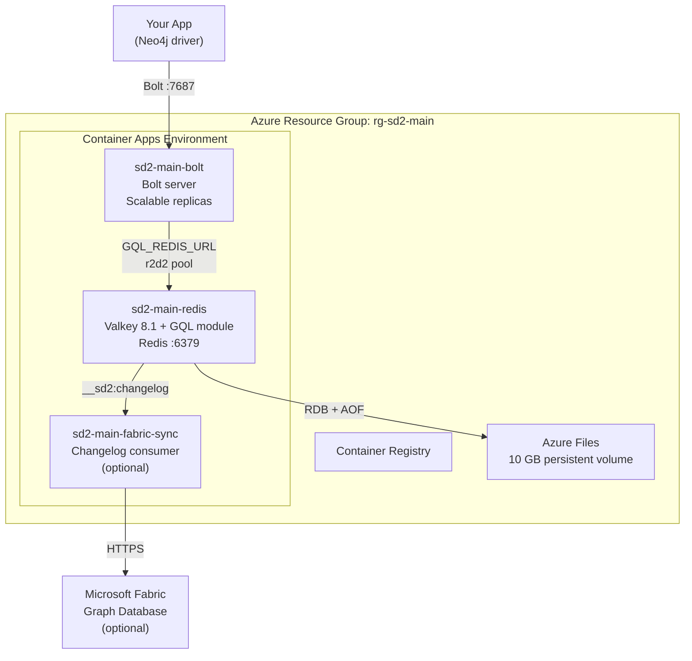

# Deploy Your Own SedanDelivery Instance

Deploy a production-ready graph database on Azure in under 10 minutes. You get:

- **Bolt protocol server** — any Neo4j driver connects out of the box (Python, .NET, Java, Go, Rust, JavaScript)
- **Redis-backed persistence** — data survives restarts, backed by Valkey with RDB + AOF
- **Horizontal scaling** — the Bolt server runs as a separate container that can scale independently
- **Optional Fabric replication** — automatic sync to Microsoft Fabric Graph Database for analytics

## Prerequisites

- An **Azure subscription** (free trial works)
- **GitHub account** with a fork of this repo
- CLI tools: `az`, `gh`, `jq` (install via `brew install azure-cli gh jq` or equivalent)

## Quick Start (5 minutes)

### 1. Fork the repo

```bash
gh repo fork cloud-ecosystem-security/SedanDelivery --clone
cd SedanDelivery
```

### 2. Create an Azure Service Principal

```bash
az login
SUBSCRIPTION_ID=$(az account show --query id -o tsv)

# Create a service principal with Contributor + User Access Administrator roles
SP=$(az ad sp create-for-rbac --name sedan-deploy \
  --role Contributor \
  --scopes "/subscriptions/${SUBSCRIPTION_ID}" \
  --output json)

# Also grant User Access Administrator for managed identity ACR pull
az role assignment create \
  --assignee "$(echo $SP | jq -r .appId)" \
  --role "User Access Administrator" \
  --scope "/subscriptions/${SUBSCRIPTION_ID}"

echo "Client ID: $(echo $SP | jq -r .appId)"
echo "Tenant ID: $(echo $SP | jq -r .tenant)"
```

### 3. Configure GitHub Secrets

```bash
gh secret set AZURE_CLIENT_ID       --body "$(echo $SP | jq -r .appId)"
gh secret set AZURE_CLIENT_SECRET   --body "$(echo $SP | jq -r .password)"
gh secret set AZURE_TENANT_ID       --body "$(echo $SP | jq -r .tenant)"
gh secret set AZURE_SUBSCRIPTION_ID --body "${SUBSCRIPTION_ID}"
```

### 4. Deploy

```bash
# Option A: Push to main (deploys to production)
git push origin main

# Option B: Manual trigger
gh workflow run deploy.yml -f environment=production

# Option C: PR-based (isolated environment per branch)
gh pr create --title "my feature"
gh pr edit --add-label deploy
```

### 5. Connect

The deployment takes ~8 minutes. When complete, get your endpoint:

```bash
# Get the Bolt endpoint
az containerapp show \
  --name sd2-main-bolt \
  --resource-group rg-sd2-main \
  --query "properties.configuration.ingress.fqdn" -o tsv
```

Then connect from any Neo4j driver:

```python
from neo4j import GraphDatabase

driver = GraphDatabase.driver(
    "bolt://sd2-main-bolt.<your-cae-id>.eastus2.azurecontainerapps.io:7687",
    auth=("neo4j", "password")
)
with driver.session() as session:
    session.run("CREATE (:Person {name: 'Alice', age: 30})")
    result = session.run("MATCH (p:Person) RETURN p.name, p.age")
    for record in result:
        print(record["p.name"], record["p.age"])
driver.close()
```

Works with Python, .NET, Java, Go, Rust, JavaScript — any driver supporting Bolt v4.2+.

## What Gets Deployed



| Resource | Purpose | Cost |
|----------|---------|------|
| Container Registry (Basic) | Stores Docker images | ~$5/mo |
| Container App: Valkey + GQL module | Graph engine + Redis storage | ~$15/mo (0.5 CPU, 1 GB) |
| Container App: Bolt server | Bolt protocol endpoint | ~$15/mo (0.5 CPU, 1 GB) |
| Azure Files (10 GB) | Persistent storage for RDB/AOF | ~$1/mo |
| VNet + NSG | Network isolation | Free |
| **Total (standalone)** | | **~$36/mo** |
| + Azure Cache for Redis (optional) | Managed HA with replication | +$40/mo (Standard C1) |
| + Fabric sync sidecar (optional) | Replication to Fabric | +$8/mo (0.25 CPU, 0.5 GB) |

## Configuration

### Storage Backends

| Mode | Env Var | Use Case |
|------|---------|----------|
| **Standalone Redis** (default) | `GQL_REDIS_URL=redis://:pass@host:6379` | Single Valkey instance, good for most workloads |
| **Redis Cluster** | `GQL_REDIS_CLUSTER_NODES=redis://n1:6379,redis://n2:6379,...` | Horizontal data sharding across multiple nodes |
| **Azure Cache for Redis** | Deploy with `persistenceBackend=azure-cache` | Managed HA with automatic failover |

The deployment workflow sets `GQL_REDIS_URL` automatically, pointing the Bolt server at the Valkey container. No manual configuration needed for the default setup.

### Environment Variables

Set these in your Container App or `deploy.yml` to customize behavior:

| Variable | Default | Description |
|----------|---------|-------------|
| **Bolt Server** | | |
| `BOLT_BIND_ADDR` | `0.0.0.0:7687` | Bolt TCP listen address |
| `BOLT_PASSWORD` | (none) | Optional password for Bolt auth |
| `BOLT_MAX_CONNECTIONS` | `1024` | Max concurrent Bolt connections |
| `BOLT_IDLE_TIMEOUT_SECS` | `300` | Close idle connections after N seconds |
| **Redis Backend** | | |
| `GQL_REDIS_URL` | (none) | Redis/Valkey connection URL |
| `GQL_REDIS_CLUSTER_NODES` | (none) | Cluster seed URLs (overrides GQL_REDIS_URL) |
| `GQL_REDIS_POOL_SIZE` | `16` | Connection pool max size |
| `GQL_REDIS_POOL_TIMEOUT_SECS` | `5` | Pool checkout timeout |
| `GQL_REDIS_KEY_PREFIX` | (none) | Key prefix for multi-tenant isolation |
| **Query Engine** | | |
| `GQL_QUERY_TIMEOUT_MS` | `30000` | Max query execution time |
| `GQL_QUERY_MAX_ROWS` | `10000000` | Max intermediate rows |
| `GQL_VARLEN_MAX_DEPTH` | `30` | Max variable-length path depth |
| **Valkey** | | |
| `VALKEY_PASSWORD` | (generated) | Authentication password (auto-generated on first deploy) |

## Scaling

### Horizontal: Multiple Bolt Replicas

The Bolt server is stateless (all state is in Redis). Scale it independently:

```bash
# Scale to 3 replicas
az containerapp update \
  --name sd2-main-bolt \
  --resource-group rg-sd2-main \
  --min-replicas 3 \
  --max-replicas 10
```

Container Apps automatically load-balances across replicas.

### Vertical: More CPU/Memory

```bash
az containerapp update \
  --name sd2-main-bolt \
  --resource-group rg-sd2-main \
  --cpu 2 --memory 4Gi
```

### High Availability: Azure Cache for Redis

For automatic failover and replication, deploy with Azure Cache:

```bash
# Re-deploy with Azure Cache backend
az deployment group create \
  --resource-group rg-sd2-main \
  --template-file infra/main.bicep \
  --parameters environmentName=main persistenceBackend=azure-cache
```

This provisions a Standard C1 Azure Cache for Redis with active-passive replication. The deploy workflow automatically wires the connection string.

## Cleanup

```bash
# Delete a branch environment
az group delete --name rg-sd2-mybranch --yes

# Delete production
az group delete --name rg-sd2-main --yes
```

Or use the **Undeploy** GitHub Actions workflow.

## Troubleshooting

### Bolt server won't start

Check logs:
```bash
az containerapp logs show --name sd2-main-bolt --resource-group rg-sd2-main --tail 50
```

Common causes:
- `GQL_REDIS_URL` not set or wrong — the server panics intentionally (no silent fallback)
- Valkey container not running — check `sd2-main-redis` logs
- Port conflict — ensure only the bolt Container App exposes port 7687

### Connection refused from client

```bash
# Verify the endpoint is reachable
az containerapp show --name sd2-main-bolt --resource-group rg-sd2-main \
  --query "properties.configuration.ingress.fqdn" -o tsv
```

Ensure your client connects to port **7687** (Bolt), not 6379 (Redis).

### Data not persisting across restarts

Check that the Valkey container has Azure Files mounted:
```bash
az containerapp show --name sd2-main-redis --resource-group rg-sd2-main \
  --query "properties.template.volumes" -o json
```

If empty, the volume mount may have been skipped. Re-deploy to fix.

## Architecture Decisions

- [ADR-001: Storage Model](ADR-001-storage-model) — Why Redis-native data structures
- [ADR-004: Distributed Redis](ADR-004-distributed-redis) — HA, pooling, clustering design
