# Architecture Overview

SedanDelivery is a Cypher-compatible graph database engine written in Rust. It provides two network interfaces (REST API and Bolt protocol), a hand-written Cypher parser, a cost-based query planner, and pluggable storage backends including Redis, in-memory, and Microsoft Fabric.

## Contents

- [Crate Map](#crate-map)
- [Request Flow -- REST API](#request-flow----rest-api)
- [Request Flow -- Bolt Protocol](#request-flow----bolt-protocol)
- [Query Pipeline](#query-pipeline)
- [Storage Layer](#storage-layer)
- [Deployment Topology](#deployment-topology)
- [Key Design Decisions](#key-design-decisions)
- [Directory Structure](#directory-structure)

## Crate Map

The workspace contains 8 crates. Arrows point from dependent to dependency.


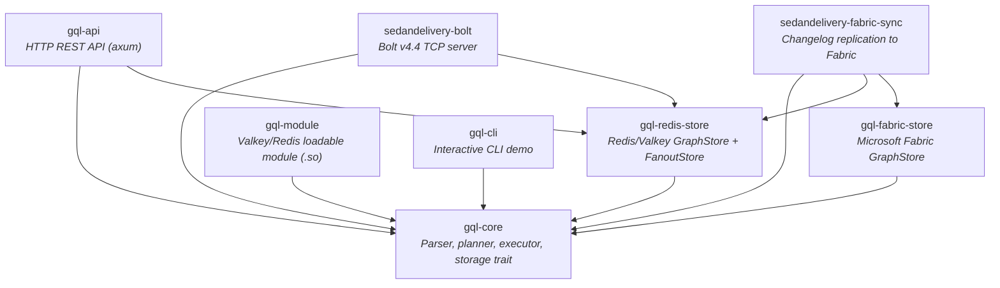

## Request Flow -- REST API

The REST API is an axum HTTP server on port 3001 (default). It exposes CRUD endpoints for nodes, edges, graphs, Cypher queries, schema inspection, neighbor traversal, and export/import.

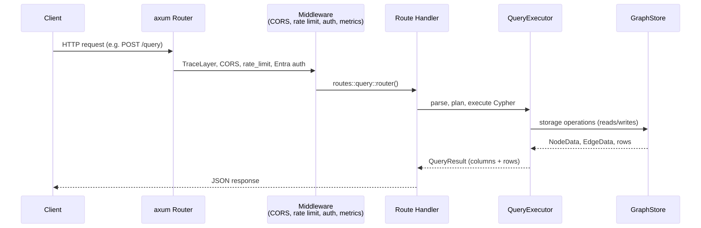

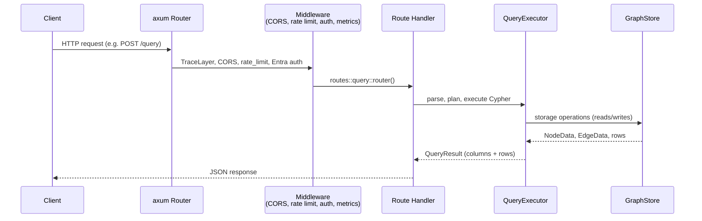

Middleware stack (applied bottom-up):
1. `TraceLayer` -- structured request/response logging
2. `CorsLayer` -- origin allowlist from `GQL_API_ALLOWED_ORIGINS`
3. `track_http_metrics` -- Prometheus request counters and latency histograms
4. `rate_limit_middleware` -- per-IP token bucket (`GQL_API_RATE_LIMIT_RPS`)
5. `require_entra_auth` -- JWT validation via Microsoft Entra ID

## Request Flow -- Bolt Protocol

The Bolt server listens on port 7687 (default) and speaks Neo4j Bolt v4.4. Any standard Neo4j driver (Python, .NET, Java, Go, JavaScript, Rust) connects directly.

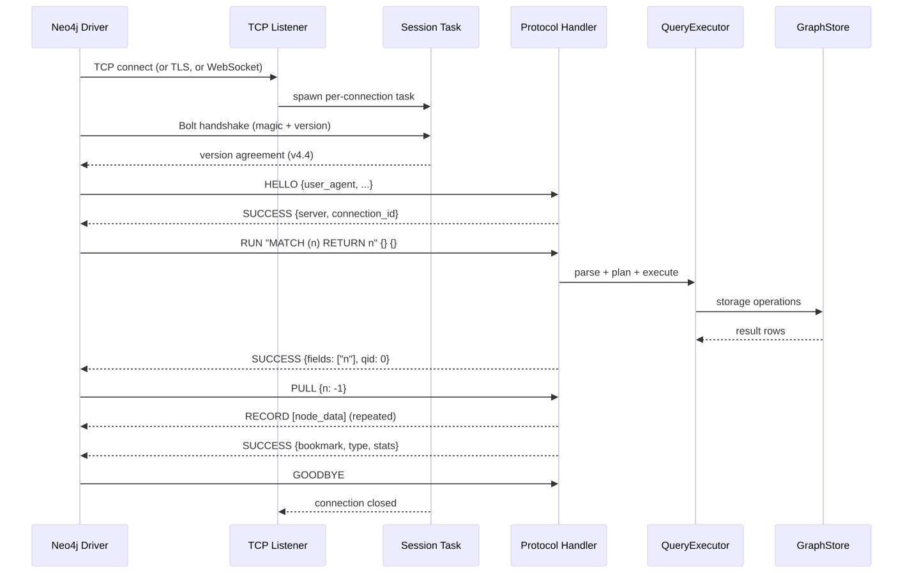

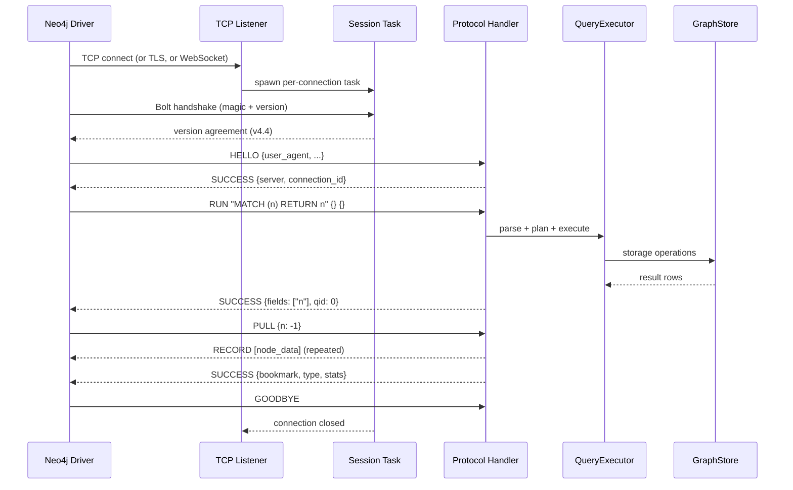

Connection lifecycle:
- Semaphore-gated concurrency (`BOLT_MAX_CONNECTIONS`, default 1024)
- Per-message idle timeout reaping (`BOLT_IDLE_TIMEOUT_SECS`, default 300) -- resets on each message
- Max connection lifetime (`BOLT_MAX_CONNECTION_LIFETIME_SECS`, default 1800) -- hard wall-clock cap that forces periodic reconnection, critical for L4 load-balancer rebalancing after scale-out
- Explicit transactions via BEGIN/COMMIT/ROLLBACK with snapshot isolation
- Write concurrency semaphore for transaction contention (`BOLT_WRITE_CONCURRENCY`)

## Query Pipeline

Every Cypher query passes through the same pipeline regardless of entry point (REST API, Bolt, Redis module, or CLI).


```mermaid
flowchart LR
    A["Cypher text"] --> B["Lexer<br/><code>parser::lexer</code>"]
    B --> C["Token stream"]
    C --> D["Parser<br/><code>parser::parser</code>"]
    D --> E["AST<br/><code>ast::Query</code>"]
    E --> F["Validator<br/><code>planner::validator</code>"]
    F --> G["Planner<br/><code>planner::QueryPlanner</code>"]
    G --> H["Operator tree<br/>(28 physical operators)"]
    H --> I["Executor<br/><code>executor::QueryExecutor</code>"]
    I --> J["Result rows<br/><code>QueryResult</code>"]
```

Key pipeline components:

- **Lexer** -- hand-written tokenizer; strict mode (`lex_query`) and lenient mode (`tokenize`) for IDE tooling.
- **Parser** -- recursive-descent parser. Handles Cypher's context-dependent `|` (label disjunction, rel-type disjunction, list comprehension pipe).
- **Validator** -- checks semantic correctness (undefined variables, invalid aggregation scoping).
- **Planner** -- translates AST clauses into a tree of 28 physical operators (NodeScan, IndexScan, Expand, VarLenExpand, Filter, Aggregate, ShortestPath, Create, Merge, etc.). Uses cardinality estimation from graph statistics for EXPLAIN output.
- **Executor** -- walks the operator tree, calls `GraphStore` methods, enforces budget limits (`GQL_QUERY_TIMEOUT_MS`, `GQL_QUERY_MAX_ROWS`).
- **Plan cache** -- process-local cache keyed by query text, avoids re-parsing and re-planning identical queries for `/query` and `/mutate`. It uses clear-on-capacity eviction (not LRU), exposes hit/miss metrics, and is explicitly invalidated after schema-changing DDL such as index/constraint changes.

## Storage Layer

All storage access goes through the `GraphStore` trait defined in `gql-core::storage`. This is the core abstraction boundary -- the engine never talks to Redis, Fabric, or memory directly.


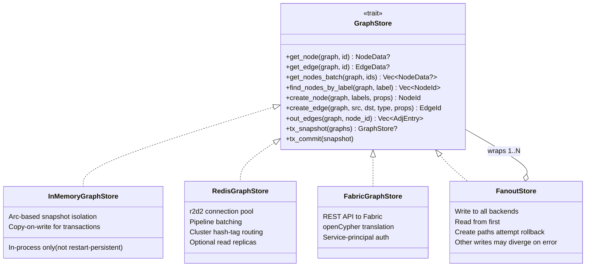

Backend selection at startup (`gql-redis-store::create_store`):
1. `GQL_REDIS_CLUSTER_NODES` set -- `RedisGraphStore` in cluster mode (auto-discovers topology from seed nodes)
2. `GQL_REDIS_URL` set -- `RedisGraphStore` in standalone mode (also used for Azure Cache for Redis with `rediss://` TLS URLs)
3. Neither set -- `InMemoryGraphStore` (volatile, for local dev/tests)

When `GQL_REDIS_REPLICA_URL` is also set, read methods are routed to a separate replica pool (round-robin across replicas with `READONLY` command). Writes always go to the primary pool. This provides eventual-consistency read scaling for read-heavy workloads.

Redis key schema uses `{graphname}` hash tags for cluster slot affinity:
```
G:{graph}:node:{id}      -- node hash (labels JSON, props JSON)
G:{graph}:edge:{id}      -- edge hash (src, dst, rel_type, props JSON)
G:{graph}:label:{label}  -- SADD of node IDs with that label
G:{graph}:out:{node_id}  -- SADD of "edge_id:neighbor_id:rel_type"
G:{graph}:in:{node_id}   -- SADD (reverse adjacency)
```

## Deployment Topology

SedanDelivery deploys as 2-4 containers in an Azure Container Apps environment. Each component is independently scalable.


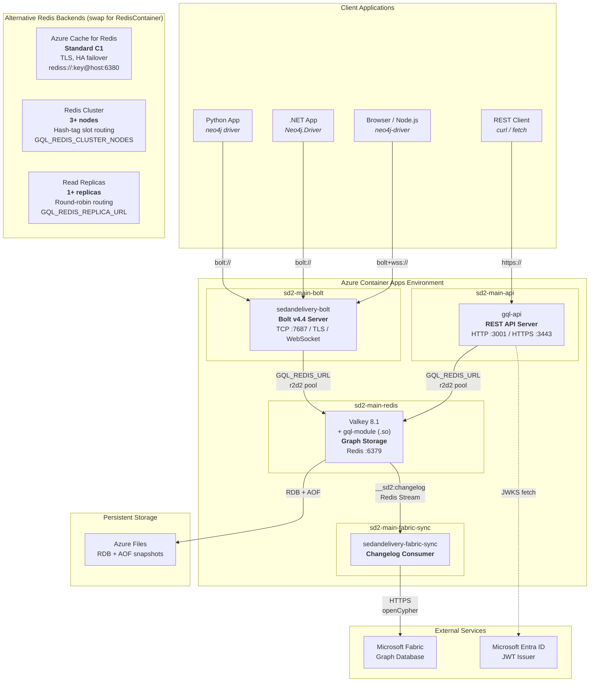

**Components:**

| Container | Image | Purpose | Scalable |
|-----------|-------|---------|----------|
| `sd2-main-bolt` | `sedandelivery-bolt` | Bolt v4.4 protocol server. Neo4j drivers connect here. | Yes (stateless) |
| `sd2-main-api` | `gql-api` | REST API with auth, rate limiting, metrics. | Yes (stateless) |
| `sd2-main-redis` | `sedandelivery` (Valkey + gql-module) | Graph storage engine. All data lives here. | No (single primary) |
| `sd2-main-fabric-sync` | `sedandelivery-fabric-sync` | Replicates changes to Microsoft Fabric. | No (single consumer) |

**Connection patterns:**
- **Bolt clients** connect to the Bolt server via TCP, TLS, or WebSocket on port 7687
- **REST clients** connect to gql-api via HTTP/HTTPS on port 3001/3443
- Both servers connect to Valkey via `GQL_REDIS_URL` using an r2d2 connection pool (or via `GQL_REDIS_CLUSTER_NODES` for cluster mode, or `rediss://` for Azure Cache with TLS)
- When `GQL_REDIS_REPLICA_URL` is set, read-only operations are routed to a separate replica pool (round-robin), while writes go to the primary
- The Fabric sync sidecar reads from a Redis Stream (`__sd2:changelog`) and pushes to Fabric via HTTPS
- Entra ID JWT validation uses a cached JWKS endpoint (async, non-blocking)

See [Deploy Your Own Instance](DEPLOY) for full setup instructions and cost estimates (~$36/mo standalone).

## Key Design Decisions

- **Hand-written parser, not lalrpop.** Cypher's `|` is context-dependent (label disjunction vs. rel-type disjunction vs. list comprehension pipe). A generated parser cannot resolve this without semantic context. See ADR-003.

- **InMemory today, not restart-persistent yet.** The Redis module runs inside the Redis/Valkey process. The `InMemoryGraphStore` keeps graph data in-process with zero serialization overhead, but that heap state is not yet serialised via Redis module save/load hooks. Redis RDB/AOF does not currently persist module graph state, and the Fabric changelog sidecar is for external replication rather than local restart recovery.

- **Bolt v4.4 for Neo4j driver compatibility.** v4.4 is the most widely supported version across Neo4j drivers (Python, .NET, Java, Go, JavaScript, Rust). It supports multi-database, bookmarks, explicit transactions, EXPLAIN/PROFILE, and streaming PULL with qid-based multiplexing.

- **Synchronous `GraphStore` trait.** All trait methods are synchronous because the Redis module runs on Redis's single-threaded event loop. Async I/O happens at the network layer (Bolt/API servers), not at the storage layer.

- **`FanoutStore` for multi-backend writes.** Rather than coupling backends, writes fan out through a simple wrapper. This enables patterns like Redis (fast reads) + Fabric (durable analytics) without modifying either backend. `create_node` and `create_edge` attempt primary rollback if a later backend fails, but the broader `write_all` mutation path returns the first error and may leave earlier stores ahead of later ones.

- **u64 node/edge IDs.** Chosen over u32 to avoid silent overflow at 4.29B entities. Redis INCR returns i64; the storage layer rejects values <= 0 as overflow. See ADR-001.

## Directory Structure

```
SedanDelivery/
  gql-core/                    Core engine (no external dependencies)
    src/
      ast/                       Cypher AST types
      parser/
        lexer/                   Hand-written tokenizer (tokens, scan)
        parser/                  Recursive-descent parser (clauses, expressions, patterns)
      planner/
        planner/                 AST-to-operator-tree (match, mutation, result planners)
        validator/               Semantic validation (expression, scope, semantic checks)
        mod.rs                   28+ physical operator definitions
      executor/
        engine/
          scan/                  Node scan, edge scan, index scan
          mutations/             Create, delete, set, merge, foreach
          helpers/               Comparison, arithmetic, dedup, expression naming
          eval.rs                Expression evaluation
          produce.rs             Result production, CALL procedures, UNION
          shaping.rs             Sort, limit, skip, distinct
          joins.rs               Apply, left-outer-apply, subquery call
          aggregation.rs         GROUP BY, count, sum, avg, collect
        filter/
          builtins.rs            60+ built-in functions (math, string, temporal, type)
          operators.rs           Comparison, regex, arithmetic operators
          temporal/              Date/time constructors, arithmetic, parsing
          collections.rs         List operations, reduce
        traversal.rs             BFS, shortest path
        budget.rs                Timeout, row-limit, profiling stats
      storage/
        mem/                     InMemoryGraphStore (nodes, edges, indexing, query)
        wal.rs                   Write-ahead log for durability
        mod.rs                   GraphStore trait
      config.rs                  Environment variable configuration
      plan_cache.rs              Query plan cache (hash map + clear-on-capacity eviction)
      types/value/               Value type system (display, convert, compare)

  gql-redis-store/             Redis/Valkey storage backend
    src/
      lib.rs                     RedisGraphStore implementation
      fanout.rs                  FanoutStore (create rollback only; other writes may diverge)
      create_store.rs            Backend selection from env vars
      connection.rs              r2d2 pool, replica routing, stats reporter
      reads.rs                   Redis read commands
      writes/                    Redis write commands (nodes, edges, graphs, helpers)
      indexing.rs                Property index management
      range.rs                   Range query support

  gql-fabric-store/            Microsoft Fabric storage backend
    src/
      lib.rs                     FabricGraphStore + connection pooling
      store/                     GraphStore impl (nodes, edges, admin)
      auth.rs                    Azure AD token acquisition (single-flight refresh)
      parsing.rs                 Fabric JSON response parsing
      sanitize.rs                Cypher injection prevention

  gql-module/                  Valkey/Redis loadable module (.so)
    src/lib.rs                   GQL.QUERY, GQL.MUTATE, GQL.CREATE-GRAPH, etc.

  gql-api/                     HTTP REST API
    src/
      main.rs                    axum server setup (HTTP or TLS)
      routes/                    Endpoint handlers (nodes, edges, query, indexes, etc.)
      auth.rs                    Entra ID JWT validation + JWKS cache
      rate_limit.rs              Per-IP sliding window rate limiting
      metrics.rs                 Prometheus metrics + slow query log
      tls.rs                     TLS configuration
      serialize.rs               Value-to-JSON conversion

  sedandelivery-bolt/          Bolt v4.4 protocol server
    src/
      main.rs                    TCP accept loop, TLS, WebSocket
      connection/                Per-connection session lifecycle
      protocol/
        handler/                 Message dispatch (hello, run, pull, transaction, explain)
        state.rs                 Session state machine
      bridge/                    Bolt-to-GQL translation (executor, types, temporal, spatial)
      message/codec.rs           Bolt binary framing
      packstream/                PackStream v1 serialization (encoder, decoder, value)
      health.rs                  Health + metrics HTTP endpoint
      metrics.rs                 Bolt-level Prometheus metrics

  sedandelivery-fabric-sync/   Changelog replication sidecar
    src/
      main.rs                    Polls Redis changelog stream, pushes to Fabric
      sync_loop.rs               Event processing with DLQ

  gql-cli/                     Interactive CLI demo
    src/main.rs                  REPL for local testing

  sdk/                         Client SDKs (Python, .NET, Rust)
  neo4j-compat-gallery/        4 open-source apps validating Bolt compatibility
  docs/                        Documentation + architecture diagrams
  tests/                       E2E integration tests + gadugi scenarios
```
