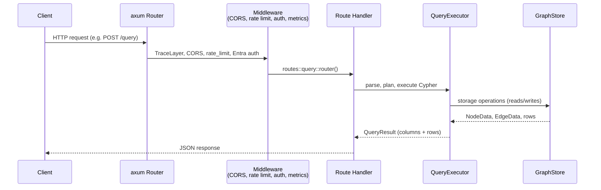
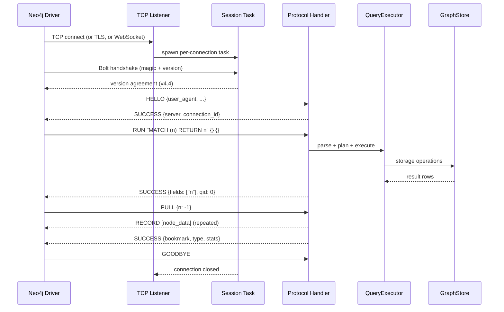
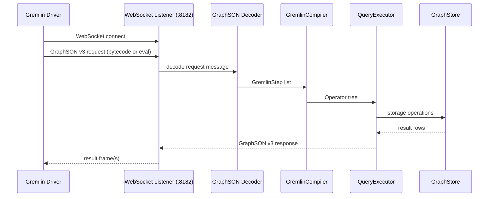
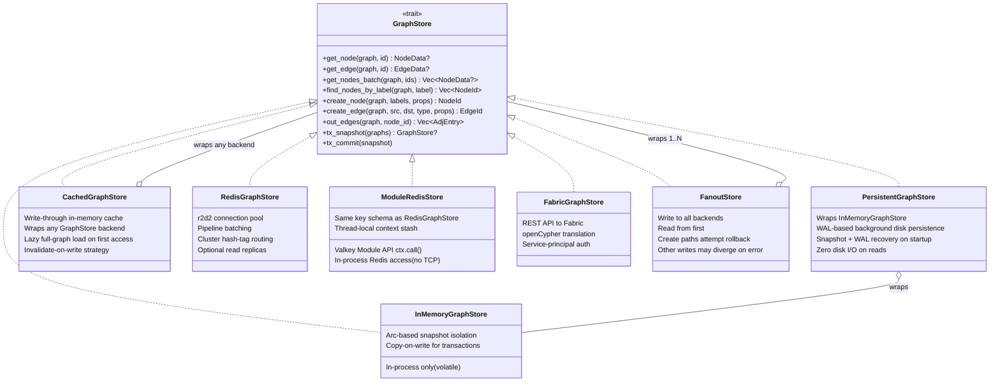
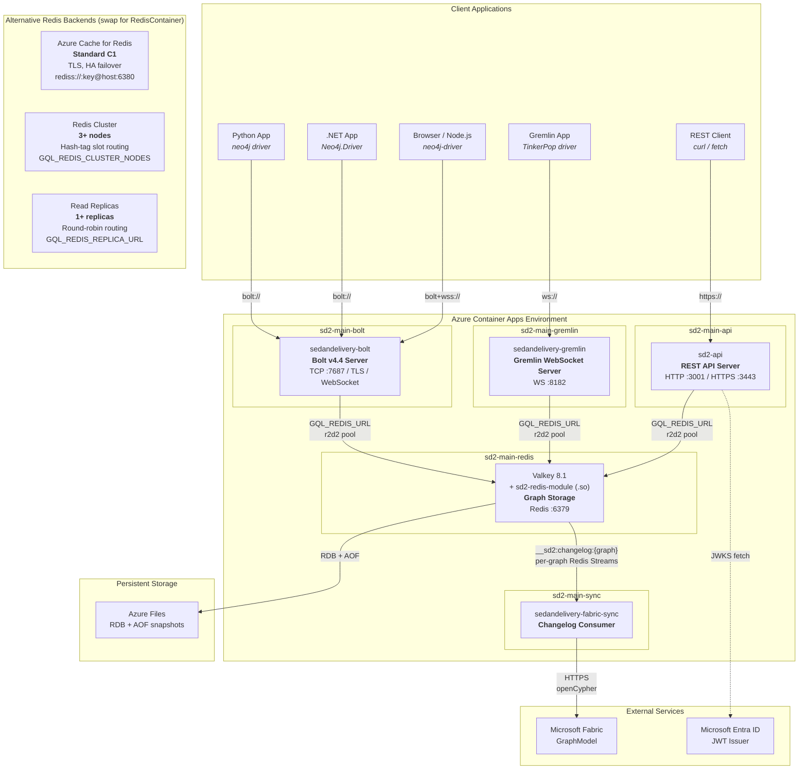

# Architecture Overview

SedanDelivery is a multi-language graph database engine written in Rust. It supports three query languages — openCypher, Apache TinkerPop Gremlin, and GQL (ISO/IEC 39075) — all sharing the same storage layer and physical executor. It provides four network interfaces (REST API, Bolt protocol, Gremlin WebSocket, and Redis commands), a hand-written Cypher parser, a cost-based query planner, and pluggable storage backends including Redis, in-memory with WAL persistence, cached, and Microsoft Fabric.

## Contents

- [Crate Map](#crate-map)
- [Query Engines](#query-engines)
- [Request Flow -- REST API](#request-flow----rest-api)
- [Request Flow -- Bolt Protocol](#request-flow----bolt-protocol)
- [Request Flow -- Gremlin WebSocket](#request-flow----gremlin-websocket)
- [Query Pipeline](#query-pipeline)
- [Storage Layer](#storage-layer)
- [Deployment Topology](#deployment-topology)
- [Key Design Decisions](#key-design-decisions)
- [Directory Structure](#directory-structure)

## Crate Map

The workspace contains 17 crates. Arrows point from dependent to dependency.

```mermaid
graph TD
    subgraph Engines["Query Engines"]
        cypher-core["cypher-core<br/><i>openCypher parser, planner, executor, storage trait</i>"]
        gremlin-core["gremlin-core<br/><i>Gremlin bytecode compiler + text parser</i>"]
        gql-engine["gql-engine<br/><i>GQL (ISO/IEC 39075) parser + planner</i>"]
    end

    subgraph Storage["Storage Backends"]
        sd2-redis-store["sd2-redis-store<br/><i>Redis/Valkey GraphStore + FanoutStore</i>"]
        gql-fabric-store["gql-fabric-store<br/><i>Microsoft Fabric GraphStore</i>"]
    end

    subgraph Servers["Protocol Servers"]
        sd2-redis-module["sd2-redis-module<br/><i>Valkey/Redis loadable module (.so)</i>"]
        sd2-api["sd2-api<br/><i>HTTP REST API (axum)</i>"]
        sedandelivery-bolt["sedandelivery-bolt<br/><i>Bolt v4.4 TCP server</i>"]
        sedandelivery-gremlin["sedandelivery-gremlin<br/><i>Gremlin WebSocket server (bytecode)</i>"]
        sedandelivery-gremlin-server["sedandelivery-gremlin-server<br/><i>Gremlin WebSocket server (text eval)</i>"]
    end

    subgraph Embedded["Embeddable Libraries"]
        sedan-cypher-embedded["sedan-cypher-embedded<br/><i>In-process openCypher engine</i>"]
        sedan-gql-embedded["sedan-gql-embedded<br/><i>In-process GQL/Cypher engine</i>"]
        sedan-gremlin-embedded["sedan-gremlin-embedded<br/><i>In-process Gremlin engine</i>"]
    end

    subgraph Other["Other"]
        gql-cli["gql-cli<br/><i>Interactive CLI demo</i>"]
        sedandelivery-fabric-sync["sedandelivery-fabric-sync<br/><i>Changelog replication to Fabric</i>"]
    end

    gremlin-core --> cypher-core
    gql-engine --> cypher-core
    sd2-redis-store --> cypher-core
    gql-fabric-store --> cypher-core
    sd2-redis-module --> cypher-core
    gql-cli --> cypher-core
    sd2-api --> cypher-core
    sd2-api --> sd2-redis-store
    sedandelivery-bolt --> cypher-core
    sedandelivery-bolt --> sd2-redis-store
    sedandelivery-gremlin --> gremlin-core
    sedandelivery-gremlin --> sd2-redis-store
    sedandelivery-gremlin-server --> gremlin-core
    sedandelivery-gremlin-server --> sd2-redis-store
    sedandelivery-fabric-sync --> cypher-core
    sedandelivery-fabric-sync --> sd2-redis-store
    sedandelivery-fabric-sync --> gql-fabric-store
    sedan-cypher-embedded --> cypher-core
    sedan-gql-embedded --> cypher-core
    sedan-gremlin-embedded --> gremlin-core
    sedan-gremlin-embedded --> cypher-core
```




## Query Engines

SedanDelivery supports three graph query languages, all sharing the same physical operator tree, executor, and `GraphStore` storage abstraction:

| Engine | Crate | Language | Status |
|--------|-------|----------|--------|
| **openCypher** | `cypher-core` | openCypher (Neo4j-compatible) | 100% TCK (3903 scenarios) |
| **Gremlin** | `gremlin-core` | Apache TinkerPop Gremlin | ~116 step types, bytecode + text, 201 TCK scenarios |
| **GQL** | `gql-engine` | ISO/IEC 39075 GQL | Initial implementation |

- **cypher-core** — Hand-written lexer/parser, cost-based planner, 28+ physical operators. This is the most mature engine.
- **gremlin-core** — Compiles Gremlin bytecode steps and text traversals into cypher-core `Operator` trees. Supports ~116 Gremlin steps. No I/O — pure translation layer. 201 TCK scenarios pass.
- **gql-engine** — GQL standard parser and planner. Handles GQL-specific syntax (`INSERT` vs `CREATE`, `FILTER` vs `WHERE`, path modes, isomorphic matching). Shares the executor and storage layer with cypher-core.

## Request Flow -- REST API

The REST API is an axum HTTP server on port 3001 (default). It exposes CRUD endpoints for nodes, edges, graphs, Cypher queries, schema inspection, neighbor traversal, and export/import.




Middleware stack (applied bottom-up):
1. `TraceLayer` -- structured request/response logging
2. `CorsLayer` -- origin allowlist from `GQL_API_ALLOWED_ORIGINS`
3. `track_http_metrics` -- Prometheus request counters and latency histograms
4. `rate_limit_middleware` -- per-IP token bucket (`GQL_API_RATE_LIMIT_RPS`)
5. `require_entra_auth` -- JWT validation via Microsoft Entra ID

## Request Flow -- Bolt Protocol

The Bolt server listens on port 7687 (default) and speaks Neo4j Bolt v4.4. Any standard Neo4j driver (Python, .NET, Java, Go, JavaScript, Rust) connects directly.




Connection lifecycle:
- Semaphore-gated concurrency (`BOLT_MAX_CONNECTIONS`, default 1024)
- Idle timeout reaping, max connection lifetime, and L4 load-balancer rebalancing -- see [Auto-Scaling Guide](auto-scaling) for details
- Explicit transactions via BEGIN/COMMIT/ROLLBACK with snapshot isolation
- Write concurrency semaphore (`BOLT_WRITE_CONCURRENCY`, default 128)
- Distributed write locks, atomic graph deletion, and cross-replica bookmarks -- see [Auto-Scaling Guide](auto-scaling) for write safety details

## Request Flow -- Gremlin WebSocket

Two Gremlin server binaries accept WebSocket connections on port 8182 (default):

- **sedandelivery-gremlin** — Accepts Gremlin bytecode (TinkerPop driver protocol). Decodes GraphSON v3 bytecode messages, compiles steps via `gremlin-core::GremlinCompiler`, and executes through the cypher-core pipeline.
- **sedandelivery-gremlin-server** — Accepts Gremlin text queries (`eval` op). Parses traversal strings via `gremlin-core::text_parser`, compiles to operator trees, and executes.

Both servers use the same `GraphStore` backend as the Bolt and REST servers (configured via environment variables). Health endpoints are exposed on port 8183.



## Query Pipeline

Every Cypher query passes through the same pipeline regardless of entry point (REST API, Bolt, Redis module, or CLI). Gremlin and GQL queries enter the pipeline after their respective parsers/compilers produce an Operator tree.




```mermaid
flowchart LR
    A["Cypher text"] --> B["Lexer<br/><code>parser::lexer</code>"]
    B --> C["Token stream"]
    C --> D["Parser<br/><code>parser::parser</code>"]
    D --> E["AST<br/><code>ast::Query</code>"]
    E --> F["Validator<br/><code>planner::validator</code>"]
    F --> G["Planner<br/><code>planner::QueryPlanner</code>"]
    G --> H["Operator tree<br/>(28 physical operators)"]
    H --> I["Executor<br/><code>executor::QueryExecutor</code>"]
    I --> J["Result rows<br/><code>QueryResult</code>"]
```

Key pipeline components:

- **Lexer** -- hand-written tokenizer; strict mode (`lex_query`) and lenient mode (`tokenize`) for IDE tooling.
- **Parser** -- recursive-descent parser. Handles Cypher's context-dependent `|` (label disjunction, rel-type disjunction, list comprehension pipe).
- **Validator** -- checks semantic correctness (undefined variables, invalid aggregation scoping).
- **Planner** -- translates AST clauses into a tree of 28 physical operators (NodeScan, IndexScan, Expand, VarLenExpand, Filter, Aggregate, ShortestPath, Create, Merge, etc.). Uses cardinality estimation from graph statistics for EXPLAIN output.
- **Executor** -- walks the operator tree, calls `GraphStore` methods, enforces budget limits (`GQL_QUERY_TIMEOUT_MS`, `GQL_QUERY_MAX_ROWS`).
- **Plan cache** -- process-local cache keyed by query text, avoids re-parsing and re-planning identical queries for `/query` and `/mutate`. It uses clear-on-capacity eviction (not LRU), exposes hit/miss metrics, and is explicitly invalidated after schema-changing DDL such as index/constraint changes.

## Storage Layer

All storage access goes through the `GraphStore` trait defined in `cypher-core::storage`. This is the core abstraction boundary -- the engine never talks to Redis, Fabric, or memory directly.




Backend selection at startup (`sd2-redis-store::create_store`):
1. `GQL_REDIS_CLUSTER_NODES` set — `RedisGraphStore` in cluster mode (auto-discovers topology from seed nodes)
2. `GQL_REDIS_URL` set — `RedisGraphStore` in standalone mode (also used for Azure Cache for Redis with `rediss://` TLS URLs)
3. Neither set — `InMemoryGraphStore` (volatile, for local dev/tests)

Additional storage wrappers:
- **PersistentGraphStore** (`cypher-core/src/storage/persistent.rs`) — Wraps `InMemoryGraphStore` with WAL-based disk persistence. All reads stay in-memory (zero disk I/O); writes append to a JSON-line WAL. A background thread periodically snapshots the full state and truncates the WAL. On startup, recovers by loading the snapshot then replaying WAL entries.
- **CachedGraphStore** (`cypher-core/src/storage/cached.rs`) — Write-through in-memory cache wrapping any `GraphStore` backend. Lazily loads the full graph into an `InMemoryGraphStore` cache on first access. Writes go to the backend first, then the cache is invalidated so the next read reloads from the backend.
- **ModuleRedisStore** (`sd2-redis-module/src/module_store.rs`) — `GraphStore` implementation using the Valkey Module API (`ctx.call()`) for in-process Redis access. Avoids TCP loopback deadlock when running inside the Redis module. Uses the same key schema as `RedisGraphStore`, so the Bolt server, REST API, and module all see the same data.

When `GQL_REDIS_REPLICA_URL` is also set, read methods are routed to a separate replica pool (round-robin across replicas with `READONLY` command). Writes always go to the primary pool. This provides eventual-consistency read scaling for read-heavy workloads.

The `GraphStore` trait exposes batch APIs with default loop-based implementations that backends override for efficiency:

- **Batch writes**: `batch_create_nodes` and `batch_create_edges` preserve input order and correctness even when a backend must internally stream Redis work in smaller pipeline chunks to satisfy backend-specific write limits. The Redis backend pipelines HSET/SADD commands in configurable chunks (`GQL_REDIS_BATCH_PIPELINE_CHUNK_SIZE`, default 250) with lock renewal between chunks.
- **Batch reads**: `out_edges_by_type_batch` and `in_edges_by_type_batch` batch adjacency lookups across multiple source nodes. The executor groups Expand operations into chunks of 256 nodes (`EXPAND_BATCH_NODE_CHUNK_SIZE`) and issues a single pipelined SMEMBERS/SSCAN per chunk to the Redis backend.

Redis key schema uses `{graphname}` hash tags for cluster slot affinity:
```
G:{graph}:node:{id}      -- node hash (labels JSON, props JSON)
G:{graph}:edge:{id}      -- edge hash (src, dst, rel_type, props JSON)
G:{graph}:label:{label}  -- SADD of node IDs with that label
G:{graph}:out:{node_id}  -- SADD of "edge_id:neighbor_id:rel_type"
G:{graph}:in:{node_id}   -- SADD (reverse adjacency)
```

## Deployment Topology

SedanDelivery deploys as 2-5 containers in an Azure Container Apps environment. Each component is independently scalable.




**Components:**

| Container | Image | Purpose | Scalable |
|-----------|-------|---------|----------|
| `sd2-main-bolt` | `sedandelivery-bolt` | Bolt v4.4 protocol server. Neo4j drivers connect here. | Yes (stateless) |
| `sd2-main-api` | `sd2-api` | REST API with auth, rate limiting, metrics. | Yes (stateless) |
| `sd2-main-gremlin` | `sedandelivery-gremlin` | Gremlin WebSocket server (port 8182). TinkerPop drivers connect here. | Yes (stateless) |
| `sd2-main-redis` | `sedandelivery` (Valkey + sd2-redis-module) | Graph storage engine. All data lives here. | No (single primary) |
| `sd2-main-sync` | `sedandelivery-fabric-sync` | Replicates changes to Microsoft Fabric GraphModel. | No (single consumer) |

**Connection patterns:**
- **Bolt clients** connect to the Bolt server via TCP, TLS, or WebSocket on port 7687
- **Gremlin clients** connect to the Gremlin server via WebSocket on port 8182
- **REST clients** connect to sd2-api via HTTP/HTTPS on port 3001/3443
- All three servers connect to Valkey via `GQL_REDIS_URL` using an r2d2 connection pool (or via `GQL_REDIS_CLUSTER_NODES` for cluster mode, or `rediss://` for Azure Cache with TLS)
- When `GQL_REDIS_REPLICA_URL` is set, read-only operations are routed to a separate replica pool (round-robin), while writes go to the primary
- The Fabric sync sidecar reads from per-graph Redis Streams (`__sd2:changelog:{graph}`) and pushes to Fabric via HTTPS
- Entra ID JWT validation uses a cached JWKS endpoint (async, non-blocking)

For scaling-specific connection behavior (read-after-write session pinning, SSCAN thresholds, connection lifecycle tuning for L4 load balancers), see the [Auto-Scaling Guide](auto-scaling).

See [Deploy Your Own Instance](DEPLOY) for full setup instructions and cost estimates (~$36/mo standalone).

## Key Design Decisions

- **Hand-written parser, not lalrpop.** Cypher's `|` is context-dependent (label disjunction vs. rel-type disjunction vs. list comprehension pipe). A generated parser cannot resolve this without semantic context. See ADR-003.

- **Three engines, one executor.** Gremlin and GQL queries compile down to the same `Operator` tree that openCypher uses. This means all three languages share the same physical executor, budget enforcement, storage layer, and transaction semantics. Adding a language only requires a parser/compiler — not a new execution engine.

- **PersistentGraphStore for standalone durability.** The `InMemoryGraphStore` is volatile; the `PersistentGraphStore` wraps it with WAL-based disk persistence for scenarios that need restart recovery without Redis. The Redis module's in-process `ModuleRedisStore` uses native Redis persistence (RDB/AOF) instead.

- **Bolt v4.4 for Neo4j driver compatibility.** v4.4 is the most widely supported version across Neo4j drivers (Python, .NET, Java, Go, JavaScript, Rust). It supports multi-database, bookmarks, explicit transactions, EXPLAIN/PROFILE, and streaming PULL with qid-based multiplexing.

- **Synchronous `GraphStore` trait.** All trait methods are synchronous because the Redis module runs on Redis's single-threaded event loop. Async I/O happens at the network layer (Bolt/API servers), not at the storage layer.

- **`FanoutStore` for multi-backend writes.** Rather than coupling backends, writes fan out through a simple wrapper. This enables patterns like Redis (fast reads) + Fabric (durable analytics) without modifying either backend. `create_node` and `create_edge` attempt primary rollback if a later backend fails, but the broader `write_all` mutation path returns the first error and may leave earlier stores ahead of later ones.

- **u64 node/edge IDs.** Chosen over u32 to avoid silent overflow at 4.29B entities. Redis INCR returns i64; the storage layer rejects values <= 0 as overflow. See ADR-001.

## Directory Structure

```
SedanDelivery/
  cypher-core/                    openCypher engine (parser, planner, executor, storage trait)
    src/
      ast/                       Cypher AST types
      parser/
        lexer/                   Hand-written tokenizer (tokens, scan)
        parser/                  Recursive-descent parser (clauses, expressions, patterns)
      planner/
        planner/                 AST-to-operator-tree (match, mutation, result planners)
        validator/               Semantic validation (expression, scope, semantic checks)
        mod.rs                   28+ physical operator definitions
      executor/
        engine/
          scan/                  Node scan, edge scan, index scan
          mutations/             Create, delete, set, merge, foreach
          helpers/               Comparison, arithmetic, dedup, expression naming
          eval.rs                Expression evaluation
          produce.rs             Result production, CALL procedures, UNION
          shaping.rs             Sort, limit, skip, distinct
          joins.rs               Apply, left-outer-apply, subquery call
          aggregation.rs         GROUP BY, count, sum, avg, collect
        filter/
          builtins.rs            60+ built-in functions (math, string, temporal, type)
          operators.rs           Comparison, regex, arithmetic operators
          temporal/              Date/time constructors, arithmetic, parsing
          collections.rs         List operations, reduce
        traversal.rs             BFS, shortest path
        budget.rs                Timeout, row-limit, profiling stats
      storage/
        mem/                     InMemoryGraphStore (nodes, edges, indexing, query)
        persistent.rs            PersistentGraphStore (WAL-based disk persistence)
        cached.rs                CachedGraphStore (write-through in-memory cache)
        wal.rs                   Write-ahead log for durability
        mod.rs                   GraphStore trait
      config.rs                  Environment variable configuration
      plan_cache.rs              Query plan cache (hash map + clear-on-capacity eviction)
      types/value/               Value type system (display, convert, compare)

  gremlin-core/                Gremlin query engine (bytecode compiler + text parser)
    src/
      bytecode.rs                GremlinStep definitions (~50 step types)
      compiler.rs                GremlinCompiler: steps → cypher-core Operator tree
      text_parser.rs             Parse Gremlin traversal text strings
      graphson.rs                GraphSON v3 request/response serialization
      steps/                     Step type definitions
      types.rs                   GremlinValue ↔ cypher-core Value conversions

  gql-engine/                  GQL (ISO/IEC 39075) query engine
    src/
      parser/                    GQL-specific syntax (INSERT, FILTER, MANDATORY MATCH)
      planner/                   Path modes (WALK/TRAIL/SIMPLE/ACYCLIC), search modifiers
      executor/                  Isomorphic matching, MANDATORY MATCH error semantics
      lib.rs                     Engine entry point

  sd2-redis-store/             Redis/Valkey storage backend
    src/
      lib.rs                     RedisGraphStore implementation
      fanout.rs                  FanoutStore (create rollback only; other writes may diverge)
      create_store.rs            Backend selection from env vars
      connection.rs              r2d2 pool, replica routing, stats reporter
      reads.rs                   Redis read commands
      writes/                    Redis write commands (nodes, edges, graphs, helpers)
      indexing.rs                Property index management
      range.rs                   Range query support

  gql-fabric-store/            Microsoft Fabric storage backend
    src/
      lib.rs                     FabricGraphStore + connection pooling
      store/                     GraphStore impl (nodes, edges, admin)
      auth.rs                    Azure AD token acquisition (single-flight refresh)
      parsing.rs                 Fabric JSON response parsing
      sanitize.rs                Cypher injection prevention

  sd2-redis-module/            Valkey/Redis loadable module (.so)
    src/
      lib.rs                     GQL.QUERY, GQL.MUTATE, GQL.CREATE-GRAPH, etc.
      module_store.rs            ModuleRedisStore (in-process ctx.call() GraphStore)

  sd2-api/                     HTTP REST API
    src/
      main.rs                    axum server setup (HTTP or TLS)
      routes/                    Endpoint handlers (nodes, edges, query, indexes, etc.)
      auth.rs                    Entra ID JWT validation + JWKS cache
      rate_limit.rs              Per-IP sliding window rate limiting
      metrics.rs                 Prometheus metrics + slow query log
      tls.rs                     TLS configuration
      serialize.rs               Value-to-JSON conversion

  sedandelivery-bolt/          Bolt v4.4 protocol server
    src/
      main.rs                    TCP accept loop, TLS, WebSocket
      connection/                Per-connection session lifecycle
      protocol/
        handler/                 Message dispatch (hello, run, pull, transaction, explain)
        state.rs                 Session state machine
      bridge/                    Bolt-to-GQL translation (executor, types, temporal, spatial)
      message/codec.rs           Bolt binary framing
      packstream/                PackStream v1 serialization (encoder, decoder, value)
      health.rs                  Health + metrics HTTP endpoint
      metrics.rs                 Bolt-level Prometheus metrics

  sedandelivery-gremlin/       Gremlin WebSocket server (bytecode protocol)
    src/
      main.rs                    WebSocket accept loop (:8182)
      connection/                Per-connection session lifecycle
      bridge/                    Gremlin-to-cypher-core translation
      protocol/                  GraphSON v3 message handling
      health.rs                  Health endpoint (:8183)
      lib.rs                     Server library

  sedandelivery-gremlin-server/ Gremlin WebSocket server (text eval protocol)
    src/
      main.rs                    WebSocket accept loop (:8182)
      executor.rs                Text traversal execution
      protocol.rs                GraphSON v3 message handling
      lib.rs                     Server library

  sedandelivery-fabric-sync/   Changelog replication sidecar
    src/
      main.rs                    Polls Redis changelog stream, pushes to Fabric
      sync_loop.rs               Event processing with DLQ

  sedan-cypher-embedded/       Embeddable openCypher engine (in-process, no I/O)
  sedan-gql-embedded/          Embeddable GQL/Cypher engine (in-process, no I/O)
  sedan-gremlin-embedded/      Embeddable Gremlin engine (in-process, no I/O)

  gql-cli/                     Interactive CLI demo
    src/main.rs                  REPL for local testing

  sd2-valkey-module/           Standalone Valkey module for MERGE operations
  sdk/                         Client SDKs (Python, .NET, Rust)
  neo4j-compat-gallery/        4 open-source apps validating Bolt compatibility
  docs/                        Documentation + architecture diagrams
  tests/                       E2E integration tests + gadugi scenarios
    gremlin-tck/               Gremlin TCK-equivalent test suite
    loadtest/                  Load testing harness
  infra/                       Azure Bicep IaC, KEDA, Prometheus alerts
  scripts/                     Test, provision, and validation scripts
  sedan-graph-ui/              .NET BFF + React graph visualizer
```
