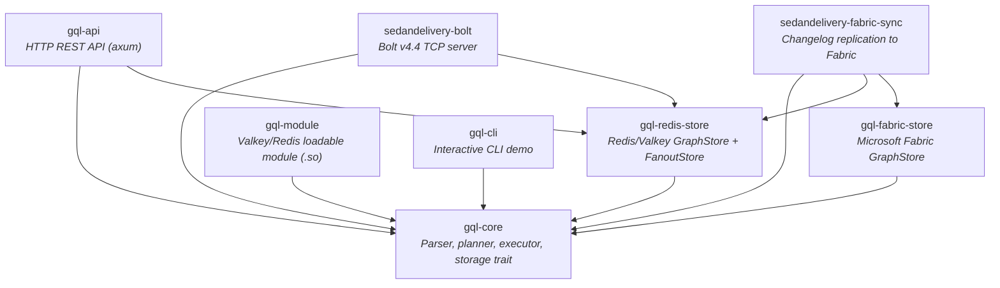
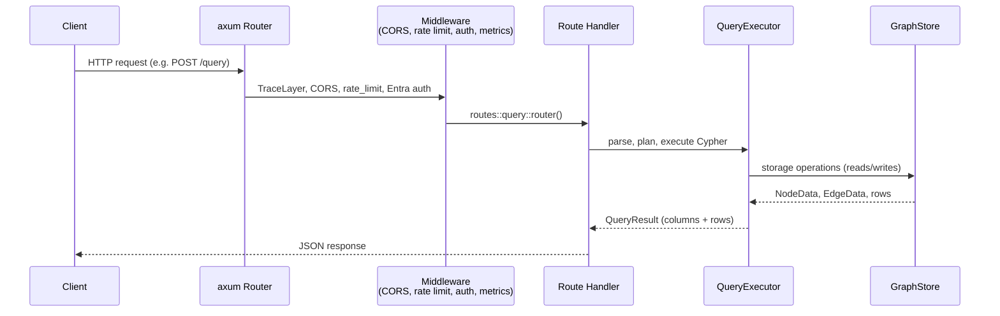
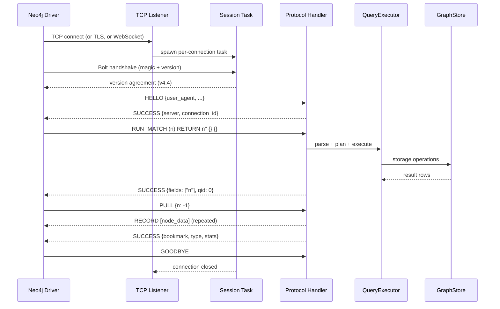
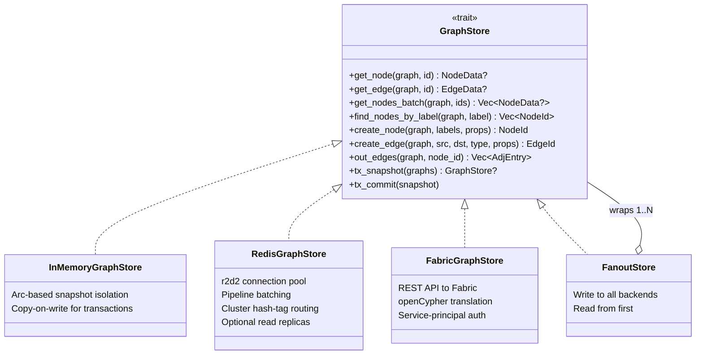

# Architecture Overview

SedanDelivery is a Cypher-compatible graph database engine written in Rust. It provides two network interfaces (REST API and Bolt protocol), a hand-written Cypher parser, a cost-based query planner, and pluggable storage backends including Redis, in-memory, and Microsoft Fabric.

## Contents

- [Crate Map](#crate-map)
- [Request Flow -- REST API](#request-flow----rest-api)
- [Request Flow -- Bolt Protocol](#request-flow----bolt-protocol)
- [Query Pipeline](#query-pipeline)
- [Storage Layer](#storage-layer)
- [Key Design Decisions](#key-design-decisions)
- [Directory Structure](#directory-structure)

## Crate Map

The workspace contains 8 crates. Arrows point from dependent to dependency.



## Request Flow -- REST API

The REST API is an axum HTTP server on port 3001 (default). It exposes CRUD endpoints for nodes, edges, graphs, Cypher queries, schema inspection, neighbor traversal, and export/import.



Middleware stack (applied bottom-up):
1. `TraceLayer` -- structured request/response logging
2. `CorsLayer` -- origin allowlist from `GQL_API_ALLOWED_ORIGINS`
3. `track_http_metrics` -- Prometheus request counters and latency histograms
4. `rate_limit_middleware` -- per-IP token bucket (`GQL_API_RATE_LIMIT_RPS`)
5. `require_entra_auth` -- JWT validation via Microsoft Entra ID

## Request Flow -- Bolt Protocol

The Bolt server listens on port 7687 (default) and speaks Neo4j Bolt v4.4. Any standard Neo4j driver (Python, .NET, Java, Go, JavaScript, Rust) connects directly.



Connection lifecycle:
- Semaphore-gated concurrency (`BOLT_MAX_CONNECTIONS`, default 1024)
- Idle timeout reaping (`BOLT_IDLE_TIMEOUT_SECS`, default 3600)
- Explicit transactions via BEGIN/COMMIT/ROLLBACK with snapshot isolation
- Write concurrency semaphore for transaction contention (`BOLT_WRITE_CONCURRENCY`)

## Query Pipeline

Every Cypher query passes through the same pipeline regardless of entry point (REST API, Bolt, Redis module, or CLI).

```mermaid
flowchart LR
    A["Cypher text"] --> B["Lexer<br/><code>parser::lexer</code>"]
    B --> C["Token stream"]
    C --> D["Parser<br/><code>parser::parser</code>"]
    D --> E["AST<br/><code>ast::Query</code>"]
    E --> F["Validator<br/><code>planner::validator</code>"]
    F --> G["Planner<br/><code>planner::QueryPlanner</code>"]
    G --> H["Operator tree<br/>(28 physical operators)"]
    H --> I["Executor<br/><code>executor::QueryExecutor</code>"]
    I --> J["Result rows<br/><code>QueryResult</code>"]
```



Key pipeline components:

- **Lexer** -- hand-written tokenizer; strict mode (`lex_query`) and lenient mode (`tokenize`) for IDE tooling.
- **Parser** -- recursive-descent parser. Handles Cypher's context-dependent `|` (label disjunction, rel-type disjunction, list comprehension pipe).
- **Validator** -- checks semantic correctness (undefined variables, invalid aggregation scoping).
- **Planner** -- translates AST clauses into a tree of 28 physical operators (NodeScan, IndexScan, Expand, VarLenExpand, Filter, Aggregate, ShortestPath, Create, Merge, etc.). Uses cardinality estimation from graph statistics for EXPLAIN output.
- **Executor** -- walks the operator tree, calls `GraphStore` methods, enforces budget limits (`GQL_QUERY_TIMEOUT_MS`, `GQL_QUERY_MAX_ROWS`).
- **Plan cache** -- LRU cache keyed by query text, avoids re-parsing and re-planning identical queries.

## Storage Layer

All storage access goes through the `GraphStore` trait defined in `gql-core::storage`. This is the core abstraction boundary -- the engine never talks to Redis, Fabric, or memory directly.



Backend selection at startup (`gql-redis-store::create_store`):
1. `GQL_REDIS_CLUSTER_NODES` set -- `RedisGraphStore` in cluster mode
2. `GQL_REDIS_URL` set -- `RedisGraphStore` in standalone mode
3. Neither set -- `InMemoryGraphStore` (volatile, for local dev/tests)

Redis key schema uses `{graphname}` hash tags for cluster slot affinity:
```
G:{graph}:node:{id}      -- node hash (labels JSON, props JSON)
G:{graph}:edge:{id}      -- edge hash (src, dst, rel_type, props JSON)
G:{graph}:label:{label}  -- SADD of node IDs with that label
G:{graph}:out:{node_id}  -- SADD of "edge_id:neighbor_id:rel_type"
G:{graph}:in:{node_id}   -- SADD (reverse adjacency)
```

## Key Design Decisions

- **Hand-written parser, not lalrpop.** Cypher's `|` is context-dependent (label disjunction vs. rel-type disjunction vs. list comprehension pipe). A generated parser cannot resolve this without semantic context. See ADR-003.

- **InMemory + WAL, not an embedded database.** The Redis module runs inside the Redis/Valkey process. The `InMemoryGraphStore` keeps graph data in-process with zero serialization overhead. Persistence comes from Redis RDB/AOF or the Fabric sync sidecar, not from an embedded storage engine.

- **Bolt v4.4 for Neo4j driver compatibility.** v4.4 is the most widely supported version across Neo4j drivers (Python, .NET, Java, Go, JavaScript, Rust). It supports multi-database, bookmarks, explicit transactions, EXPLAIN/PROFILE, and streaming PULL with qid-based multiplexing.

- **Synchronous `GraphStore` trait.** All trait methods are synchronous because the Redis module runs on Redis's single-threaded event loop. Async I/O happens at the network layer (Bolt/API servers), not at the storage layer.

- **`FanoutStore` for multi-backend writes.** Rather than coupling backends, writes fan out through a simple wrapper. This enables patterns like Redis (fast reads) + Fabric (durable analytics) without modifying either backend.

- **u64 node/edge IDs.** Chosen over u32 to avoid silent overflow at 4.29B entities. Redis INCR returns i64; the storage layer rejects values <= 0 as overflow. See ADR-001.

## Directory Structure

```
SedanDelivery/
  gql-core/                    Core engine (no external dependencies)
    src/
      ast/                       Cypher AST types
      parser/
        lexer.rs                 Hand-written tokenizer
        parser.rs                Recursive-descent parser
      planner/
        planner.rs               AST-to-operator-tree translation
        validator.rs             Semantic validation
        mod.rs                   28 physical operator definitions
      executor/
        engine/                  Operator evaluation (scan, expand, join, etc.)
        filter/                  Predicate evaluation, built-in functions
        traversal/               Graph traversal (BFS, shortest path)
        budget.rs                Timeout and row-limit enforcement
      storage/
        mod.rs                   GraphStore trait + InMemoryGraphStore
      plan_cache.rs              LRU query plan cache
      types/                     Value type system (Bool, Int, Float, String, List, Map, etc.)

  gql-redis-store/             Redis/Valkey storage backend
    src/
      lib.rs                     RedisGraphStore implementation
      fanout.rs                  FanoutStore (multi-backend writes)
      create_store.rs            Backend selection from env vars
      connection.rs              r2d2 pool, replica routing
      reads.rs / writes.rs       Redis command implementations

  gql-fabric-store/            Microsoft Fabric storage backend
    src/
      lib.rs                     FabricGraphStore
      store.rs                   GraphStore trait implementation
      auth.rs                    Azure AD token acquisition
      parsing.rs                 Fabric JSON response parsing

  gql-module/                  Valkey/Redis loadable module (.so)
    src/lib.rs                   GQL.QUERY, GQL.MUTATE, GQL.CREATE-GRAPH, etc.

  gql-api/                     HTTP REST API
    src/
      main.rs                    axum server setup
      routes/                    Endpoint handlers (nodes, edges, query, etc.)
      auth.rs                    Entra ID JWT validation
      rate_limit.rs              Per-IP rate limiting
      metrics.rs                 Prometheus metrics

  sedandelivery-bolt/          Bolt v4.4 protocol server
    src/
      main.rs                    TCP accept loop, TLS, WebSocket
      connection/session.rs      Per-connection session lifecycle
      protocol/handler/          Message dispatch (HELLO, RUN, PULL, BEGIN, etc.)
      protocol/state.rs          Session state machine
      message/codec.rs           Bolt binary framing
      packstream/                PackStream v1 serialization

  sedandelivery-fabric-sync/   Changelog replication sidecar
    src/main.rs                  Polls Redis changelog stream, pushes to Fabric

  gql-cli/                     Interactive CLI demo
    src/main.rs                  REPL for local testing

  sdk/                         Client SDKs (Python, .NET, Rust)
  docs/                        Documentation
```
