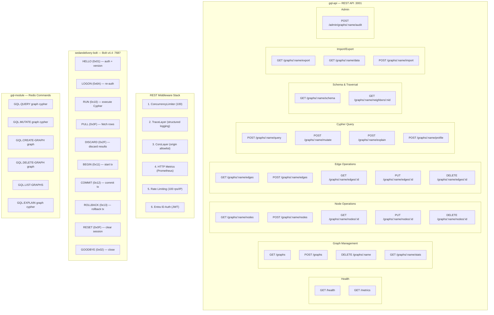

# API Contracts

Exhaustive inventory of all API entry points across SedanDelivery's three network interfaces:
REST API (gql-api), Bolt Protocol (sedandelivery-bolt), and Redis Module commands (gql-module).

## API Surface Diagram

### Mermaid

See [routing.mmd](routing.mmd) and [routing.dot](routing.dot) for diagram sources.

## REST API Route Inventory

| Method | Path | Handler | Auth | Request Body | Response |
|--------|------|---------|------|-------------|----------|
| GET | /health | health_handler | None | — | 200 OK |
| GET | /metrics | metrics | None | — | Prometheus text |
| GET | /graphs | list_graphs | Entra JWT | — | JSON array |
| POST | /graphs | create_graph | Entra JWT | `{ name }` | 201 Created |
| DELETE | /graphs/:name | delete_graph | Entra JWT | — | 200 OK |
| GET | /graphs/:name/stats | graph_stats | Entra JWT | — | JSON stats |
| GET | /graphs/:name/nodes | list_nodes | Entra JWT | — | JSON array |
| POST | /graphs/:name/nodes | create_node | Entra JWT | `{ labels, properties }` | JSON node |
| GET | /graphs/:name/nodes/:id | get_node | Entra JWT | — | JSON node |
| PUT | /graphs/:name/nodes/:id | update_node | Entra JWT | `{ properties }` | JSON node |
| DELETE | /graphs/:name/nodes/:id | delete_node | Entra JWT | — | 200 OK |
| GET | /graphs/:name/edges | list_edges | Entra JWT | — | JSON array |
| POST | /graphs/:name/edges | create_edge | Entra JWT | `{ src, dst, type, props }` | JSON edge |
| GET | /graphs/:name/edges/:id | get_edge | Entra JWT | — | JSON edge |
| PUT | /graphs/:name/edges/:id | update_edge | Entra JWT | `{ properties }` | JSON edge |
| DELETE | /graphs/:name/edges/:id | delete_edge | Entra JWT | — | 200 OK |
| POST | /graphs/:name/query | query_handler | Entra JWT | `{ query, params }` | QueryResult |
| POST | /graphs/:name/mutate | mutate_handler | Entra JWT | `{ query, params }` | QueryResult |
| POST | /graphs/:name/explain | explain_handler | Entra JWT | `{ query }` | Plan text |
| POST | /graphs/:name/profile | profile_handler | Entra JWT | `{ query }` | Profile data |
| GET | /graphs/:name/schema | schema_handler | Entra JWT | — | JSON schema |
| GET | /graphs/:name/neighbors/:nid | neighbors_handler | Entra JWT | — | JSON neighbors |
| GET | /graphs/:name/export | export_handler | Entra JWT | — | JSON full graph |
| GET | /graphs/:name/data | export_handler | Entra JWT | — | JSON data only |
| POST | /graphs/:name/import | import_handler | Entra JWT | JSON graph data | 200 OK |
| POST | /admin/graphs/:name/audit | audit_handler | Entra JWT | — | Audit report |

## Bolt Protocol Messages

| Message | Tag | Handler File | Purpose |
|---------|-----|-------------|---------|
| HELLO | 0x01 | handler/hello.rs:226 | Version negotiation + auth |
| LOGON | 0x6A | handler/hello.rs:264 | Re-authenticate session |
| RUN | 0x10 | handler/run.rs:535 | Execute Cypher query |
| PULL | 0x3F | handler/pull.rs:18 | Fetch result rows |
| DISCARD | 0x2F | handler/pull.rs:217 | Discard pending results |
| BEGIN | 0x11 | handler/transaction.rs:19 | Start explicit transaction |
| COMMIT | 0x12 | handler/transaction.rs:66 | Commit transaction |
| ROLLBACK | 0x13 | handler/transaction.rs:98 | Rollback transaction |
| RESET | 0x0F | handler/transaction.rs:121 | Clear session state |
| GOODBYE | 0x02 | — | Close connection |

## Redis Module Commands

| Command | Args | Handler | Read/Write |
|---------|------|---------|------------|
| GQL.QUERY | `<graph> <cypher>` | cmd_gql_query (lib.rs:193) | Read-only |
| GQL.MUTATE | `<graph> <cypher>` | cmd_gql_mutate (lib.rs:243) | Write |
| GQL.CREATE-GRAPH | `<graph>` | cmd_gql_create_graph (lib.rs:302) | Write |
| GQL.DELETE-GRAPH | `<graph>` | cmd_gql_delete_graph (lib.rs:334) | Write |
| GQL.LIST-GRAPHS | — | cmd_gql_list_graphs (lib.rs:365) | Read-only |
| GQL.EXPLAIN | `<graph> <cypher>` | cmd_gql_explain (lib.rs:385) | Read-only |

## Auth Configuration

| Interface | Auth Method | Config |
|-----------|------------|--------|
| REST API | Microsoft Entra ID JWT | `GQL_API_ENTRA_TENANT_ID`, `GQL_API_ENTRA_CLIENT_ID` |
| Bolt | Password-based | `BOLT_PASSWORD` |
| Redis Module | Redis ACL / `requirepass` | `VALKEY_PASSWORD` |
