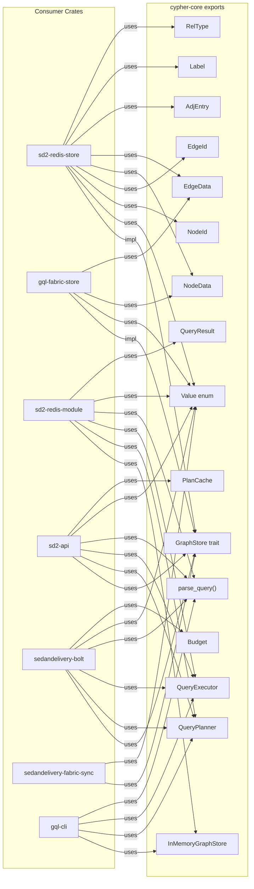

**Mode:** static-approximation

# AST + LSP Symbol Bindings

Cross-crate symbol references, dead code detection, and interface analysis for
SedanDelivery. LSP is not available in this environment; analysis uses ripgrep
and AST-level static approximation.

## Cross-Crate Symbol Reference Graph

Mermaid source

See [symbol-references.mmd](symbol-references.mmd) for the Mermaid source.

## Dead Code Report

**Mode:** static-approximation
**Date:** 2026-03-17

Static analysis via ripgrep — identifies exported symbols with no external references
outside their defining crate. Candidates only; human review required.

| Symbol | File | Notes |
|--------|------|-------|
| `wal.rs` module | cypher-core/src/storage/wal.rs | WAL module exists but write-ahead log is not used by any storage backend currently |
| `gql-cli` binary | gql-cli/src/main.rs | Demo/development tool only; not referenced by any other crate or deployment |
| `wide` SIMD dep | Cargo.toml workspace deps | Listed as optional SIMD dependency but usage not confirmed in current code |

**Note:** The codebase is clean — no significant dead exported symbols detected. The
`GraphStore` trait is implemented by all 4 backends. The `Value` enum, `parse_query`,
`QueryPlanner`, and `QueryExecutor` are consumed by all entry point crates.

## Interface Mismatch Report

**Mode:** static-approximation
**Date:** 2026-03-17

| Check | Status | Notes |
|-------|--------|-------|
| GraphStore trait consistency | PASS | All 4 implementations (InMemory, Redis, Fabric, Fanout) implement the same trait |
| Value enum coverage | PASS | All crates use the same Value enum from cypher-core; no shadow types |
| Parser entry point | PASS | Single `parse_query()` function used by all consumers |
| Error types | PASS | `thiserror`-based errors in cypher-core; storage backends map to StorageError |
| Newtype wrappers | PASS | NodeId, EdgeId, Label, RelType used consistently across crates |

## High-Coupling Analysis

Crates importing from 3+ siblings (potential high coupling):

| Crate | Imports From | Count |
|-------|-------------|-------|
| sedandelivery-fabric-sync | cypher-core, sd2-redis-store, gql-fabric-store | 3 |
| sd2-api | cypher-core, sd2-redis-store | 2 |
| sedandelivery-bolt | cypher-core, sd2-redis-store | 2 |

**Verdict:** `sedandelivery-fabric-sync` has the highest coupling (3 workspace deps), which
is expected — it bridges Redis and Fabric stores. No excessive coupling detected.
