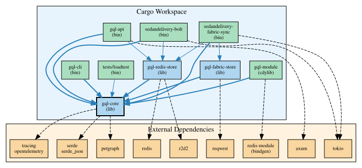
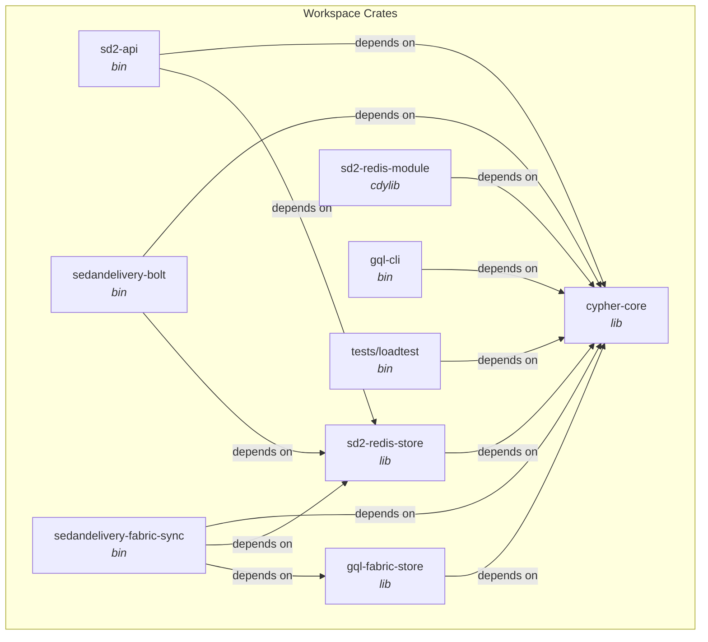

# Compile-time Dependencies

Cargo workspace dependency graph for SedanDelivery — 8 crates plus a loadtest binary.

## Workspace Dependency Graph

Mermaid source

See [dependencies.mmd](dependencies.mmd) and [dependencies.dot](dependencies.dot) for diagram sources.

## External Dependencies

### Shared (workspace-level)

| Crate | Version | Purpose | License |
|-------|---------|---------|---------|
| thiserror | 2.0 | Error derive macros | MIT/Apache-2.0 |
| indexmap | 2.0 | Ordered hash maps | MIT/Apache-2.0 |
| rustc-hash | 2.0 | Fast hashing | MIT/Apache-2.0 |
| regex | 1.10 | Pattern matching | MIT/Apache-2.0 |
| typed-arena | 2.0 | Arena allocation | MIT |
| jiff | 0.2 | Temporal types | MIT |
| smol_str | 0.3 | Short inline strings | MIT/Apache-2.0 |
| petgraph | 0.8 | Graph algorithms | MIT/Apache-2.0 |
| serde | 1.0 | Serialization | MIT/Apache-2.0 |
| serde_json | 1.0 | JSON support | MIT/Apache-2.0 |
| tracing | 0.1 | Structured logging | MIT |
| tokio | 1 | Async runtime | MIT |

### Per-Crate Key Dependencies

| Crate | Key Dependencies |
|-------|-----------------|
| cypher-core | regex, typed-arena, jiff, smol_str, petgraph, indexmap |
| sd2-redis-store | redis, r2d2, cypher-core |
| gql-fabric-store | reqwest, cypher-core |
| sd2-redis-module | redis-module (bindgen, requires libclang), cypher-core |
| sd2-api | axum, tower, tower-http, hyper, cypher-core, sd2-redis-store |
| sedandelivery-bolt | tokio, cypher-core, sd2-redis-store |
| sedandelivery-fabric-sync | tokio, cypher-core, sd2-redis-store, gql-fabric-store |

### Dev/Test Dependencies

| Crate | Version | Purpose |
|-------|---------|---------|
| proptest | 1.6 | Property-based testing |
| criterion | 0.8 | Benchmarking |
| insta | 1.40 | Snapshot testing |
| cucumber | 0.22 | BDD/TCK tests |

## Dependency Policy

- All dependencies must be MIT or Apache-2.0 licensed
- No GPL, LGPL, or SSPL dependencies permitted
- Shared versions pinned in workspace `[workspace.dependencies]`
- Members reference shared deps with `{ workspace = true }`

## Circular Dependencies

**None detected.** The dependency graph is a clean DAG with `cypher-core` as the leaf.
