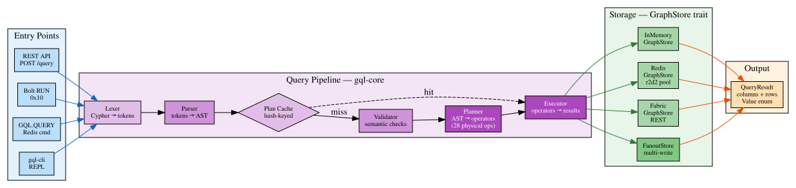
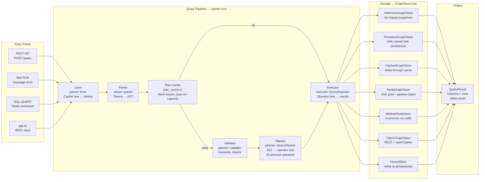
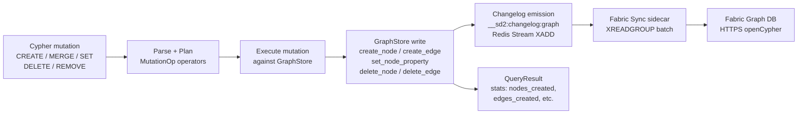
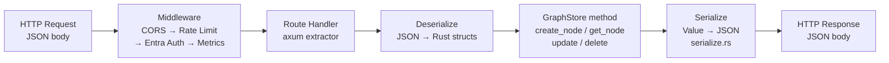

# Data Flow

Data transformation chains from API entry to storage and back for SedanDelivery.

## Query Pipeline Flow

All Cypher queries follow the same pipeline regardless of entry point (REST, Bolt, Redis module, CLI).

Mermaid source

See [dataflow.mmd](dataflow.mmd) and [dataflow.dot](dataflow.dot) for diagram sources.

## Mutation Data Flow

## REST CRUD Data Flow

## Redis Key Schema (Data at Rest)

| Key Pattern | Type | Contents |
|-------------|------|----------|
| `G:{graph}:node:{id}` | HASH | labels (JSON), props (JSON) |
| `G:{graph}:edge:{id}` | HASH | src, dst, rel_type, props (JSON) |
| `G:{graph}:label:{label}` | SET | Node IDs with that label |
| `G:{graph}:out:{node_id}` | SET | `edge_id:neighbor_id:rel_type` adjacency |
| `G:{graph}:in:{node_id}` | SET | Reverse adjacency |
| `G:{graph}:_nextid` | STRING | Auto-increment counter |
| `G:{graph}:_labels` | SET | All label names in graph |
| `G:{graph}:_reltypes` | SET | All relationship type names |
| `G:{graph}:_propidx:{label}:{prop}` | SET | Property index entries |
| `G:{graph}:write_lock` | STRING | Distributed write lock |
| `__sd2_registry:graphs` | SET | All graph names |
| `__sd2:changelog:{graph}` | STREAM | Mutation changelog for Fabric sync |

## Value Type System

The `Value` enum in `cypher-core::types::Value` is the unified value type:

| Variant | Rust Type | Use |
|---------|-----------|-----|
| Null | — | Missing values |
| Bool | bool | Boolean properties |
| Integer | i64 | Integer properties |
| Float | f64 | Floating point |
| String | Box\<str\> | String properties |
| List | Vec\<Value\> | List values |
| Map | IndexMap | Map/dictionary values |
| Node | NodeData | Full node with labels + props |
| Relationship | EdgeData | Full edge with type + props |
| Path | PathData | Graph path result |
| Date/Time/DateTime | jiff types | Temporal values |
| Duration | jiff Duration | Duration values |
| Point2D/Point3D | f64 coords | Spatial values |
