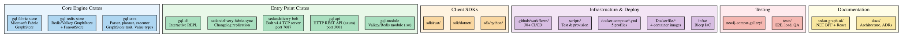
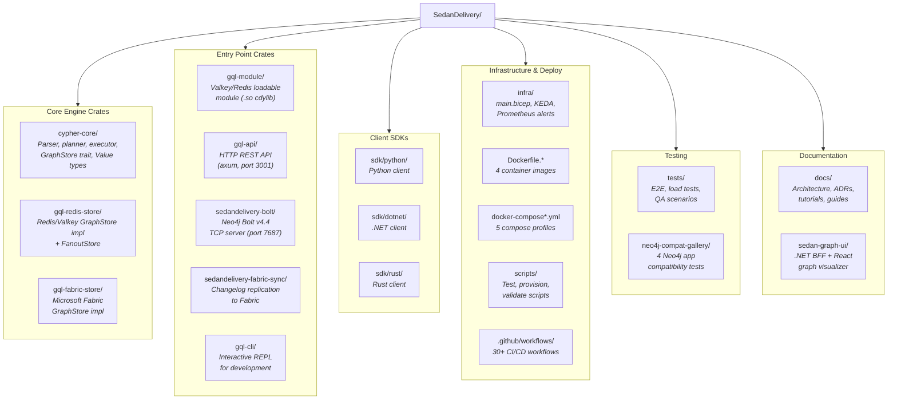

# Repository Surface

Overview of the SedanDelivery repository structure — a Rust openCypher query engine
that runs as a Redis/Valkey module with Bolt v4.4 and REST API servers.

## Repository Structure Diagram

Mermaid source

See [repo-surface.mmd](repo-surface.mmd) and [repo-surface.dot](repo-surface.dot) for diagram sources.

## Build System

- **Language**: Rust (edition 2021)
- **Build**: Cargo workspace with 9 members (8 crates + loadtest)
- **License**: MIT OR Apache-2.0
- **Release profile**: LTO fat, opt-level 3, codegen-units 1, symbols stripped
- **Dev profile**: opt-level 1 (arena-heavy code)

## Key Configuration Files

| File | Purpose |
|------|---------|
| `Cargo.toml` | Workspace root with shared dependency versions |
| `Cargo.lock` | Lockfile for reproducible builds |
| `rustfmt.toml` | Formatting configuration |
| `clippy.toml` | Clippy lint configuration |
| `.pre-commit-config.yaml` | Pre-commit hooks |
| `docs/_config.yml` | Jekyll GitHub Pages configuration |
