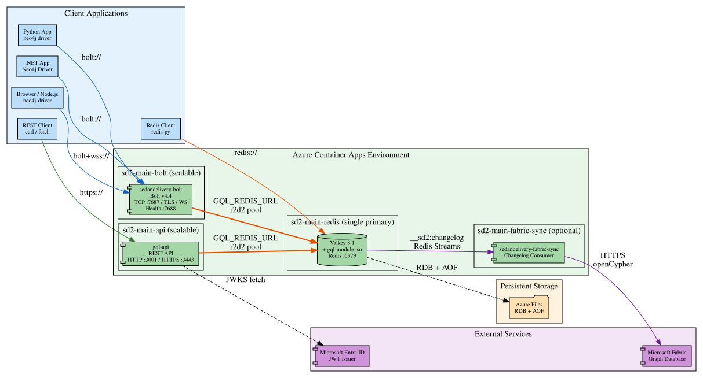
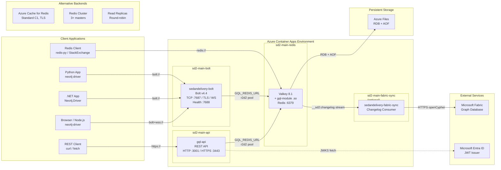

# Runtime Topology

Services, containers, ports, and inter-service connections for SedanDelivery.

## Deployment Architecture

SedanDelivery deploys as 2–4 containers in an Azure Container Apps environment.
Each component is independently scalable except the Valkey primary.

Mermaid source

See [topology.mmd](topology.mmd) and [topology.dot](topology.dot) for diagram sources.

## Docker Compose Profiles

| Profile | File | Services | Purpose |
|---------|------|----------|---------|
| **Standalone** | `docker-compose.yml` | Valkey + Bolt | Local development |
| **Cluster** | `docker-compose.cluster.yml` | 6 Redis nodes + Bolt | Redis Cluster testing |
| **Replica** | `docker-compose.replica.yml` | Master + 2 replicas + Bolt | Read-replica routing |
| **Scale** | `docker-compose.scale-test.yml` | Valkey + 2 Bolt instances | Multi-instance safety |
| **Chaos** | `docker-compose.chaos-test.yml` | Valkey + Toxiproxy + 2 Bolt | Fault injection |

## Port Map

| Service | Protocol | Port | Purpose |
|---------|----------|------|---------|
| Valkey/Redis | TCP | 6379 | Graph storage (primary) |
| Valkey replicas | TCP | 6380, 6381 | Read replicas |
| Bolt server | Bolt/TCP | 7687 | Neo4j client connections |
| Bolt health | HTTP | 7688 | Health checks + Prometheus |
| Bolt instance 2 | Bolt/TCP | 7689 | Scale-test second instance |
| GQL API | HTTP | 3001 | REST API |
| GQL API TLS | HTTPS | 3443 | REST API (TLS) |
| Toxiproxy | HTTP | 8474 | Chaos admin API |

## Connection Patterns

- **Bolt clients** → TCP/TLS/WebSocket → `sedandelivery-bolt:7687`
- **REST clients** → HTTP/HTTPS → `gql-api:3001/3443`
- **Bolt/API servers** → `GQL_REDIS_URL` (r2d2 pool) → `Valkey:6379`
- **Cluster mode** → `GQL_REDIS_CLUSTER_NODES` → multiple Redis nodes
- **Replica reads** → `GQL_REDIS_REPLICA_URL` → round-robin across replicas
- **Fabric sync** → Redis Streams (`__sd2:changelog:{graph}`) → HTTPS → Fabric
- **Auth** → Entra ID JWKS endpoint (async, cached)

## Infrastructure (Azure Bicep)

| Resource | Purpose |
|----------|---------|
| VNet + NSG | Network isolation |
| Azure Container Registry | Docker image storage |
| Container Apps Environment | Managed container hosting |
| Azure Storage + File Share | Persistent Valkey data |
| Log Analytics Workspace | Monitoring + diagnostics |
| KEDA ScaledObjects | Auto-scaling (connections, latency metrics) |

### Persistence Backends (Bicep param: `persistenceBackend`)

| Mode | Description |
|------|-------------|
| `valkey-volume` | Azure Files volume mount for RDB/AOF |
| `azure-cache` | Azure Cache for Redis Standard C1 |
| `azure-cache-cluster` | Azure Cache with clustering (1-10 shards) |
