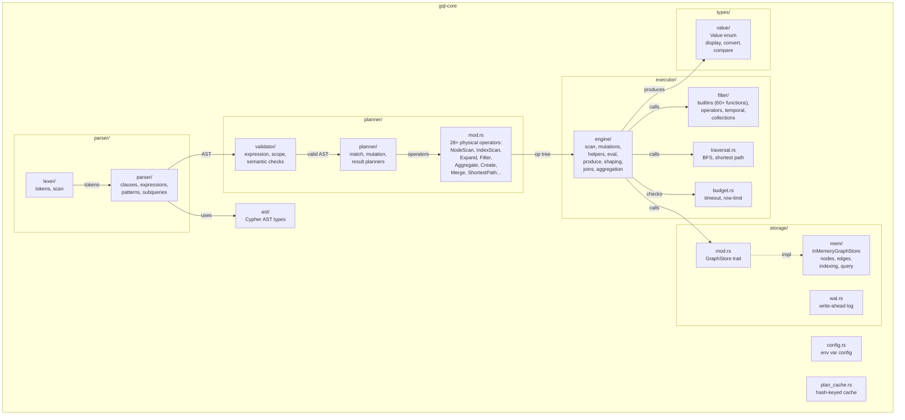
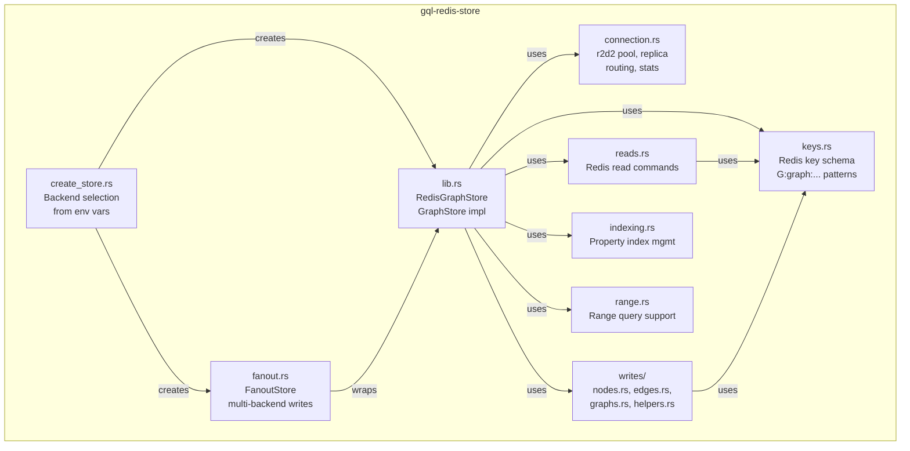
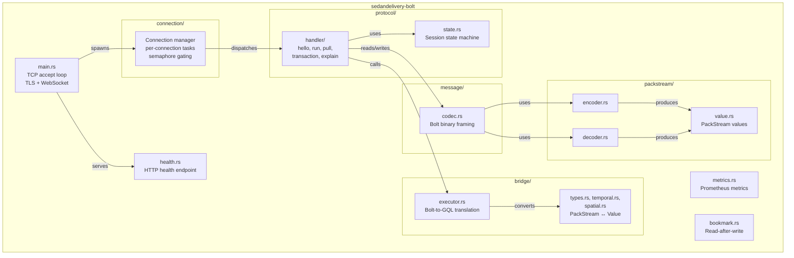
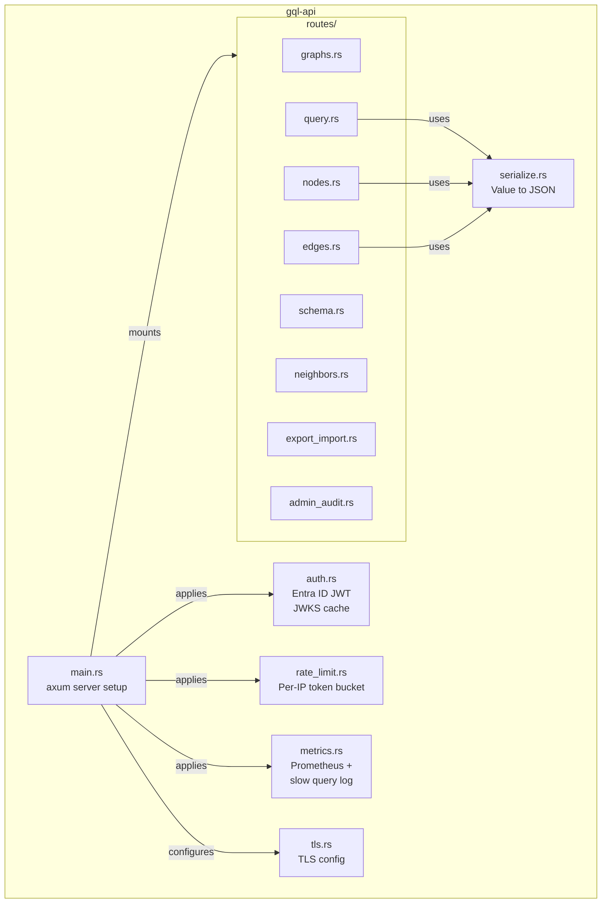
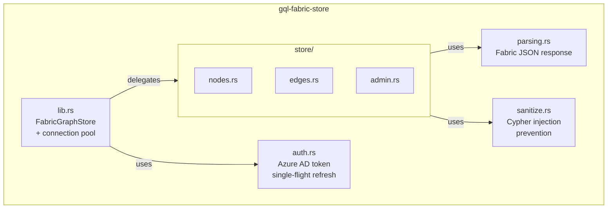

# Service Component Architecture

Per-crate internal module structure for the 5 major SedanDelivery crates.
Each crate with 3+ internal modules gets its own diagram.

## gql-core — Query Engine Core

See [gql-core.mmd](gql-core.mmd) for the Mermaid source.

## gql-redis-store — Redis Storage Backend

See [gql-redis-store.mmd](gql-redis-store.mmd) for the Mermaid source.

## sedandelivery-bolt — Bolt Protocol Server

See [sedandelivery-bolt.mmd](sedandelivery-bolt.mmd) for the Mermaid source.

## gql-api — REST API Server

See [gql-api.mmd](gql-api.mmd) for the Mermaid source.

## gql-fabric-store — Fabric Storage Backend

See [gql-fabric-store.mmd](gql-fabric-store.mmd) for the Mermaid source.
