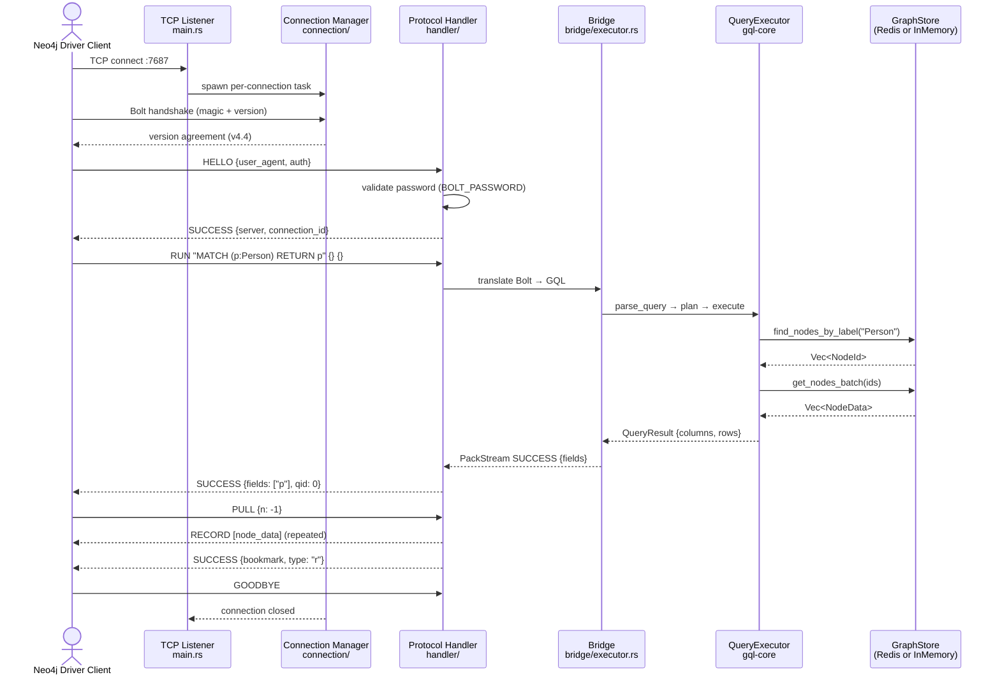
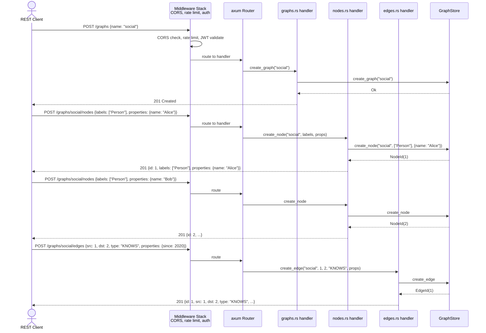
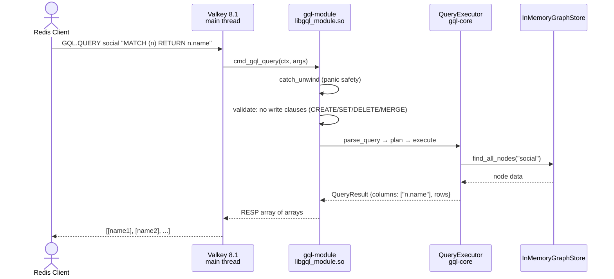
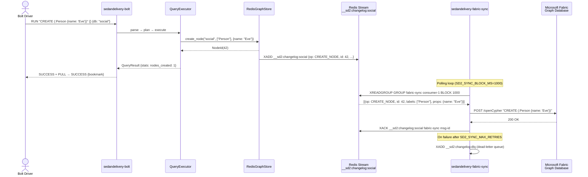
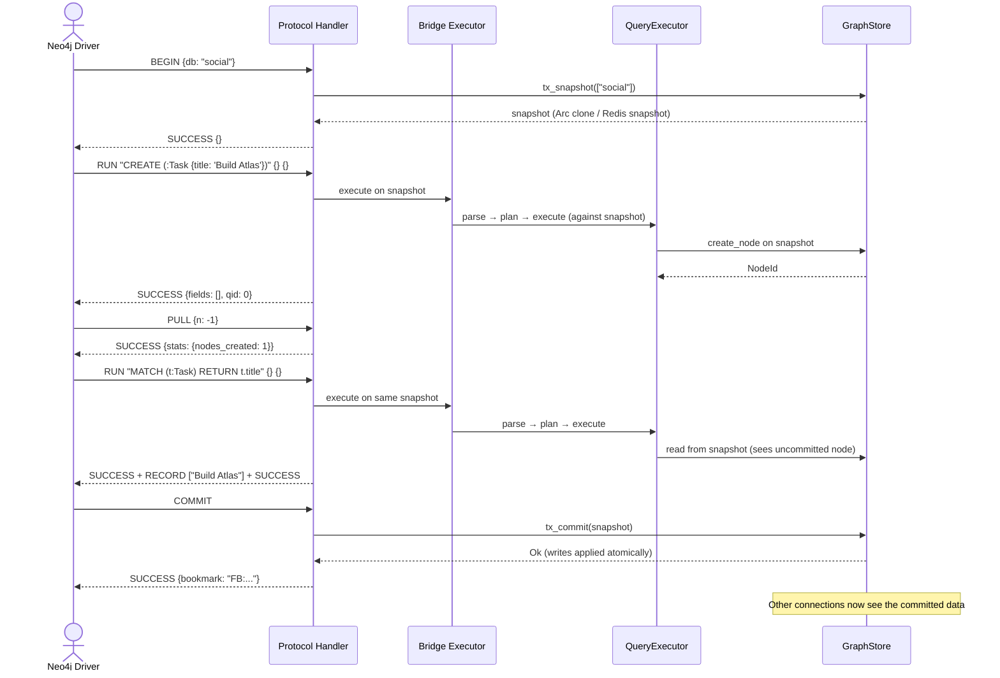

# User Journey Scenarios

5 key end-to-end paths traced through the SedanDelivery system, from client entry
to final outcome.

## Journey 1: Bolt Client Executes a Cypher Query

See [journey-bolt-query.mmd](journey-bolt-query.mmd).

## Journey 2: REST Client Creates a Graph and Adds Data

See [journey-rest-crud.mmd](journey-rest-crud.mmd).

## Journey 3: Redis Module Processes GQL.QUERY

See [journey-redis-query.mmd](journey-redis-query.mmd).

## Journey 4: Fabric Sync Replicates a Mutation

See [journey-fabric-sync.mmd](journey-fabric-sync.mmd).

## Journey 5: Explicit Transaction with Snapshot Isolation

See [journey-explicit-tx.mmd](journey-explicit-tx.mmd).
