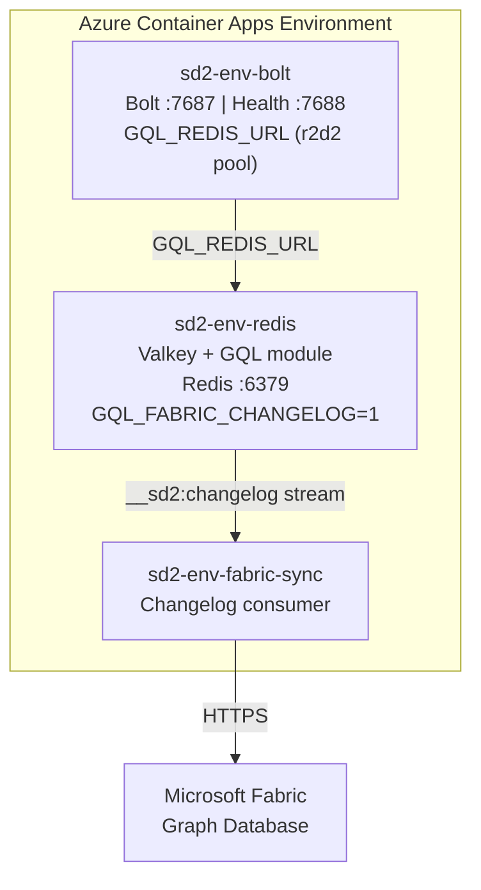

# SedanDelivery Documentation

A Rust GQL/Cypher query engine — a clean-room, MIT/Apache-2.0-licensed replacement for RedisGraph/FalkorDB.

## Guides

- [**Architecture Overview**](architecture) — Crate map, request flows, query pipeline, storage layer, and key design decisions
- [**Deploy Your Own Instance**](DEPLOY) — Full production deployment guide: prerequisites, Azure setup, scaling, HA, troubleshooting
- [**Auto-Scaling Guide**](auto-scaling) — Horizontal scaling: architecture, write safety, KEDA metrics, connection lifecycle, testing, and configuration reference
- [**Redis Cluster Mode**](cluster-mode) — Deploy against Redis Cluster: setup, validation, slot-local routing, and resharding checks
- [**Cluster Write Safety**](cluster-write-safety) — How cluster-safe pipeline dispatch, registry-backed metadata, and the delete size guard avoid routing failures and unsafe oversized graph deletion
- [**Admin API**](admin-api) — Operational HTTP reference for the Redis-backed metadata audit route
- [**Graph Metadata Audit**](graph-metadata-audit) — Why `_labels`/`_reltypes`/`_propidx` registries drift, two-phase staleness detection, repair semantics, and conservative `_deleting` reporting
- [**Read-After-Write Routing**](read-after-write-routing) — 5-second freshness window that pins Bolt session reads to the primary after a write, including explicit-transaction behavior, non-default database routing, and the executed outside-in validator
- [**Routing Context API**](routing-context-api) — `ReadConsistency`, `GraphStore::with_read_consistency(...)`, `route_read`, `route_read_for_graph`, and `READ_AFTER_WRITE_WINDOW` reference for store implementors and test authors
- [**Redis Key Schema**](redis-key-schema) — Complete reference for Redis keys, hash-tag contract, adjacency encoding, and metadata registries
- [Tutorial](TUTORIAL) — Getting started with SedanDelivery
- [Fabric Graph Tutorial](FABRIC_TUTORIAL) — Deploy, write data, query in Fabric portal, REST API, and monitoring
- [Validation Guide](validation) — Full test suite: what was validated, how to re-run, CI tiers, benchmark baselines
- [Authentication (Entra ID)](auth) — Configure JWT auth for the REST API
- [Secrets Configuration](secrets) — Repository secrets inventory, creation, rotation, and monitoring
- [Benchmarks](benchmarks) — How to run and interpret performance benchmarks

## Code Atlas

- [**Code Atlas**](atlas/) — Living architecture documentation with 8 layers of diagrams, cross-crate analysis, and bug hunt reports

## Neo4j Compatibility

- [**Neo4j Compatibility Gallery**](neo4j-compat-gallery) — 4 security apps validated against SedanDelivery's Bolt v4.4 protocol with screenshots (Neodash, neovis.js, GraphKer CVE explorer, Network Security analyzer)

## Deployment

SedanDelivery deploys to Azure Container Apps via GitHub Actions.

### Quick Deploy

1. Create a PR from your feature branch
2. Add the `deploy` label to the PR
3. The deployment workflow provisions an isolated Azure environment:
   - Azure Container Registry (ACR) for the Docker image
   - Container Apps Environment with persistent storage (Azure Files)
   - Valkey container with the GQL module loaded
4. A bot comment posts the Redis and Bolt endpoints plus the Bolt password retrieval command when deployment completes
5. Remove the `deploy` label or run the **Undeploy** workflow to clean up

### Infrastructure

| Resource | Purpose |
|----------|---------|
| Azure Container Registry | Stores Docker images (Valkey, Bolt, Fabric sync) |
| Azure Storage Account + File Share | Persistent data volume for Valkey RDB/AOF |
| Container Apps Environment | Managed container hosting |
| Container App: Valkey + GQL module | Redis server with graph query engine (port 6379) |
| Container App: sedandelivery-bolt | Standalone Bolt server (port 7687), scalable |
| Azure Cache for Redis (optional) | Managed HA Redis backend with replication + failover |

### Storage Backends

SedanDelivery supports multiple storage backends via the `GraphStore` trait:

| Backend | Crate | Use Case |
|---------|-------|----------|
| `InMemoryGraphStore` | `gql-core` | Default in-module store, tests |
| `RedisGraphStore` | `gql-redis-store` | External Redis/Valkey via TCP |
| `FabricGraphStore` | `gql-fabric-store` | Microsoft Fabric Graph Database |
| `FanoutStore` | `gql-redis-store` | Write to multiple backends simultaneously |

### Distributed Mode (ADR-004)

When `GQL_REDIS_URL` is set, the Bolt server uses `RedisGraphStore` with an r2d2
connection pool to connect to an external Redis/Valkey backend. This enables:

- **HA**: Azure Cache for Redis Standard C1 with active-passive replication
- **Connection pooling**: r2d2 pool (default 16 connections, configurable)
- **Multi-instance scaling**: Multiple bolt replicas sharing the same Redis backend

When `GQL_REDIS_URL` is unset, the Bolt server uses `InMemoryGraphStore` with
full transaction isolation (identical to pre-distributed behavior).

See [ADR-004](ADR-004-distributed-redis) for the full architecture decision record.

### Environment Variables

| Variable | Default | Description |
|----------|---------|-------------|
| `BOLT_BIND_ADDR` | `0.0.0.0:7687` | Bolt TCP listen address |
| `BOLT_PASSWORD` | — | Bolt auth password. Required in `ENVIRONMENT=production`; Azure Container Apps deploys auto-generate and reuse the `bolt-password` Container App secret |
| `BOLT_TLS_CERT` | — | PEM certificate chain file for in-process Bolt TLS; must be set together with `BOLT_TLS_KEY`; Azure Container Apps deploys mount this as `/mnt/secrets/bolt-tls-cert` |
| `BOLT_TLS_KEY` | — | PEM private key file for in-process Bolt TLS; must be set together with `BOLT_TLS_CERT`; Azure Container Apps deploys mount this as `/mnt/secrets/bolt-tls-key` |
| `BOLT_REQUIRE_TLS` | `false` | Refuse startup unless in-process Bolt TLS is configured; Azure Container Apps deploys set this to `true` for the public Bolt endpoint |
| `BOLT_WS_ALLOWED_ORIGINS` | — | Comma-separated browser origins allowed to use Bolt over WebSocket; when set, a matching `Origin` header is required and `*` allows any origin |
| `BOLT_MAX_CONNECTIONS` | `1024` | Max concurrent Bolt connections |
| `BOLT_MAX_CONN_PER_IP` | `50` | Max concurrent connections from a single IP (DoS protection) |
| `BOLT_HANDSHAKE_TIMEOUT_MS` | `5000` | Max time (ms) to complete TLS handshake before slot is reclaimed |
| `BOLT_IDLE_TIMEOUT_SECS` | `300` | Close idle connections after N seconds (short default aids L4 load-balancer rebalancing) |
| `BOLT_MAX_CONNECTION_LIFETIME_SECS` | `1800` | Force-close connections after N seconds regardless of activity (0 = disabled); periodic reconnection aids L4 load balancing |
| `BOLT_WRITE_CONCURRENCY` | `128` | Max concurrent write transactions |
| `BOLT_AUTH_MAX_ATTEMPTS` | `10` | Max failed auth attempts per IP per window before rate limiting |
| `BOLT_AUTH_WINDOW_SECS` | `60` | Auth rate limit sliding window duration (seconds) |
| `GQL_REDIS_URL` | — | Redis/Valkey URL; when set, bolt uses Redis-backed store (use `rediss://` for TLS with Azure Cache) |
| `GQL_REDIS_CLUSTER_NODES` | — | Comma-separated cluster seed URLs (enables Redis Cluster mode, overrides `GQL_REDIS_URL`) |
| `GQL_REDIS_REPLICA_URL` | — | Comma-separated replica URLs for read-only query routing (round-robin) |
| `GQL_REDIS_POOL_SIZE` | `64` | r2d2 connection pool max size |
| `GQL_REDIS_POOL_TIMEOUT_SECS` | `5` | Pool checkout timeout in seconds |
| `GQL_REDIS_IDLE_TIMEOUT_SECS` | `300` | Idle connection reap timeout in seconds |
| `GQL_REDIS_MIN_IDLE` | `1` | Minimum warm connections kept in pool |
| `GQL_REDIS_KEY_PREFIX` | — | Key prefix for multi-tenant isolation |
| `GQL_FABRIC_ENDPOINT` | — | Fabric Graph Database REST API URL |
| `GQL_FABRIC_TENANT_ID` | — | Azure AD tenant for Fabric auth |
| `GQL_FABRIC_CLIENT_ID` | — | Service principal app ID for Fabric |
| `GQL_FABRIC_CLIENT_SECRET` | — | Service principal secret for Fabric |
| `GQL_FABRIC_TIMEOUT_SECS` | `10` | HTTP timeout for Fabric API calls |
| `VALKEY_PASSWORD` | — | Password for Valkey authentication (injected at runtime) |

### gql-api (REST API)

| Variable | Default | Description |
|----------|---------|-------------|
| `GQL_API_BIND_ADDR` | `0.0.0.0:3001` | HTTP listen address |
| `GQL_API_ALLOWED_ORIGINS` | `localhost:5000,5173` | Comma-separated CORS origins |
| `GQL_API_ENTRA_TENANT_ID` | — | Entra ID tenant for JWT auth (required in production) |
| `GQL_API_ENTRA_CLIENT_ID` | — | App registration client ID for JWT audience validation |
| `GQL_API_RATE_LIMIT_RPS` | `100` | Max requests per second per client (rate limiting) |
| `GQL_API_MAX_CONCURRENCY` | `100` | Max concurrent HTTP requests per replica; excess requests receive HTTP 503 |
| `GQL_API_IMPORT_BODY_LIMIT_BYTES` | `2097152` | Max import request body size (bytes) |
| `ENVIRONMENT` | — | Set to `production` to enforce auth and CORS config |

### GQL Engine Limits

| Variable | Default | Description |
|----------|---------|-------------|
| `GQL_QUERY_TIMEOUT_MS` | `30000` | Max query execution time (ms). Min: 1 |
| `GQL_QUERY_MAX_ROWS` | `10000000` | Max intermediate rows per query. Min: 1 |
| `GQL_VARLEN_MAX_DEPTH` | `30` | Default max depth for `[*]` patterns. Min: 1 |
| `GQL_MAX_QUERY_SIZE` | `67108864` | Max query string size (bytes). Min: 1 |
| `GQL_PARSER_MAX_DEPTH` | `256` | Max expression nesting depth. Min: 1 |

## Bolt Protocol (Recommended)

SedanDelivery includes a built-in Neo4j Bolt v4.4 server (`sedandelivery-bolt`). Any standard Neo4j driver connects directly — no custom SDK needed.

```bash
# Build and run the Bolt server
cargo run -p sedandelivery-bolt
# Listens on 0.0.0.0:7687 (configure via BOLT_BIND_ADDR env var)
# Optional auth via BOLT_PASSWORD env var
```

### Python (neo4j driver)
```bash
pip install neo4j
```
```python
from neo4j import GraphDatabase

driver = GraphDatabase.driver("bolt://localhost:7687", auth=None)
with driver.session() as session:
    session.run("CREATE (:Person {name: 'Alice', age: 30})")
    result = session.run("MATCH (p:Person) RETURN p.name AS name, p.age AS age")
    for record in result:
        print(record["name"], record["age"])
driver.close()
```

### .NET (Neo4j.Driver)
```bash
dotnet add package Neo4j.Driver
```
```csharp
using Neo4j.Driver;

var driver = GraphDatabase.Driver("bolt://localhost:7687", AuthTokens.None);
await using var session = driver.AsyncSession();
await session.RunAsync("CREATE (:Person {name: 'Alice', age: 30})");
var result = await session.RunAsync("MATCH (p:Person) RETURN p.name AS name, p.age AS age");
await foreach (var record in result)
    Console.WriteLine($"{record["name"].As<string>()} {record["age"].As<long>()}");
```

### Rust (neo4rs)
```toml
[dependencies]
neo4rs = "0.8"
tokio = { version = "1", features = ["full"] }
```
```rust
use neo4rs::*;

let graph = Graph::connect(
    ConfigBuilder::default()
        .uri("bolt://localhost:7687")
        .user("").password("").build()?
).await?;
graph.run(query("CREATE (:Person {name: 'Alice', age: 30})")).await?;
let mut result = graph.execute(
    query("MATCH (p:Person) RETURN p.name AS name, p.age AS age")
).await?;
while let Some(row) = result.next().await? {
    println!("{} {}", row.get::<String>("name")?, row.get::<i64>("age")?);
}
```

### Java, Go, JavaScript
Any Neo4j driver that supports Bolt 4.2-4.4 works. See the [Neo4j Driver Manual](https://neo4j.com/docs/create-applications/) for your language.

Browser clients that connect over WebSocket must set `BOLT_WS_ALLOWED_ORIGINS` to an explicit allowlist such as `https://app.example.com`; otherwise SedanDelivery rejects requests carrying an `Origin` header.

### Configuration

| Variable | Default | Description |
|----------|---------|-------------|
| `BOLT_BIND_ADDR` | `0.0.0.0:7687` | Bolt TCP listen address |
| `BOLT_PASSWORD` | (none) | Optional for direct bolt runs; local Compose profiles default it from `VALKEY_PASSWORD` unless overridden |
| `BOLT_WS_ALLOWED_ORIGINS` | (none) | Comma-separated WebSocket origin allowlist; when set, requests must send a matching `Origin` header |

See [Bolt Protocol Spec](specs/sedandelivery-bolt-spec) for implementation details.

## Custom Client SDKs (Redis protocol)

For direct Redis protocol access, SedanDelivery also provides custom client libraries:

### Python
```bash
pip install sedandelivery   # or: pip install -e sdk/python
```
```python
from sedandelivery import SedanDB
db = SedanDB(host="localhost", password="secret")
g = db.select_graph("social")
g.create()
g.mutate("CREATE (:Person {name: $name})", name="Alice")
for r in g.query("MATCH (n) RETURN n.name"):
    print(r["name"])
```

### .NET
```bash
dotnet add package SedanDelivery.Client
```
```csharp
using var db = new SedanDB("localhost:6379,password=secret");
var g = db.SelectGraph("social");
g.Create();
g.Mutate("CREATE (:Person {name: $name})", new { name = "Alice" });
foreach (var r in g.Query("MATCH (n) RETURN n.name"))
    Console.WriteLine(r.Get<string>("name"));
```

### Rust
```toml
[dependencies]
sedan-client = { path = "sdk/rust/sedan-client" }
```
```rust
let db = SedanDB::new("redis://localhost:6379")?;
let mut g = db.select_graph("social")?;
g.create()?;
g.mutate("CREATE (:Person {name: 'Alice'})")?;
for record in g.query("MATCH (n) RETURN n.name")? {
    println!("{}", record.get_str("name").unwrap());
}
```

See [sdk/README.md](../sdk/README.md) for the full Redis-protocol SDK API reference.

## Fabric Graph Replication

`ENABLE_FABRIC` is **`true` by default** in `deploy.yml`. Every deployment provisions a
[Microsoft Fabric Graph Database](https://learn.microsoft.com/fabric/) workspace alongside
the Container App and deploys a `sedandelivery-fabric-sync` sidecar that continuously
replicates graph mutations to Fabric.

**Architecture:**



**What you get:**

- **Low-latency reads** from the co-located Valkey container
- **Durable, queryable graph** in Fabric for analytics and cross-service joins
- **Automatic provisioning** via `scripts/provision-fabric.sh`
- **Portal query editor** -- run openCypher queries directly in Fabric

The Fabric endpoint and credentials are injected as Container App environment variables
(`GQL_FABRIC_ENDPOINT`, `GQL_FABRIC_TENANT_ID`, `GQL_FABRIC_CLIENT_ID`) with the client
secret stored as a Container App secret (`secretref:fabric-client-secret`).

See the [Fabric Graph Tutorial](FABRIC_TUTORIAL) for a complete walkthrough: deploying,
writing data, viewing in the Fabric portal, REST API access, and monitoring replication.

## Testing

- [**Load Test Tool**](../tests/loadtest/README.md) — Rust binary for scale validation (node creation, connection ramp, mixed read/write)
- [**QA Scenario Runner**](../tests/qa/) — QA scenarios and gadugi YAML definitions (`b1-write-safety.yaml`, `b2-advanced-scaling.yaml`, `b3-data-layer.yaml`, `b4-observability.yaml`)
- `docker-compose.chaos-test.yml` — Chaos testing with toxiproxy (network partition, latency injection)
- `docker-compose.scale-test.yml` — Multi-instance testing (2+ Bolt replicas sharing Redis)
- `scripts/test-network-partition.sh` — Network partition resilience test via toxiproxy
- `scripts/test-scale-down-drain.sh` — Graceful scale-down drain test (3 to 1 replicas under load)
- `scripts/test-resharding-resilience.sh` — Redis Cluster resharding resilience test under write load

## Source Code

- [GitHub Repository](https://github.com/cloud-ecosystem-security/SedanDelivery)

## Internal

- [Design decisions](https://github.com/cloud-ecosystem-security/SedanDelivery/tree/main/docs) (ADRs)
  - [ADR-004: Distributed Redis](ADR-004-distributed-redis)
  - [ADR-005: Redis Cluster Routing Safety](ADR-005-cluster-pipeline-atomicity) — cluster-aware pipeline dispatch plus registry-backed metadata paths (Issue #745)
