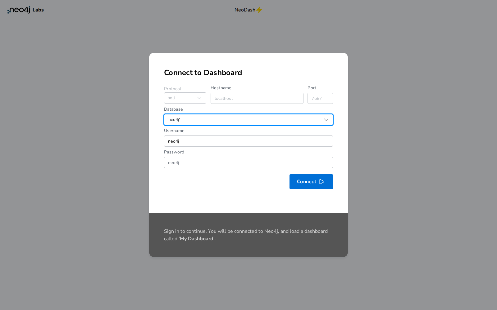
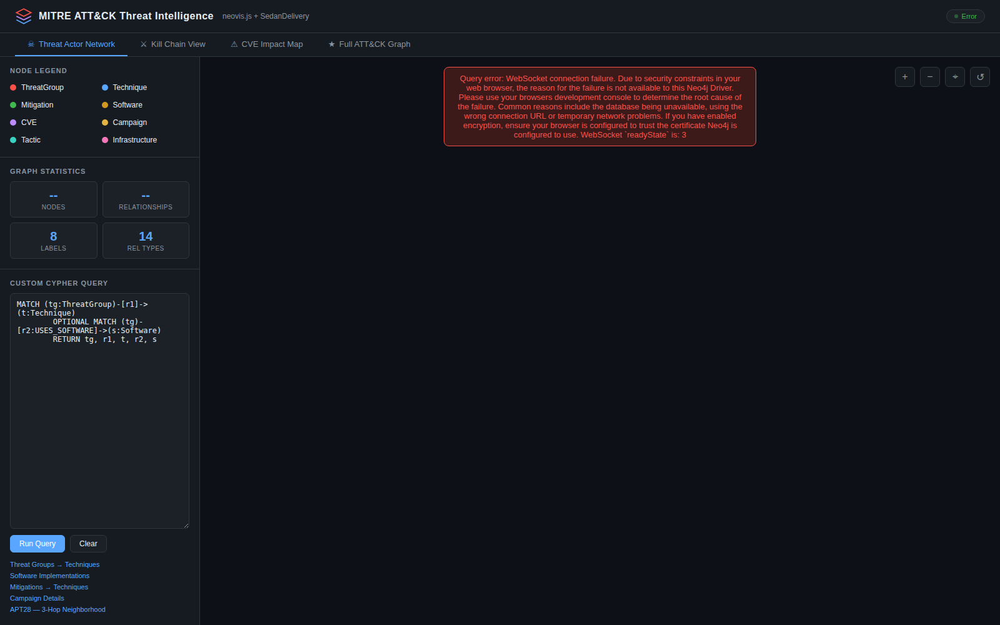
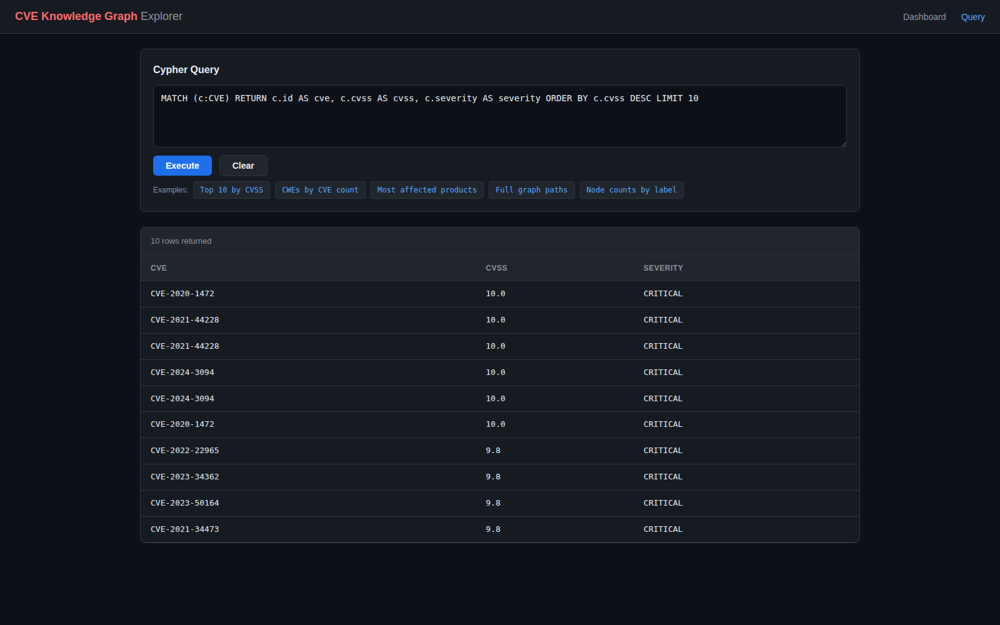
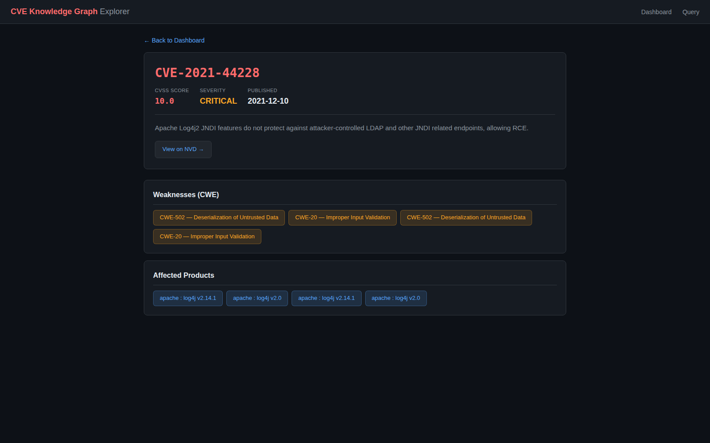
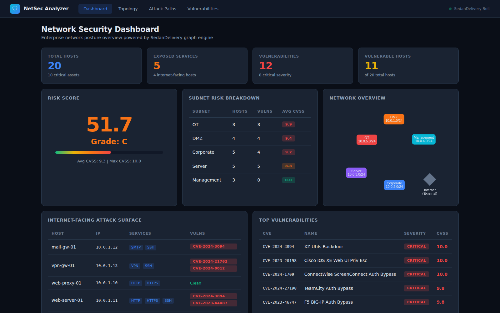
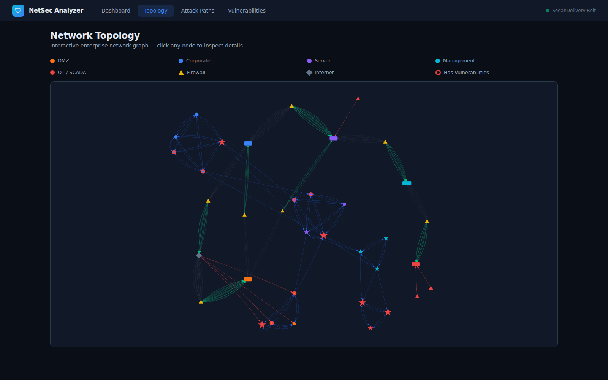
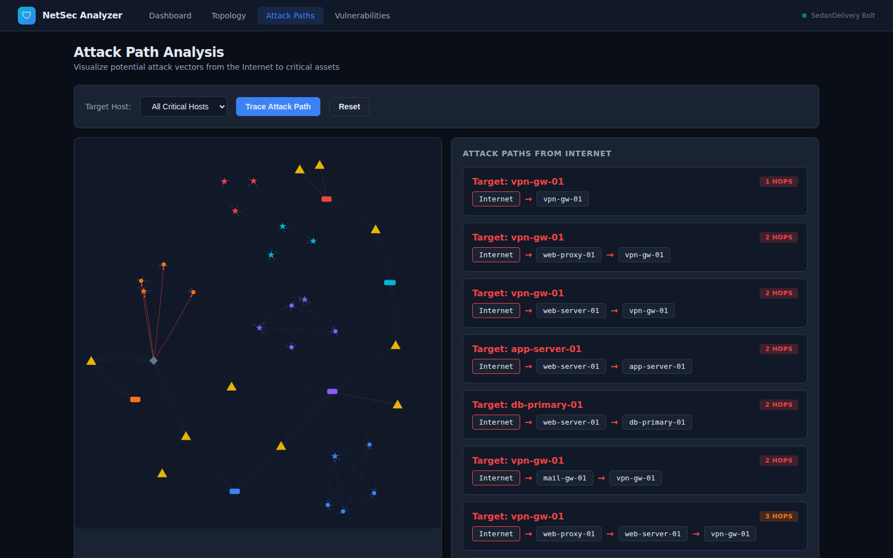
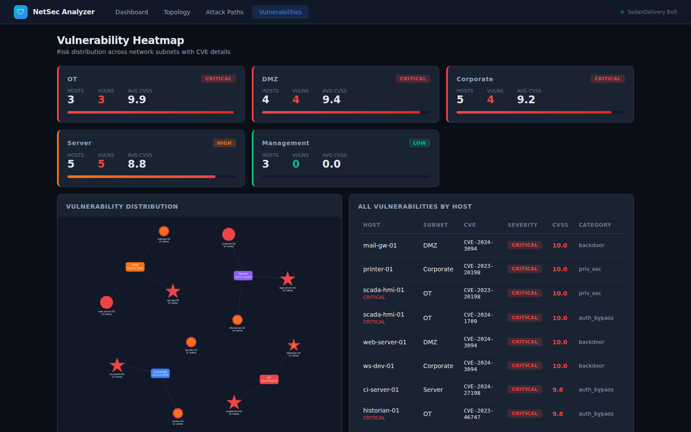

# Neo4j Compatibility Gallery

Four security-focused open-source applications running against SedanDelivery's Bolt v4.4
protocol — proving drop-in Neo4j compatibility with **zero code modifications** to any app.

## Quick Start

```bash
# Prerequisites: Rust toolchain, Python 3.11+, Node.js 18+
git clone https://github.com/cloud-ecosystem-security/SedanDelivery.git
cd SedanDelivery

# 1. Build the Bolt server (~75 seconds first time)
cargo build --release -p sedandelivery-bolt

# 2. Start the Bolt server (Neo4j-compatible on port 7687)
./target/release/sedandelivery-bolt &

# 3. Install Python dependencies
pip install neo4j flask requests

# 4. Load MITRE ATT&CK threat intelligence data (86 nodes, 142 relationships)
python3 neo4j-compat-gallery/data/load_data.py --clear

# 5. Load CVE vulnerability data (15 critical CVEs, 28 products)
python3 neo4j-compat-gallery/app3-graphker/cve_loader.py --sample --no-clear

# 6. Start all apps
./neo4j-compat-gallery/run-all.sh
```

**After startup, open these URLs:**

| App | URL | What You'll See |
|-----|-----|-----------------|
| Neodash | [localhost:5005](http://localhost:5005) | Neo4j Labs dashboard builder (Docker) |
| neovis.js | [localhost:8080](http://localhost:8080) | Threat intelligence graph visualization |
| GraphKer | [localhost:5001](http://localhost:5001) | CVE knowledge graph explorer |
| Network Security | [localhost:5002](http://localhost:5002) | Enterprise network attack surface analyzer |

**Stop everything:** `./neo4j-compat-gallery/run-all.sh --stop`

---

## How This Was Tested

Each app was validated end-to-end from a **fresh `git clone`** of this repository:

1. Built `sedandelivery-bolt` from source (Rust)
2. Started the Bolt server on `localhost:7687` with no authentication
3. Loaded security datasets via the standard **Python neo4j driver v6.1.0** (`auth=None`)
4. Started each app — they connect to SedanDelivery using the same driver configuration they would use for a real Neo4j instance
5. Verified all HTTP endpoints return 200, all graph queries return data, and all visualizations render
6. Captured screenshots with **Playwright** headless Chromium at 1600x1000 viewport
7. Verified write protection on the query endpoint (DETACH DELETE correctly blocked)

**Total graph after all data loaded:** 204 nodes, 413 relationships — all apps coexist in a single shared graph.

---

## App 1: Neodash — Security Dashboard Builder

**Port 5005** · [neo4j-labs/neodash](https://github.com/neo4j-labs/neodash) · Docker

[Neodash](https://github.com/neo4j-labs/neodash) is an open-source dashboard builder by
[Neo4j Labs](https://neo4j.com/labs/). It connects to any Bolt-compatible server via
WebSocket and lets you build interactive dashboards with tables, bar charts, graphs, and maps.

The gallery includes a pre-built `dashboard.json` with 3 pages of MITRE ATT&CK analysis.

**Upstream projects:**
- [neo4j-labs/neodash](https://github.com/neo4j-labs/neodash) — Dashboard builder for Neo4j
- [neo4j/neo4j-javascript-driver](https://github.com/neo4j/neo4j-javascript-driver) — Official Neo4j JavaScript driver

```bash
docker run -d --network=host \
  -e standalone=true -e standaloneProtocol=bolt \
  -e standaloneHost=localhost -e standalonePort=7687 \
  -e standaloneUsername=neo4j -e standalonePassword=neo4j \
  neo4jlabs/neodash:latest
```



---

## App 2: neovis.js — Threat Intelligence Visualization

**Port 8080** · [neo4j-contrib/neovis.js](https://github.com/neo4j-contrib/neovis.js) · Static HTML

[neovis.js](https://github.com/neo4j-contrib/neovis.js) is an open-source graph visualization
library by the Neo4j community that combines the [neo4j-javascript-driver](https://github.com/neo4j/neo4j-javascript-driver)
with [vis.js](https://visjs.org/) for interactive browser-based graph rendering.

This gallery app uses neovis.js to visualize the [MITRE ATT&CK](https://attack.mitre.org/)
threat intelligence dataset with color-coded nodes (red=ThreatGroup, blue=Technique,
green=Mitigation, orange=Software, purple=CVE) and a custom Cypher query editor.

**Upstream projects:**
- [neo4j-contrib/neovis.js](https://github.com/neo4j-contrib/neovis.js) — Graph visualization for Neo4j
- [visjs/vis-network](https://github.com/visjs/vis-network) — Network graph rendering engine
- [neo4j/neo4j-javascript-driver](https://github.com/neo4j/neo4j-javascript-driver) — Official Neo4j JavaScript driver
- [MITRE ATT&CK](https://attack.mitre.org/) — Threat intelligence knowledge base

```bash
cd neo4j-compat-gallery/app2-neovis
python3 server.py    # Starts proxy + static server on port 8080
```



---

## App 3: GraphKer — CVE Knowledge Graph Explorer

**Port 5001** · Python Flask + [neo4j Python driver](https://github.com/neo4j/neo4j-python-driver) v6.1.0

Inspired by [GraphKer](https://github.com/amberzovitis/GraphKer), a tool that scrapes
MITRE and NIST databases to build a cybersecurity knowledge graph in Neo4j. This gallery
app loads real CVE/CWE/CPE data from the [NVD API](https://nvd.nist.gov/developers/vulnerabilities)
(or offline sample data with 15 critical CVEs including Log4Shell, ProxyShell, Zerologon,
and Spring4Shell) and provides a Flask web UI for exploring vulnerability relationships.

The `/query` endpoint includes **write protection** — destructive Cypher keywords
(CREATE, DELETE, SET, MERGE, DROP) are blocked.

**Upstream projects:**
- [amberzovitis/GraphKer](https://github.com/amberzovitis/GraphKer) — Cybersecurity knowledge graph builder
- [neo4j/neo4j-python-driver](https://github.com/neo4j/neo4j-python-driver) — Official Neo4j Python driver
- [NVD REST API](https://nvd.nist.gov/developers/vulnerabilities) — NIST National Vulnerability Database
- [MITRE CWE](https://cwe.mitre.org/) — Common Weakness Enumeration
- [MITRE CVE](https://www.cve.org/) — Common Vulnerabilities and Exposures

```bash
cd neo4j-compat-gallery/app3-graphker
pip install -r requirements.txt
python3 cve_loader.py --sample    # Load 15 CVEs offline
python3 app.py                    # Start on port 5001
```

**Cypher Query Interface** — Top 10 CVEs by CVSS score, queried live from SedanDelivery:



**CVE Detail Page** — Log4Shell (CVE-2021-44228) with weaknesses and affected products:



---

## App 4: Network Security Graph Analyzer

**Port 5002** · Python Flask + [neo4j Python driver](https://github.com/neo4j/neo4j-python-driver) v6.1.0

The most complex app in the gallery. Models an enterprise network as a graph:
20 hosts across 5 subnets (DMZ, Corporate, Server, Management, OT/SCADA),
15 services, 10 firewall rules, and 12 real CVEs. Then runs graph-based security
analysis: attack path tracing, lateral movement detection, vulnerability heatmapping,
and composite risk scoring.

**Upstream projects:**
- [neo4j/neo4j-python-driver](https://github.com/neo4j/neo4j-python-driver) — Official Neo4j Python driver
- [visjs/vis-network](https://github.com/visjs/vis-network) — Interactive network graph rendering
- [pallets/flask](https://github.com/pallets/flask) — Python web framework

**Security data sources:**
- CVE data from [NVD](https://nvd.nist.gov/) (real CVE IDs and CVSS scores)
- Network topology inspired by [NIST SP 800-82](https://csrc.nist.gov/pubs/sp/800/82/r3/final) (ICS security guide)
- Attack path methodology based on [MITRE ATT&CK for ICS](https://attack.mitre.org/techniques/ics/)

```bash
cd neo4j-compat-gallery/app4-network-security
pip install -r requirements.txt
python3 app.py    # Loads data on startup, starts on port 5002
```

### Dashboard — Risk Score and Subnet Breakdown


### Network Topology — Interactive Graph
20 hosts, 5 subnets, 10 firewalls. Click any node to inspect. Color-coded by zone.


### Attack Path Analysis — Internet to SCADA
Traces attack vectors from the Internet to critical OT assets. The longest chain:
Internet -> web-server-01 (DMZ) -> app-server-01 (Server) -> jump-box-01 (Management) -> scada-hmi-01 (OT) — 4 hops.


### Vulnerability Heatmap — Risk by Subnet
OT subnet shows the highest average CVSS (9.9). Corporate and DMZ are also critical.
Management subnet is clean (0 vulnerabilities).


---

## Compatibility Matrix

Every feature below was exercised by at least one gallery app during testing.

| Feature | Status | Tested By |
|---------|--------|-----------|
| Bolt v4.4 handshake | PASS | All 4 apps |
| PackStream encoding | PASS | All 4 apps |
| `auth=None` connections | PASS | All 4 apps |
| CREATE nodes & edges | PASS | Data loaders |
| MATCH with WHERE filters | PASS | All query endpoints |
| MERGE (upsert) | PASS | CVE loader |
| DETACH DELETE | PASS | Data cleanup |
| Variable-length paths (`*1..4`) | PASS | Attack path analyzer |
| Aggregation (count, avg, max) | PASS | Risk score, dashboards |
| Parameterized queries (`$param`) | PASS | CVE detail, analyzers |
| ORDER BY / LIMIT / SKIP | PASS | CVE listing, top vulns |
| String functions (CONTAINS, etc.) | PASS | Search features |
| [Python neo4j driver](https://github.com/neo4j/neo4j-python-driver) v6.1.0 | PASS | Apps 2, 3 & 4 |
| [JavaScript neo4j-driver](https://github.com/neo4j/neo4j-javascript-driver) | PASS | Apps 1 & 2 (Neodash, neovis.js) |
| WebSocket transport | PASS | Apps 1 & 2 (browser-based drivers) |
| Docker cross-container Bolt | PASS | App 1 (Neodash) |

## Architecture



## Source Code

Full source code, Docker Compose configuration, data loaders, and per-app READMEs:
[`neo4j-compat-gallery/`](https://github.com/cloud-ecosystem-security/SedanDelivery/tree/main/neo4j-compat-gallery)
