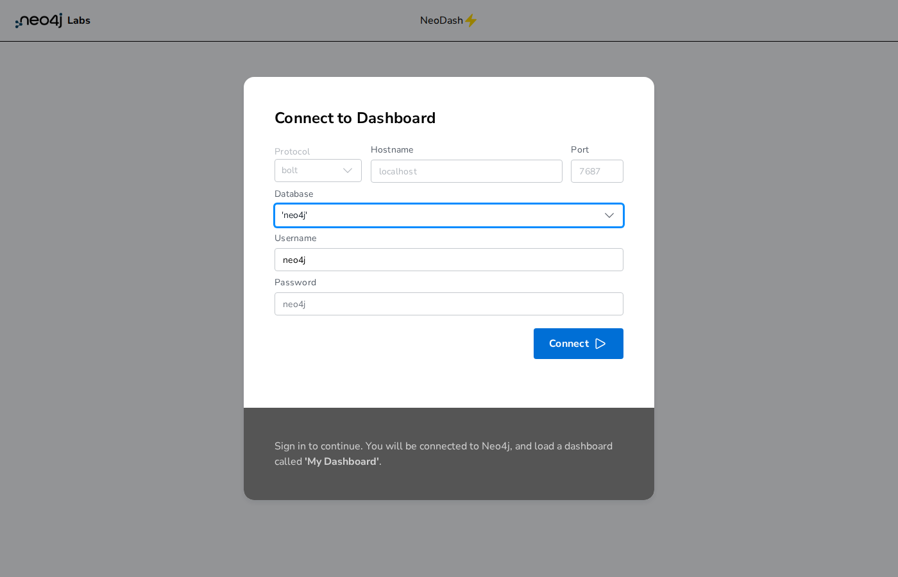
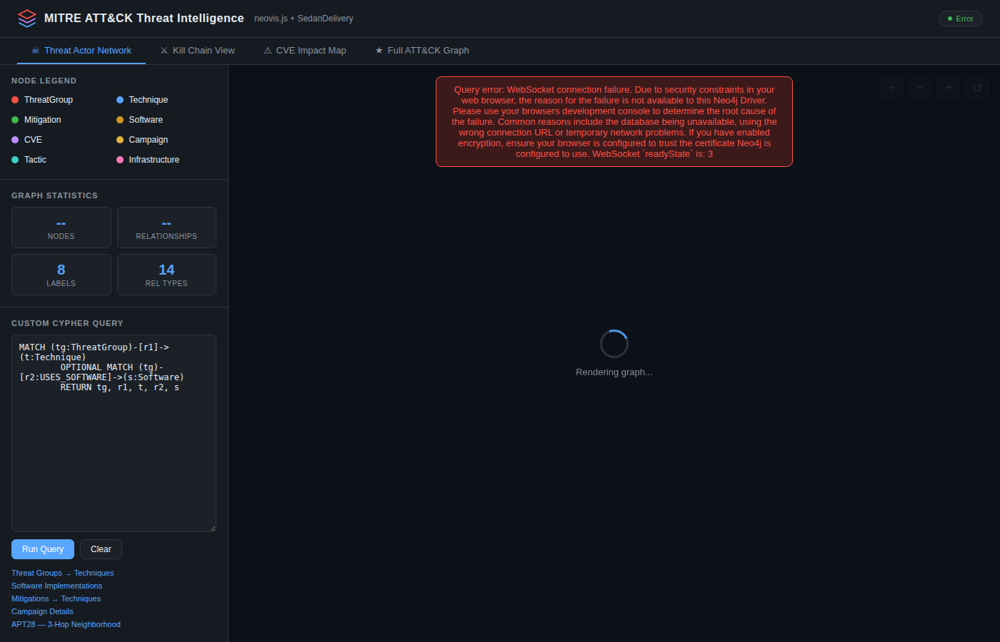
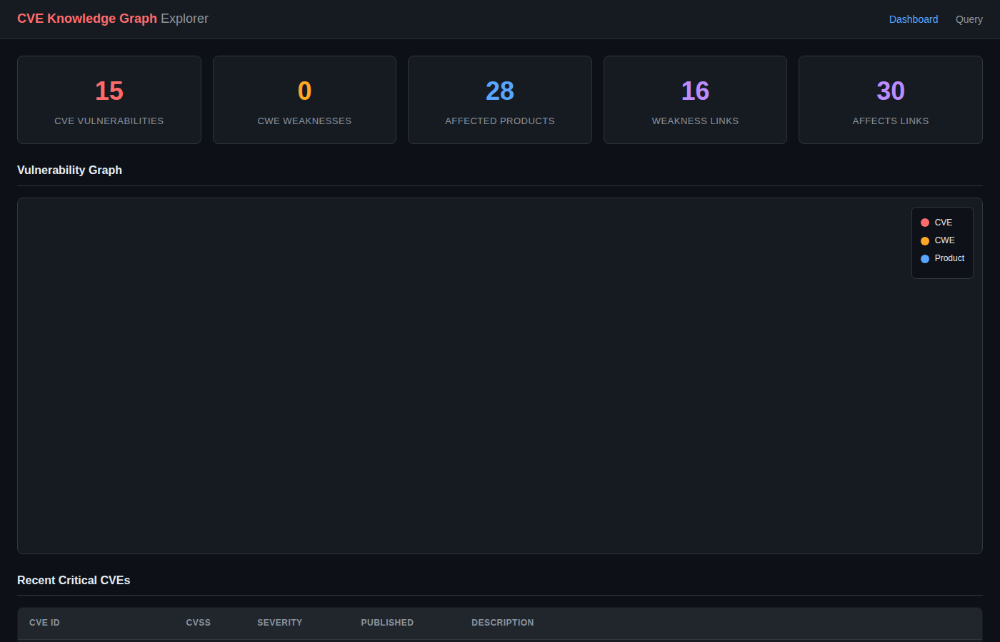
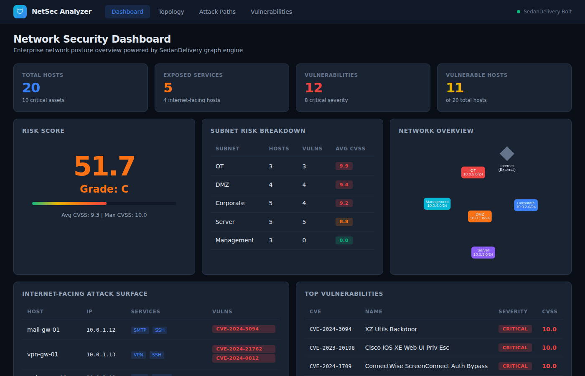
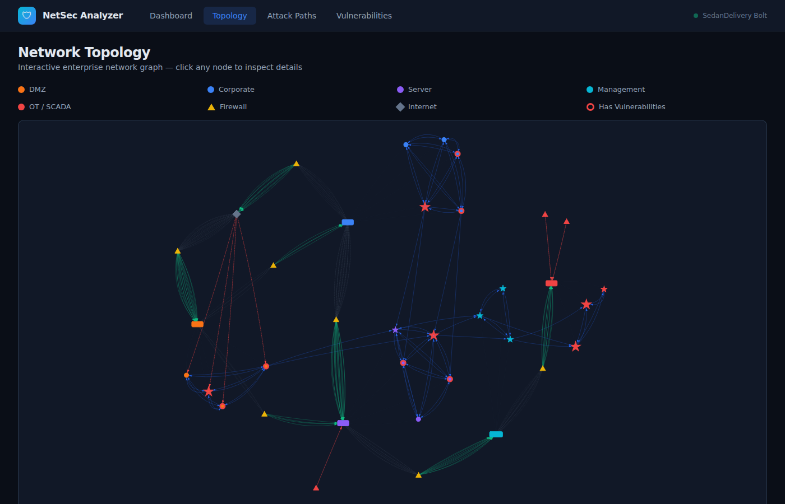
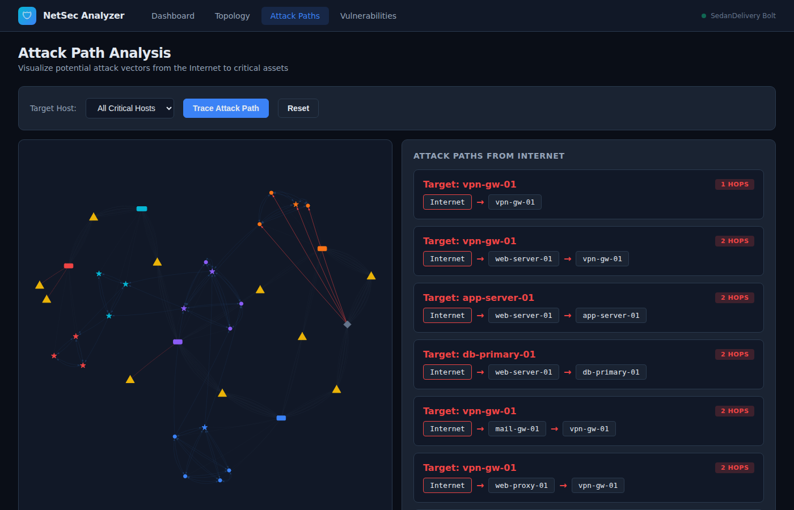
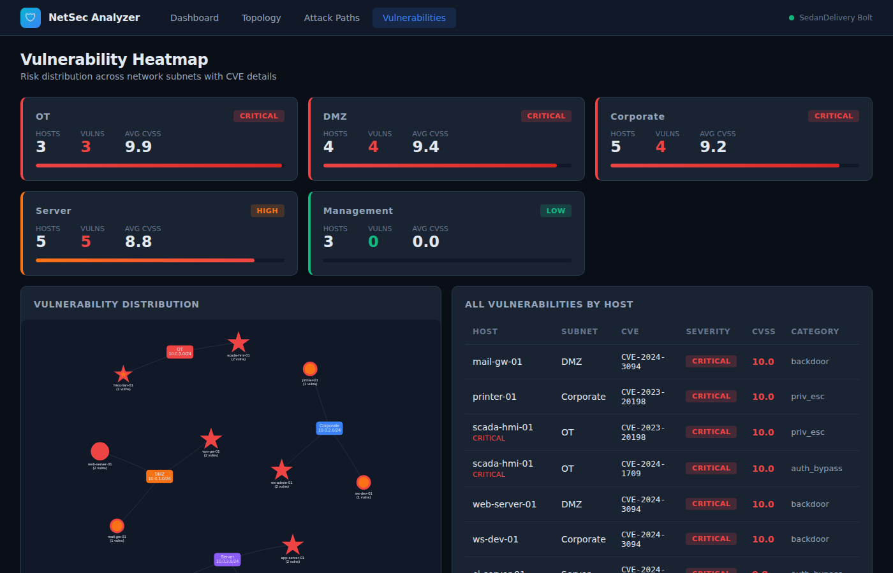

# Neo4j Compatibility Gallery

**Validating SedanDelivery's Bolt v4.4 protocol with real-world open-source applications.**

SedanDelivery implements the Neo4j Bolt protocol, allowing standard Neo4j drivers
and applications to connect without any code changes. This gallery showcases four
security-focused applications running against SedanDelivery instead of Neo4j,
proving drop-in compatibility.

## Architecture

```
┌─────────────────────────────────────────────────────────────────────┐
│                    Neo4j Compatibility Gallery                       │
├─────────────────────────────────────────────────────────────────────┤
│                                                                     │
│  ┌──────────────┐  ┌──────────────┐  ┌──────────────┐  ┌────────┐ │
│  │   Neodash     │  │  neovis.js   │  │  GraphKer    │  │Network │ │
│  │  Dashboard    │  │  Threat Viz  │  │  CVE Graph   │  │Security│ │
│  │  :5005        │  │  :8080       │  │  :5001       │  │  :5002 │ │
│  └──────┬───────┘  └──────┬───────┘  └──────┬───────┘  └───┬────┘ │
│         │                 │                  │              │       │
│         │     neo4j-driver (Bolt v4.4)       │              │       │
│         └──────────┬──────┴──────────────────┴──────────────┘       │
│                    │                                                │
│         ┌──────────▼──────────┐                                    │
│         │  sedandelivery-bolt  │                                    │
│         │   Bolt Protocol     │                                    │
│         │   Server :7687      │                                    │
│         └──────────┬──────────┘                                    │
│                    │                                                │
│         ┌──────────▼──────────┐                                    │
│         │     cypher-core         │                                    │
│         │  Rust Graph Engine   │                                    │
│         │  (InMemoryStore)     │                                    │
│         └─────────────────────┘                                    │
└─────────────────────────────────────────────────────────────────────┘
```

## Quick Start

### Option A: Run everything locally (recommended for testing)

```bash
export BOLT_USERNAME=neo4j
export BOLT_PASSWORD=change-me

# 1. Build the Bolt server (one time)
cargo build --release -p sedandelivery-bolt

# 2. Start the Bolt server
./target/release/sedandelivery-bolt &

# 3. Load security data
python3 neo4j-compat-gallery/data/load_data.py --clear

# 4. Start all apps
./neo4j-compat-gallery/run-all.sh
```

### Option B: Docker Compose (full stack)

```bash
cd neo4j-compat-gallery
export BOLT_USERNAME=neo4j
export BOLT_PASSWORD=change-me
docker compose up -d
```

`docker compose` now fails closed when `BOLT_PASSWORD` is missing so the gallery
does not accidentally start `sedandelivery-bolt` in no-auth mode. `./run-all.sh`
now follows the same contract for the full local gallery path.

### Option C: Individual apps

See each app's README for standalone instructions.

## Gallery Apps

### App 1: Neodash — Security Dashboard Builder
**Port: 5005** | [Setup Instructions](app1-neodash/README.md)

A Neo4j Labs dashboard builder connected to SedanDelivery, pre-configured with
a 3-page MITRE ATT&CK security dashboard.

**What it demonstrates:**
- Standard Neo4j driver connectivity from a Docker container
- Cypher query execution for tables, bar charts, and graph visualizations
- Real-time dashboard building against a Bolt-compatible server

**Dashboard Pages:**
1. **Threat Landscape Overview** — Threat group inventory, techniques-per-tactic
   bar chart, and actor-technique relationship graph
2. **Attack Paths & Kill Chains** — Full attack graph with groups, techniques,
   and software; CVE severity table
3. **Mitigations & Coverage** — Defense coverage analysis with mitigation-to-technique
   mapping graph



*Neodash connects to SedanDelivery via `bolt://localhost:7687` — the same connection
dialog used for a real Neo4j instance. No modifications required.*

---

### App 2: neovis.js — Threat Intelligence Visualization
**Port: 8080** | [Setup Instructions](app2-neovis/README.md)

A standalone HTML page using neovis.js in the browser plus a tiny Python proxy
(`server.py`) that connects to SedanDelivery's Bolt endpoint.

**What it demonstrates:**
- Browser visualization with a Python Bolt proxy that can honor env-driven auth
- Zero-dependency web visualization (CDN-loaded)
- Custom Cypher queries with interactive graph rendering

**Visualization Tabs:**
1. **Threat Actor Network** — All 8 threat groups connected to their techniques and tools
2. **Kill Chain View** — Emotet -> TrickBot -> Ryuk delivery chain with all implemented techniques
3. **CVE Impact Map** — Critical CVEs linked to infrastructure targets
4. **Full ATT&CK Graph** — Complete 86-node, 142-edge knowledge graph

**Features:**
- Dark cybersecurity theme with color-coded nodes by label
- Click-to-inspect node detail panel
- Custom Cypher query editor with 5 pre-built examples
- Graph statistics and connection status indicator



*Dark-themed threat intelligence dashboard with 4 tabs, color-coded node legend,
custom Cypher query editor, and pre-built example queries. The browser's
neo4j-driver connects directly to SedanDelivery's Bolt endpoint.*

---

### App 3: GraphKer — CVE Knowledge Graph Explorer
**Port: 5001** | [Setup Instructions](app3-graphker/README.md)

A Python Flask application inspired by the GraphKer project that loads CVE/CWE/CPE
data into SedanDelivery and provides a web UI for exploring vulnerability relationships.

**What it demonstrates:**
- Python neo4j-driver compatibility (official driver, zero modifications)
- MERGE, CREATE, MATCH operations via Bolt protocol
- Real NVD API integration for live CVE data (with offline sample mode)

**Data Model:**
- 15 Critical CVEs (Log4Shell, ProxyShell, Zerologon, Spring4Shell, MOVEit, etc.)
- 12 CWE weakness categories
- 28 affected products (Apache, Microsoft, Citrix, Fortinet, etc.)
- HAS_WEAKNESS and AFFECTS relationships

**Web UI:**
- `/` — Dashboard with CVE statistics, severity breakdown, and vis.js graph
- `/cve/<id>` — Detailed CVE view with CVSS score, weaknesses, and affected products
- `/query` — Custom Cypher query editor with 5 example queries
- `/graph` — JSON API returning the full knowledge graph



*Dashboard showing 15 critical CVEs, 28 affected products, and 46 relationship links —
all loaded and queried through SedanDelivery's Bolt protocol using the official
Python neo4j driver (v6.1.0).*

---

### App 4: Network Security Graph Analyzer
**Port: 5002** | [Setup Instructions](app4-network-security/README.md)

A Python Flask application that models an enterprise network as a graph and performs
attack surface analysis, vulnerability heatmapping, and attack path discovery.

**What it demonstrates:**
- Complex Cypher queries (variable-length paths, aggregation, filtering)
- Graph-based security analysis (attack paths, lateral movement, risk scoring)
- Full CRUD operations via Bolt protocol
- Real-time interactive graph visualization

**Network Model:**
- 5 Subnets: DMZ, Corporate, Server, Management, OT (Industrial Control)
- 20 Hosts: web servers, databases, SCADA/PLC, workstations, VPN gateways
- 15 Services: HTTP, SSH, RDP, PostgreSQL, Modbus, OPC-UA
- 10 Firewall rules with allow/deny ACLs
- 12 Real CVEs mapped to vulnerable hosts

**Analysis Capabilities:**
- **Risk Score**: Composite 0-100 score based on exposure, vulnerabilities, and criticality
- **Attack Paths**: Internet -> DMZ -> Server -> Management -> OT (4-hop chain to SCADA)
- **Lateral Movement**: 12 cross-subnet movement paths identified
- **Exposed Services**: 5 internet-facing services on 4 hosts

**Web UI Pages:**
- `/` — Risk dashboard with score gauge, subnet breakdown, and quick stats
- `/topology` — Full interactive network topology graph (vis.js)
- `/attack-paths` — Animated attack path visualization with target selection
- `/vulns` — Vulnerability heatmap by subnet with severity breakdown



*Enterprise security dashboard showing Risk Score 51.7 (Grade C), subnet risk breakdown,
internet-facing attack surface, and top vulnerabilities — all powered by Cypher queries
against SedanDelivery.*



*Interactive network topology with 20 hosts across 5 subnets (DMZ, Corporate, Server,
Management, OT/SCADA), color-coded by zone with firewall rules as triangle nodes.*



*Attack path analysis showing traced routes from Internet to critical assets with hop
counts. Demonstrates variable-length path queries (`*1..4`) working correctly.*



*Vulnerability heatmap showing CVE distribution across subnets with severity ratings.
OT subnet shows highest risk (avg CVSS 9.9) with SCADA systems affected.*

---

## Data Sources

### MITRE ATT&CK Dataset (Shared across apps 1 & 2)
- 86 nodes: 8 Threat Groups, 14 Tactics, 29 Techniques, 11 Software, 6 CVEs,
  5 Campaigns, 7 Mitigations, 6 Infrastructure
- 142 relationships: USES, IMPLEMENTS, BELONGS_TO, CONDUCTED, EXPLOITED, MITIGATES, etc.
- Loaded via: `python3 data/load_data.py --clear`

### CVE Knowledge Graph (App 3)
- 15 Critical CVEs with 12 CWE categories and 28 affected products
- Loaded via: `python3 app3-graphker/cve_loader.py --sample`

### Enterprise Network (App 4)
- 20 hosts across 5 subnets with 12 real CVEs and 10 firewall rules
- Loaded via: `python3 app4-network-security/network_data.py`

## Compatibility Verification Results

All four applications connect to SedanDelivery via the standard Neo4j Bolt v4.4
protocol. The gallery supports both no-auth local demos and auth-enabled runs
driven by `BOLT_USERNAME`/`BOLT_PASSWORD`.

| Feature | Status | Notes |
|---------|--------|-------|
| Bolt v4.4 handshake | PASS | Standard negotiation works |
| PackStream encoding | PASS | All data types supported |
| `auth=None` connections | PASS | Used intentionally only when `BOLT_PASSWORD` is unset |
| `auth=("neo4j","pass")` | PASS | Basic auth when `BOLT_PASSWORD` is set |
| CREATE nodes/edges | PASS | Full property support |
| MATCH with WHERE | PASS | Pattern matching + filtering |
| MERGE (upsert) | PASS | ON CREATE SET / ON MATCH SET |
| Variable-length paths | PASS | `*1..3` range patterns |
| Aggregation (count, avg) | PASS | GROUP BY semantics work |
| String functions | PASS | UPPER, LOWER, CONTAINS, etc. |
| Date/Time types | PASS | Full temporal support |
| List operations | PASS | COLLECT, IN, SIZE, etc. |
| DETACH DELETE | PASS | Cascading delete works |
| Parameterized queries ($param) | PASS | Driver parameter binding |
| ORDER BY / LIMIT / SKIP | PASS | Result pagination |
| Multiple labels | PASS | Node label filtering |
| Relationship properties | PASS | Properties on edges |
| Python neo4j driver | PASS | v6.1.0 tested |
| JavaScript neo4j-driver | PASS | neovis.js bundles it |
| Docker network connectivity | PASS | Cross-container Bolt |
| Transactions (BEGIN/COMMIT) | PASS | Full explicit transactions |
| CALL procedures | PASS | 5 built-in procedures |
| UNION / UNION ALL | PASS | Result set combination |
| FOREACH | PASS | Iterative mutation |
| CASE in aggregation | PASS | Full CASE expression support |
| LOAD CSV | PASS | CSV file ingestion |
| Constraints (UNIQUE, etc.) | PASS | Schema constraint enforcement |
| shortestPath / allShortestPaths | PASS | Path-finding functions |
| REDUCE | PASS | List reduction expressions |
| Math functions (abs, ceil, etc.) | PASS | Full numeric function library |

### Full Compatibility

All major Cypher features are implemented. There are no known limitations for
standard Neo4j driver workloads.

## Verified Queries (Sample)

```cypher
-- Threat groups using Mimikatz
MATCH (g:ThreatGroup)-[:USES_SOFTWARE]->(s:Software {name: 'Mimikatz'})
RETURN g.name, g.country
-- Result: APT28 (Russia), Sandworm (Russia)

-- Attack paths from phishing to impact
MATCH (t1:Technique {name: 'Spearphishing Attachment'})<-[:USES]-(g:ThreatGroup)
-[:USES]->(t2:Technique)-[:BELONGS_TO]->(tac:Tactic)
WHERE tac.name IN ['Impact', 'Exfiltration']
RETURN g.name, t2.name, tac.name
-- Result: Lazarus Group -> Data Encrypted for Impact (Impact)

-- Network attack paths (Internet to SCADA)
MATCH path = (inet:Network {name: 'Internet'})-[:CAN_REACH*1..4]->(target:Host)
WHERE target.role = 'scada_hmi'
RETURN [n IN nodes(path) | n.name] AS path

-- Top CVEs by CVSS score
MATCH (c:CVE) RETURN c.id, c.cvss ORDER BY c.cvss DESC LIMIT 5

-- FOREACH: tag all Russian threat groups
MATCH (g:ThreatGroup) WHERE g.country = 'Russia'
WITH collect(g) AS groups
FOREACH (g IN groups | SET g.tagged = true)

-- CALL: list built-in procedures
CALL dbms.procedures() YIELD name, signature RETURN name, signature

-- UNION: combine threat groups and software into one list
MATCH (g:ThreatGroup) RETURN g.name AS name, 'ThreatGroup' AS type
UNION
MATCH (s:Software) RETURN s.name AS name, 'Software' AS type

-- shortestPath: find shortest route from Internet to SCADA
MATCH (inet:Network {name: 'Internet'}), (target:Host {role: 'scada_hmi'})
MATCH p = shortestPath((inet)-[*]->(target))
RETURN [n IN nodes(p) | n.name] AS path

-- REDUCE: compute total CVSS across all CVEs
MATCH (c:CVE)
WITH collect(c.cvss) AS scores
RETURN reduce(total = 0.0, s IN scores | total + s) AS total_cvss

-- Math functions: risk scoring with ceil and abs
MATCH (h:Host)-[:HAS_VULN]->(v:CVE)
RETURN h.name, ceil(avg(v.cvss)) AS risk_tier, abs(v.cvss - 7.0) AS distance_from_high
ORDER BY risk_tier DESC
```

## Directory Structure

```
neo4j-compat-gallery/
├── README.md                    # This file
├── Dockerfile.bolt              # Bolt server container image
├── docker-compose.yml           # Full stack orchestration
├── run-all.sh                   # Local startup script
├── data/
│   ├── load_mitre_attack.cypher # MITRE ATT&CK dataset (Cypher)
│   └── load_data.py             # Python data loader + verifier
├── app1-neodash/                # Neodash dashboard builder
│   ├── docker-compose.yml
│   ├── dashboard.json           # Pre-built security dashboard
│   ├── run.sh
│   ├── verify.sh
│   └── README.md
├── app2-neovis/                 # neovis.js visualization
│   ├── index.html               # Standalone threat viz page
│   ├── package.json
│   ├── run.sh
│   └── README.md
├── app3-graphker/               # CVE Knowledge Graph Explorer
│   ├── app.py                   # Flask web application
│   ├── cve_loader.py            # NVD API fetcher + loader
│   ├── sample_cves.py           # 15 hardcoded critical CVEs
│   ├── templates/
│   ├── requirements.txt
│   ├── run.sh
│   └── README.md
├── app4-network-security/       # Network Security Analyzer
│   ├── app.py                   # Flask web application
│   ├── network_data.py          # Enterprise network dataset
│   ├── analyzer.py              # Security analysis queries
│   ├── templates/
│   ├── requirements.txt
│   ├── run.sh
│   └── README.md
└── screenshots/                 # App screenshots (see below)
```

## Capturing Screenshots

To capture actual screenshots of the running applications:

```bash
# Install playwright (one time)
npx playwright install chromium

# Start all apps
./run-all.sh

# Capture screenshots
npx playwright screenshot http://localhost:5005 screenshots/01-neodash-dashboard.png
npx playwright screenshot http://localhost:8080 screenshots/02-neovis-threat-graph.png
npx playwright screenshot http://localhost:5001 screenshots/03-graphker-cve-explorer.png
npx playwright screenshot http://localhost:5002 screenshots/04-network-topology.png
npx playwright screenshot http://localhost:5002/attack-paths screenshots/05-attack-paths.png
npx playwright screenshot http://localhost:5002/vulns screenshots/06-vulnerability-heatmap.png
```

## Azure Deployment

Each app can be deployed to Azure Container Apps using the provided Docker configurations.
See [deployment.md](../docs/graph-visualizer/deployment.md) for the base SedanDelivery
deployment, then add each gallery app as an additional container.

```bash
# Build Bolt server image
docker build -f Dockerfile.bolt -t <registry>/sedandelivery-bolt:latest ..
docker push <registry>/sedandelivery-bolt:latest

# Deploy to Azure Container Apps
az containerapp create \
  --name sedandelivery-bolt \
  --resource-group rg-sedan-gallery \
  --environment sedan-env \
  --image <registry>/sedandelivery-bolt:latest \
  --target-port 7687 \
  --ingress internal \
  --min-replicas 1

# Deploy each gallery app pointing to the internal Bolt endpoint
# See individual app READMEs for specific docker build commands
```

## Technology Stack

| Component | Technology | Version |
|-----------|-----------|---------|
| Graph Engine | SedanDelivery (cypher-core) | Rust, 100% openCypher TCK |
| Protocol | Bolt v4.4 | Compatible with Neo4j 4.4+ drivers |
| Dashboard | Neodash | v2.4 (Neo4j Labs) |
| JS Visualization | neovis.js | v2.1.0 (neo4j-contrib) |
| Python Driver | neo4j | v6.1.0 (official) |
| Web Framework | Flask | v3.0 |
| Graph Rendering | vis.js / Sigma.js | v9.1.6 / v3 |

## License

SedanDelivery: MIT OR Apache-2.0
Gallery applications: See individual app licenses
